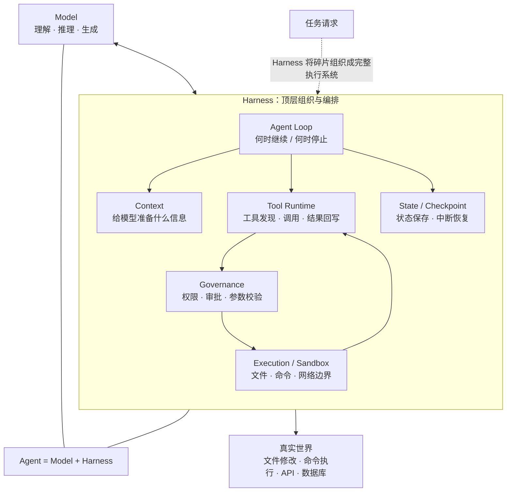
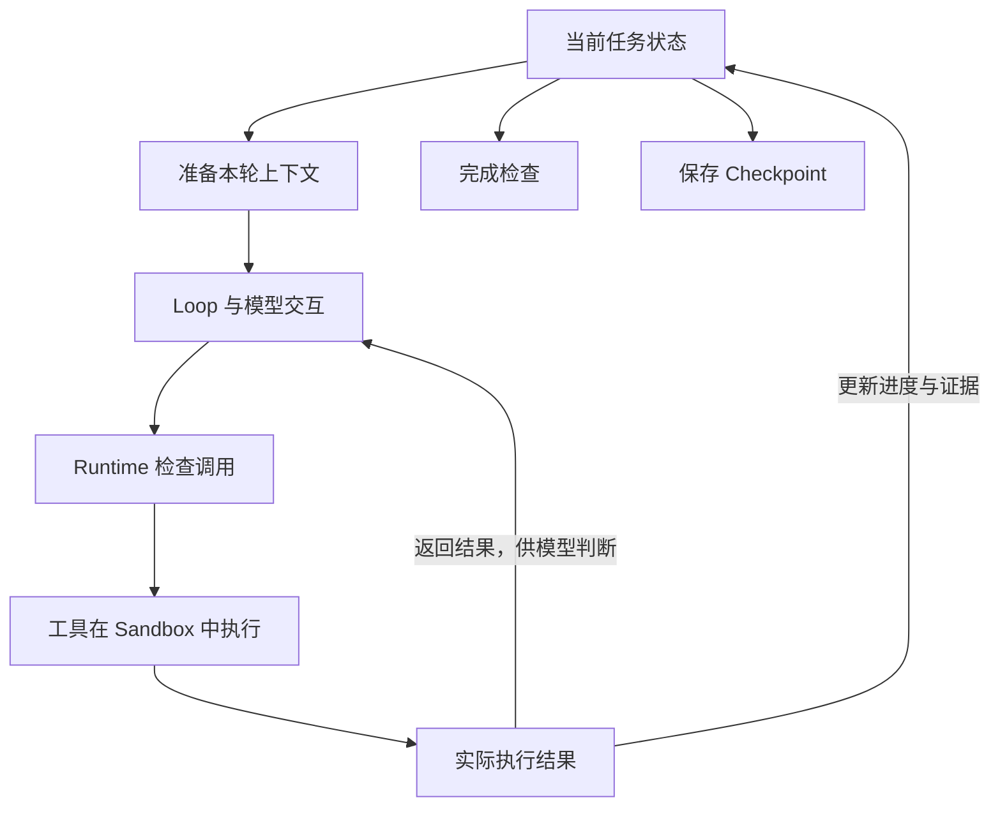
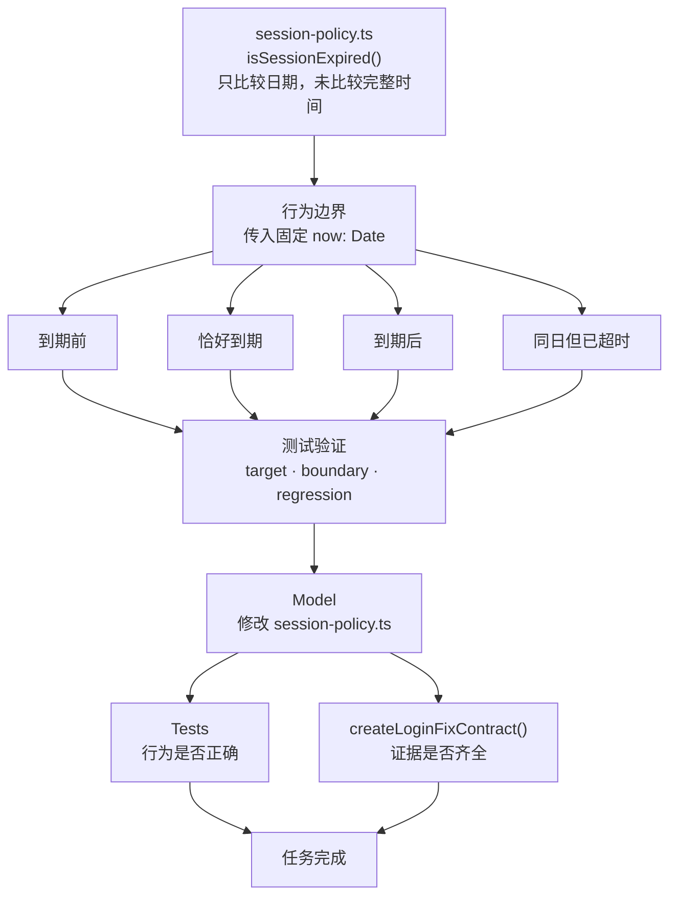
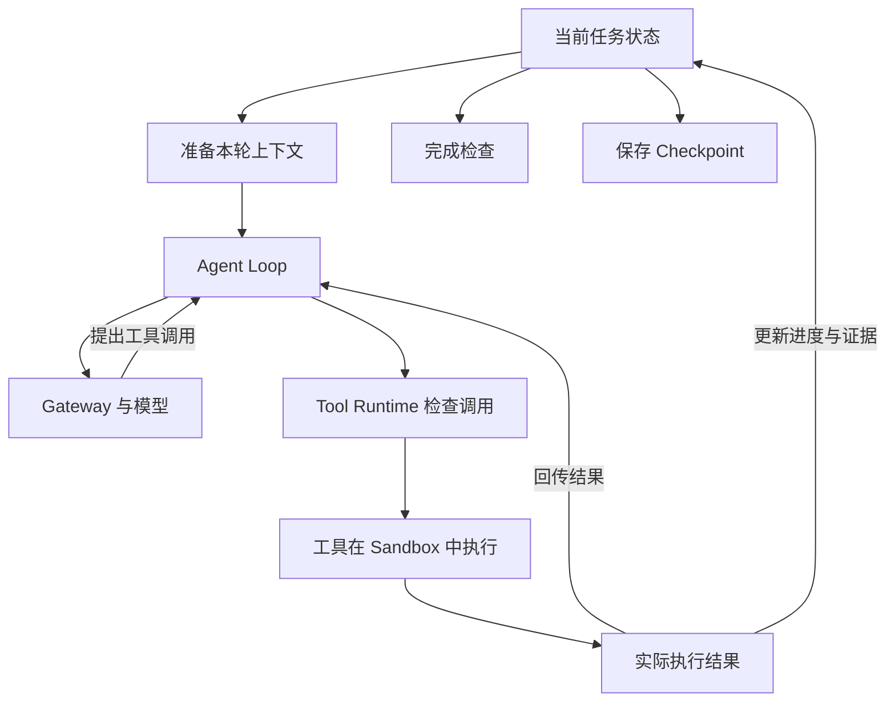
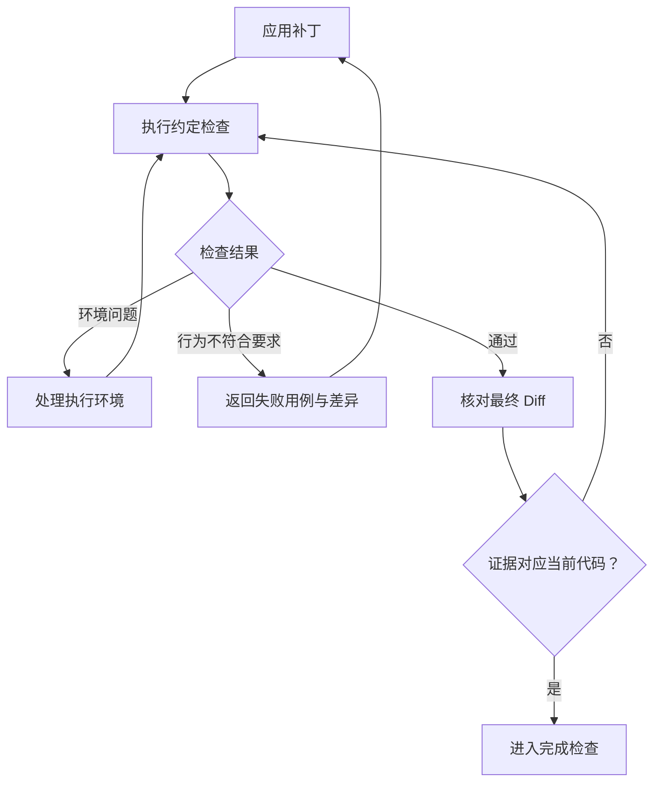
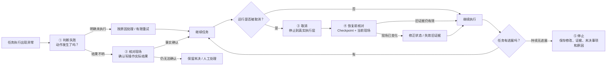
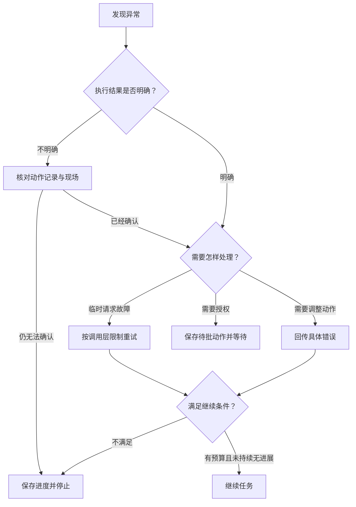
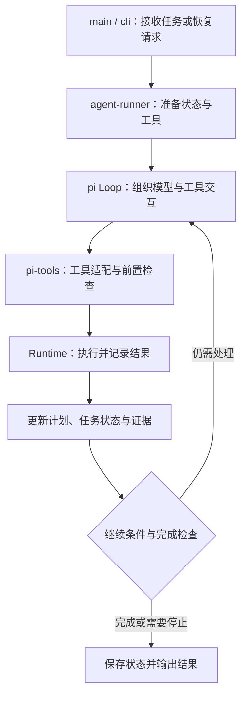
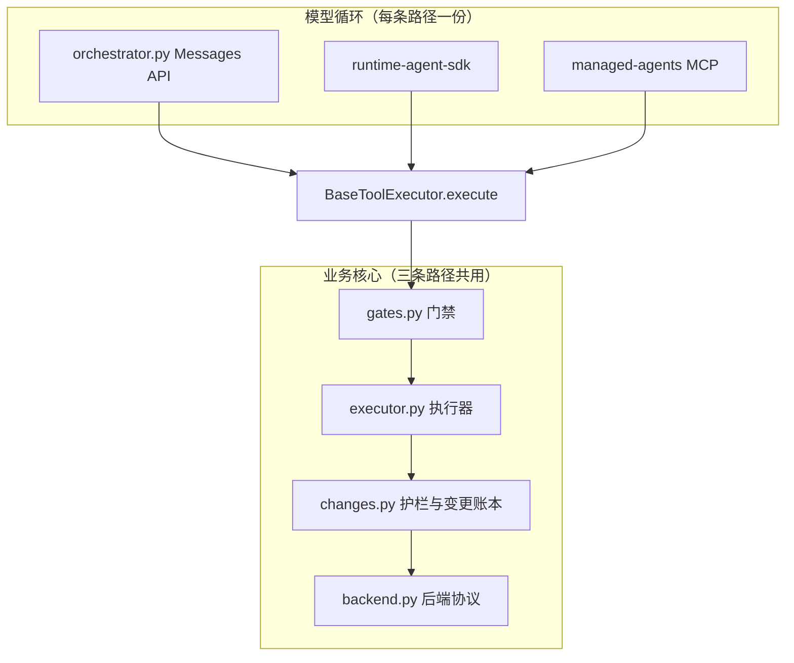
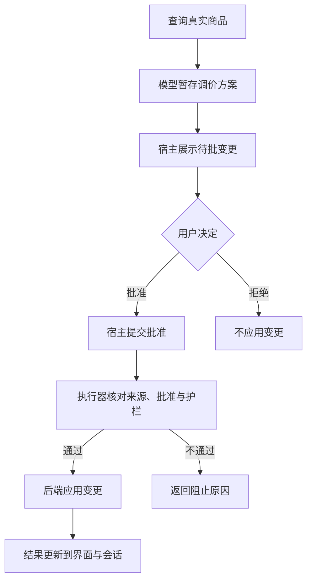

# 3\.5 PPT 

# 3\.5 Agent Harness：把一次代码修改做完整 v8

前几节已经具备：Agent Loop、Planning、State / Checkpoint、Sandbox。

但**单个模块正确 ≠ 整个 Agent 能正确完成任务**。

本节解决的是：如何把准备、修改、验证、异常处理、恢复和交付串成完整闭环。 

核心案例：**修复登录会话过期问题，并完成修改、测试和交付。**

使用和不使用 pi 框架时，Harness 哪些连接需要实现哪些功能。


---


## 一、理解 Harness：模型之外，谁来组织任务

### 1\.1 模型提出动作，程序让动作发生




**这些围绕模型，组织工具、状态、上下文与执行环境的支撑程序，合在一起就是 Harness。**


Model：负责**理解、推理、生成动作**。

Harness：负责**让动作真正发生，并组织整个执行过程**。 

Harness 连接： 

- Agent Loop 

- Context 

- State / Checkpoint 

- Tool Runtime 

- Governance 

- Sandbox 


核心关系：

**Agent = Model \+ Harness。**

同一个模型，在不同 Harness 中可能表现完全不同。


Agent 工程优化不能只看模型和 Prompt，还要检查： 

- 模型看到了什么？ 

- 动作是否真正执行？ 

- 执行结果是否正确返回？ 

- 失败后能否继续处理？


### 1\.2 Tool、Runtime、Loop 各自负责哪一段

Harness 不是重新写一个“大类”，而是把已有模块按职责连接起来。

|模块|本例中的职责|
|---|---|
|Tool|提供读取文件、应用补丁、运行测试等具体能力|
|Tool Runtime|检查调用，管理执行，记录并返回结果|
|Loop|组织模型与工具之间的多轮交互|
|State|保存计划、执行事实、验证证据和未完成事项|
|Sandbox|限制操作实际能够触及的文件、进程或其他资源|
|任务运行层|协调启动、等待、取消、恢复和收尾|

一次工具调用的基本链路：

**Model → Loop → Runtime → Tool / Sandbox → Result → Loop**

关键原则：

- **执行约束放在执行入口。**

- 路径、权限、参数检查不能只写在某个 Loop 分支。 

- “是否继续下一轮”属于运行控制，不应交给 Tool 决定。 

- Agent Runtime 负责更高层的启动、等待、取消、恢复和收尾。 


### 1\.3 工具结果要同时交给模型和程序

一次执行结果有两个消费者：

- **给模型**：提供下一步判断依据。 

- **给程序**：更新状态、证据和完成条件。 

只返回给模型：

> 模型知道失败了，但程序可能仍认为任务已经完成。
> 
> 

只更新程序：

> 状态正确，但模型不知道为什么失败、下一步怎么修。
> 
> 




因此：

**执行结果 → Model Context \+ State / Evidence**

状态与上下文职责不同：

- State：保存程序可核对的事实。 

- Context：提供模型当前需要的信息。 

代码变化后，旧测试证据必须失效，并告诉模型哪些检查需要重新执行。

---


## 二、跑通登录修复：从要求到交付

### 2\.1 先把“修好了”变成可检查的行为

Harness 是如何把这些模块连接起来的。



本例的缺陷位于 `fixtures/demo-app/src/auth/session-policy.ts`。

缺陷：

`isSessionExpired()` 只比较日期，没有比较完整时间。

因此需要明确四个行为边界：

- 到期前 

- 恰好到期 

- 到期后 

- **同日但已经超时**

测试使用固定 `now: Date`，不需要真实等待时间流逝。


任务完成需要两层检查：

**第一层：测试验证行为**

- `target`

- `boundary`

- `regression`

**第二层：Completion Contract 验证交付证据**

- 当前代码存在目标 Diff 

- 三组验证全部通过 

- 指定交付产物存在 


核心区别：

> **测试回答“代码行为对不对”；Completion Contract 回答“交付证据齐不齐”。**
> 
> 


### 2\.2 准备工作区，给模型足够的起点

执行前先确认：

- 工作区已有修改 

- 本次允许修改的范围 

- 测试运行目录 

- Runtime 与依赖 

- 后台服务是否真实存在 


不要依赖隐含环境状态：

- 上一次 `cd` 不代表下一次 Shell 仍在该目录。 

- 历史记录写着“服务已启动”，不代表进程仍然存在。 


首轮 Context 只需要四类信息：

|内容|模型需要知道什么|
|---|---|
|目标|修复什么行为，哪些情况必须满足|
|入口|从哪个文件、函数和测试开始检查|
|边界|允许修改什么，哪些动作需要审批|
|验收|必须完成哪些验证，生成什么交付产物|

原则：

> **给模型足够开始工作的上下文，而不是把整个仓库塞进去。**
> 
> 

代码、日志和其他信息后续通过 Tool 按需读取。


### 2\.3 先确认失败，再应用补丁

修改前先建立证据链：

**读取代码 → 读取测试 → 复现失败 → 修改 → 再验证**

先确认：

- 缺陷是否真实存在？ 

- 当前测试是否真正覆盖缺陷？ 

- 调用方怎样使用这个函数？ 


如果应该失败的测试却通过：

> **先检查测试覆盖，不要立即修改代码。**
> 
> 


补丁执行仍必须经过：

**Runtime 检查 → Sandbox 执行**

所有写入路径都必须受到同样约束。

补丁失败时：

- 返回真实失败原因 

- 让模型重新读取文件 

- **程序不能猜测模型想修改的位置**

成功后：

- 保存 Diff 

- 保留 `toolCallId`

- 更新任务状态





### 2\.4 让测试结果决定下一步

修改后执行：

- 类型 / 语法 / Lint 

- `target`

- `boundary`

- `regression`


失败首先区分两类：

**环境失败**

> 测试没有真正运行 → 代码行为尚未验证。
> 
> 

**行为失败**

> 测试正常运行，但断言失败 → 把失败用例、预期值、实际值和日志位置交回模型。
> 
> 


最重要的证据原则：

> **测试结果必须对应实际受测代码。**
> 
> 

测试通过后，如果相关代码再次变化：


**旧测试记录仍然真实，但已经不能证明当前代码正确。**



核心结论：

> **“测试曾经通过” ≠ “当前代码已经验证”。**
> 
> 


### 2\.5 核对最终改动，再宣布完成

测试通过后，还要检查最终 Diff：

- 是否真正修复目标问题？ 

- 是否保留原有行为？ 

- 是否删除了失败测试？ 

- 是否放宽了断言？ 

- 是否绕过了验证？ 

`exit_code = 0` 只是执行证据，不等于需求已经满足。


最终由 Completion Contract 判断：

**当前 Diff \+ 当前有效测试证据 \+ 交付产物 → completed**


在当前工程中，重点检查下面几个时机：


模型可以说：

> “任务已经完成。”
> 
> 

但最终状态必须由**程序依据证据**决定。


交付说明必须说清四件事：

- 改了什么 

- 验证了什么 

- 什么没有验证 

- 还有什么限制

---


## 三、遇到异常时，让继续执行有依据

**任务被打断以后，Harness 怎样依据真实执行情况决定下一步。**也就是异常路径的解决和处理。


统一为五个阶段：

1. 判断失败：动作到底有没有发生？ 

2. 结果不明：先核对现场。 

3. 用户取消：停止必须传到真实执行层。 

4. 再次恢复：重新检查旧状态和旧证据。 

5. 持续无进展：主动停止。


核心原则：

> **继续执行不是默认动作，而是一个需要证据支持的决定。**
> 
> 




### 3\.1 先分清错误，再决定是否重试

同样是“调用失败”，后续动作可能完全不同。

**错误处理首先不是决定“要不要重试”，而是确认“刚才的动作到底有没有发生”。**

三类情况：

- 明确未执行 → 可以按原因处理 / 有限重试。 

- 明确失败 → 根据具体原因调整动作。 

- 执行结果不明 → **先检查现场，不能直接重试。**

|发生了什么|程序应怎样处理|
|---|---|
|临时模型请求故障|按调用层规则有限重试|
|补丁明确未匹配、未写入|返回原因，让模型读取后调整|
|缺少授权|保存待批动作，进入等待|
|写操作结果不明|查执行记录与现场，再决定下一步|
|相同动作持续失败且无进展|达到限制后停止，保留未完成事项|

错误必须足够具体，能够推动下一步发生变化。

不要只返回：修改失败。

应该返回：**目标文件存在，但待替换片段没有匹配，请重新读取当前内容。**

同时必须守住事实边界：**不知道有没有写入，就记录“结果不明”，不能伪装成普通失败。**


### 3\.2 写操作结果不明，为什么不能直接重放

典型问题：

```Plaintext
补丁提交 → 文件已写入 → 程序退出 → 结果尚未保存
```


此时：

- Checkpoint 认为修改还没完成。 

- 实际文件可能已经修改成功。 

如果直接 Replay：

- 可能重复写入 

- 可能再次失败 

- 可能扩大副作用 

恢复时先核对：

- 原动作涉及什么对象？ 

- 执行前是什么状态？ 

- 当前现场发生了什么变化？ 

只有三种结论：

- **确认已经执行** → 恢复真实结果，不重复执行。 

- **确认没有执行** → 满足条件后重新执行。 

- **部分执行 / 无法确认** → 保留未决，继续核查或人工处理。 

核心原则：**写操作恢复不是 Replay，而是先恢复执行事实。**


### 3\.3 取消任务，要停到真实执行层

UI 停止输出，不代表任务真正停止。

取消信号必须沿调用链传播：

**任务入口 → Model / Runtime → Executor → 实际进程**

还要确认：

- 模型请求是否停止 

- 测试进程是否退出 

- 文件写入是否已经发生 

取消不会自动撤销已经产生的副作用。


因此取消后的状态应该记录：**实际上发生了什么，而不是统一标记为 failed。**


核心结论：**Cancel 解决“怎样真正停下来”，不是“怎样恢复到原状态”。**


### 3\.4 恢复之前，重新检查旧结论

Checkpoint 保存的是：**上一次运行结束时的事实。**


它不能证明：**这些事实现在仍然有效。**


恢复前重新检查三类信息：

|检查对象|要回答的问题|
|---|---|
|当前工作区|与存档时相比，相关文件是否变化？|
|未决动作|上次调用实际执行到了哪里，是否可能已经产生修改？|
|证据与授权|旧测试和待批动作是否仍适用于当前现场？|

恢复顺序：

**现场核对 → 修正状态 → 失效过期证据 → 构建 Context → 继续 Loop**


未受影响的有效证据可以保留，只重新验证发生变化的部分即可。


### 3\.5 任务没有推进时，怎样停下来

Agent 可能一直在运行，却没有真正推进：

- 重复同一个补丁 

- 重复同一个错误 

- 重复执行测试 

- 没有代码变化 

- 没有新证据 

- 计划没有推进 

因此要区分：

**局部 Retry：**一个动作最多尝试多少次。

**任务 Budget：**整个任务最多运行多少轮、多久。

不能因为一次局部重试成功，就重置整个任务预算。


停止后保存：

- 已有修改 

- 测试结果 

- 未决动作 

- 停止原因 

核心判断：

> **程序运行结束 ≠ 任务完成。**
> 
> 


把本节的处理放在一起，可以得到一条统一的判断路径：




---


## 四、完善 pi 工程：把规则接到实际路径

前面定义的是运行规则。

`planning_agent_demo` 已包含计划、审批、任务状态和 Checkpoint，本节继续复用它们。


可以先按三组文件建立认识：


```Markdown
继续完善 planning_agent_demo，以当前安装的 pi 版本为准。

先阅读：
agent-runner.ts、pi-tools.ts、runtime.ts、loop-guard.ts、
completion-contract.ts、cli.ts，以及相关现有测试。

保留现有 runAgentLoop / runAgentLoopContinue、计划、任务状态、
审批与 Checkpoint。先列出现有实现和实际缺口，再修改对应模块。

本次重点：
1. 测试证据关联实际受测内容；相关文件变化后，旧证据失效。
2. 各验证范围使用最新有效结果，避免“曾经通过”掩盖后续失败。
3. 取消信号覆盖实际执行路径，核实进程退出并记录已发生的修改。
4. 恢复先核对现场；暂停、取消、等待审批保持各自语义。
5. 将真实错误与具体完成缺项反馈给下一轮。

保持现有 Gateway 配置与 3.4 执行边界，不增加绕过 Runtime 的入口。

验收覆盖：
- 三组测试通过后修改相关文件，任务不能直接完成。
- 同一内容、同一验证范围先通过后失败，任务不能完成。
- 待批期间修改目标文件，旧批准不能直接执行旧补丁。
- 取消运行中的测试，确认相关进程退出并保存实际进度。
- 模型输出“已完成”，不能绕过缺失或失败的验证。

交付最小改动、实际执行的检查、未执行项和仍存在的限制。
```


### 4\.1 先读调用链，再找接入点

先顺着一次 `run_test` 阅读：

**main / cli → agent\-runner → pi Loop → pi\-tools → Runtime → State / Evidence → Completion Check**





读 Harness 的重点：**规则有没有覆盖实际调用路径。**


两个容易接错的位置：

**首轮与后续轮次不同**

- 首轮 Context 由应用准备。 

- 后续 Context 才由 Loop Hook 更新。 

- 完成判断必须读取最新业务状态。 

**不是所有调用都会经过 ****`afterToolCall`**

- 工具不存在 

- 参数校验失败 

- `beforeToolCall` 拒绝 

都可能提前结束。


因此拒绝记录不能只放在 `afterToolCall`。

审批也一样：**模型输出 ****`approved: true`**** ≠ 获得授权。**


真正批准必须来自宿主审批流程。


### 4\.2 完成检查要读“当前内容的最新结果”


**问题一：版本编号没变，实际内容变了**

文件可能被外部修改，而 Runtime revision 没有变化。

因此测试证据必须关联：

> **实际受测内容 / 内容指纹**
> 
> 

而不是只关联逻辑版本号。


**问题二：早先成功掩盖后续失败**

|顺序|受测内容|范围|结果|
|---|---|---|---|
|第一次|相同内容|`boundary`|通过|
|第二次|相同内容|`boundary`|失败|


同一内容、同一验证范围：最新结果失败 → 不能继续使用早先的成功记录。

最终原则：**Completion 判断当前可核对的事实，而不是历史上曾经出现过成功。**


### 4\.3 错误与缺项要准确进入下一轮

Completion Contract 拒绝完成以后，不能只返回：任务未完成。

而要明确：

- 哪组测试没执行 

- 哪条证据已经过期 

- 最新结果为什么失败 

- 哪个动作正在等待批准 

Runtime 的结构化错误不能在 Tool Adapter 中被压缩成模糊错误。


核心原则：**状态记录事实，Context 告诉模型下一步缺什么。**


模型可以根据失败调整动作，但不能修改规则：

- Patch 失败 → 可以重新读取。 

- 权限不足 → 不能换工具绕过。 

- 测试失败 → 可以修代码，不能删除验收条件。


### 4\.4 取消和恢复要遵守已有状态语义

继续复用现有：

`AbortController → Runtime → execFile`

重点补查：

- Patch 路径是否支持取消 

- 子进程是否真正退出 

- 已经发生的写入是否正确记录


检查取消链路时，可以顺着三个问题看：


还要区分：

**Pause**

`--pause-after`

> 保存后停止，任务仍是 `running`，允许恢复。
> 
> 

**Cancel**

`SIGINT → ABORTED → cancelled`

> 当前实现中的终态。
> 
> 

不能把二者都描述成“暂停”。


恢复仍遵循：**先核对现场，再恢复消息，再请求模型。**


### 4\.5 把本次改造限制在明确范围内

缺口在对应模块:

本次只补五类连接：

1. 测试证据关联实际受测内容。 

2. 每个验证范围采用最新有效结果。 

3. Cancel 覆盖真实执行路径。 

4. Resume 先核对现场。 

5. 真实错误与 Completion 缺项进入下一轮 Context。 


同时保持：

- 现有 Gateway 

- Planning 

- Approval 

- Checkpoint 

- Sandbox 边界 


```Plaintext
继续完善 planning_agent_demo，以当前安装的 pi 版本为准。

先阅读：
agent-runner.ts、pi-tools.ts、runtime.ts、loop-guard.ts、
completion-contract.ts、cli.ts，以及相关现有测试。

保留现有 runAgentLoop / runAgentLoopContinue、计划、任务状态、
审批与 Checkpoint。先列出现有实现和实际缺口，再修改对应模块。

本次重点：
1. 测试证据关联实际受测内容；相关文件变化后，旧证据失效。
2. 各验证范围使用最新有效结果，避免“曾经通过”掩盖后续失败。
3. 取消信号覆盖实际执行路径，核实进程退出并记录已发生的修改。
4. 恢复先核对现场；暂停、取消、等待审批保持各自语义。
5. 将真实错误与具体完成缺项反馈给下一轮。

保持现有 Gateway 配置与 3.4 执行边界，不增加绕过 Runtime 的入口。

验收覆盖：
- 三组测试通过后修改相关文件，任务不能直接完成。
- 同一内容、同一验证范围先通过后失败，任务不能完成。
- 待批期间修改目标文件，旧批准不能直接执行旧补丁。
- 取消运行中的测试，确认相关进程退出并保存实际进度。
- 模型输出“已完成”，不能绕过缺失或失败的验证。

交付最小改动、实际执行的检查、未执行项和仍存在的限制。
```


工程师 Review 的重点是：**规则是否在正确的位置生效。**

---


## 五、实践验收：看决定，也看实际后果

验收有两个对象：

**Agent Harness**

检查：

- Planning 

- Approval 

- Completion 

- Cancel 

- Resume 

**目标登录应用**

检查：

- 会话过期是否真正失效 

- 原有登录行为是否正常 


核心区别：

> **Harness 测试通过 ≠ 登录缺陷修复成功。**
> 
> **登录测试通过 ≠ Harness 的取消与恢复正确。**
> 
> 


### 5\.1 用固定动作检查运行机制

第一层：**用确定输入验证确定的程序规则。**


```Bash
npm ls @earendil-works/pi-agent-core @earendil-works/pi-ai
npm test
npm run build
```


测试通过后，再用固定动作检查暂停与恢复：

```Bash
WS=$(mktemp -d)

node --import tsx scripts/child-run.ts \
  --scenario ac_full \
  --workspace "$WS" \
  --run-id run-harness \
  --pause-after 6 \
  --auto-approve

node --import tsx scripts/child-run.ts \
  --scenario ac_full \
  --workspace "$WS" \
  --resume run-harness \
  --auto-approve
```

检查：

- Harness 自身测试 

- Build 

- Pause / Resume 

- Checkpoint 

- 已完成动作是否重复 

- Completion 状态是否正确 

**所有 Bash 代码保持原文不动。**

脚本化实验的价值**固定输入、重复触发同一条路径，方便验证控制逻辑,**但它不能证明真实模型能够自主定位并修复缺陷。


### 5\.2 用真实模型完成登录任务

第二层：**验证真实模型能否利用 Harness 完成完整任务。**

```Bash
npm start
```

已有入口：

```Bash
cd planning_agent_demo
npm run lab:harness   # 固定动作，不依赖 Gateway，每次新建工作区
npm run lab:cycle     # 真实模型，需 Gateway 可用
```

本次任务保持明确：

> 修复会话到期后仍能访问的问题。先检查现有用例，补齐必要的行为覆盖，完成 `target`、`boundary`、`regression` 三组验证，并生成约定的交付说明。


如果目标工作区是 Git 仓库，可以在其中执行：

```Plaintext
git status --short
git diff --stat
git diff
```


核心原则：**真实运行结果来自执行记录，不来自模型对执行过程的描述。**


### 5\.3 主动制造反例，不等待模型偶然犯错

一次成功不能证明控制规则可靠。

因此主动制造反例：

验证不能只看日志：“拒绝了”“取消了”还不够。


还要检查真实后果：

- 文件有没有被修改？ 

- 子进程有没有退出？ 

- 任务有没有错误进入 `completed`？ 


核心原则：**控制规则验收 = 检查程序决定 \+ 检查实际后果。**


### 5\.4 失败后，找到第一个断开的连接

出现问题后沿链路定位：

**Runtime → Tool Adapter → Message / Context → State → Completion Contract**


例如：

模型没有看到失败：

> 查 Runtime 结果 → Tool Adapter → 消息回写。
> 
> 

状态已经记录失败，但任务仍然完成：

> 查 Evidence → Completion Contract。
> 
> 

不要第一反应修改 Prompt。


核心方法：**找到第一个断开的连接，在对应层修复。**


修复后：

- 重跑原失败场景 

- 再检查相邻行为 

- 保存配置、结果、失败原因和未验证项


---


## 六、手动实现全套 Harness

`commerce-agents` 是 Anthropic 的一个电商 Agent，基于 python 语言和 Claude code 开发。它通过 Anthropic 模型客户端 SDK 调用 Messages API，由应用自己组织模型与工具之间的循环。

代码中提供了多条运行路径。本节只看最典型的 `runtime-messages-api`：它的工作过程主要是使用 Anthropic 模型客户端 SDK 调用 Messages API，由应用自己组织模型与工具之间的Loop 与 Harness。


将工程理解为三部分：


同一份 core 还被 `runtime-agent-sdk`、`managed-agents` 两条路径复用。




业务要求：**把这件商品的价格下调 10%，执行前先给我确认。**


类比登录修复中的分工：


基本流程：查询 → 暂存 → 展示 → 审批 → 执行 → 返回结果


### 6\.1 模型循环可以更换，业务规则继续复用

pi 版本：框架负责通用 Loop。

Messages API 版本：应用自己处理 Tool Use、Tool Result 和下一轮请求。


`commerce-agents` 将业务门禁、执行器和变更记录放在可复用的 `core` 中。


循环与执行器之间的连接点只有一个：循环把「工具名 \+ 参数字典」交给 `BaseToolExecutor.execute()`，拿回一个 `ToolOutcome`。

```Python
# commerce-common/commerce_common/execution.py
@dataclass
class ToolOutcome:
    result_text: str                    # 给模型看的内容
    events: list[AgentEvent] = field(default_factory=list)   # 给宿主看的事件
    is_error: bool = False              # 工具真的失败了
    blocked: str | None = None          # 被哪道门禁拦下
```


模型循环可以替换，业务执行规则不应该跟着重写。


### 6\.2 手写 Loop，要把调用与结果准确配对

手写 Loop 的基本过程：

1. 准备身份、状态、Context 和 Tools。 

2. 请求模型。 

3. 获取 `tool_use`。 

4. 交给 Executor。 

5. 使用原 `tool_use_id` 构造 `tool_result`。 

6. 进入下一轮。 


将结果交给宿主，同时回填模型消息：

```Python
calls = list(zip(tool_uses, outcomes, strict=True))
settled = {block.id: outcome for block, outcome in calls}

for block, outcome in calls:
    for event in outcome_events(block.name, block.id, outcome):
        yield event

messages.append(
    {
        "role": "user",
        "content": [
            tool_result_block(block.id, outcome)
            for block, outcome in calls
        ],
    }
)

settled = {}
```


核心要求：**Tool Result 必须准确对应原 Tool Use。**


不能把多个结果合并成一段模糊自然语言。


同一个 `ToolOutcome` 同时产生：

- Model Result 

- Host Event 


这样模型与宿主看到的是同一次执行事实。


这两个去向在源码里就是 `ToolOutcome` 的两个字段：

```Python
# commerce-common/commerce_common/streaming.py
@dataclass
class ToolOutcome:
    """One tool call's product: ``result_text`` for the model, ``events`` for the host.
    ``blocked`` names the gate that held the call; ``is_error`` marks a failure."""

    result_text: str
    events: list[AgentEvent] = field(default_factory=list)
    is_error: bool = False
    blocked: str | None = None
```


```Python
# commerce-common/commerce_common/turn.py
def tool_result_block(tool_use_id: str, outcome: ToolOutcome) -> dict[str, Any]:
    return {
        "type": "tool_result",
        "tool_use_id": tool_use_id,
        "content": outcome.result_text,
        "is_error": outcome.is_error,
    }

def outcome_events(tool: str, tool_use_id: str, outcome: ToolOutcome) -> Iterator[AgentEvent]:
    """The host events for one finished tool call: the outcome's own events (``ui``
    events stamped with the call id), then its ``tool_result``."""
    for event in outcome.events:
        ...
```


`tool_result_block` 只读 `result_text` 和 `is_error`；界面事件全部来自 `outcome.events`。两个函数接收同一个 `outcome`，因此不可能出现一边说成功、一边说失败。


错误也通过这条链路返回。

```Python
# commerce-common/commerce_common/execution.py
async def execute(self, name: str, tool_input: dict[str, Any] | None) -> ToolOutcome:
    try:
        return await self.dispatch(name, dict(tool_input or {}))
    except InvalidArguments as invalid:
        return ToolOutcome.error(invalid_arguments_text(name, invalid.invalid))
    except Exception as error:  # a tool failure must not end the turn
        if (outcome := self.domain_error(error)) is not None:
            return outcome
        logger.warning("tool %s failed and is reported as unavailable", name, exc_info=True)
        return ToolOutcome.error(self.unavailable_text.format(name=name))
```


模型收到的反馈越准确，下一轮才越容易采取合适动作。

```Python
# commerce-common/commerce_common/turn.py
def close_open_tool_uses(
    messages: list[dict[str, Any]], settled: Mapping[str, ToolOutcome] | None = None
) -> int:
    """... the call's real outcome when ``settled`` has it (a write that finished is
    reported as done, not as one to repeat), else an error naming the interruption."""
```


#### 每轮请求是怎么组装的


在 pi 版本里，上下文由框架按 Hook 组织。手写 Loop 时，请求体要自己拼：

```Python
# merchant-agent/runtime-messages-api/merchant_agent_runtime/orchestrator.py
for round_index in range(self.config.max_tool_iterations + 1):
    force_text = round_index == self.config.max_tool_iterations
    if force_text:
        tool_choice: dict[str, str] = {"type": "none"}
    elif round_index == 0 and forced_tool:
        tool_choice = {"type": "tool", "name": forced_tool}
    else:
        tool_choice = {"type": "auto"}

    request_messages = build_request_messages(
        messages,
        rolling_breakpoint=(
            self.config.rolling_conversation_cache and tool_choice["type"] == "auto"
        ),
    )
    request: dict[str, Any] = {
        "model": self.config.model,
        "max_tokens": self.config.max_tokens,
        "system": system,
        "tools": self._tools,
        "tool_choice": tool_choice,
        "messages": request_messages,
        **self.config.thinking_request_fields(),
    }
```


这里有三点值得记住。


1. **提示词分两块，跨回合稳定。**

```Python
# commerce-common/commerce_common/prompt_assembly.py
def build_system_blocks(static_text: str, context: str) -> list[dict[str, Any]]:
    """The system prompt: the static text carrying the cache breakpoint, then the
    per-request context behind it. Nothing per request goes in the first block; a byte's
    change there would re-read the tool array and the static text on every call."""
    return [
        {"type": "text", "text": static_text, "cache_control": {"type": "ephemeral"}},
        {"type": "text", "text": context},
    ]
```


**2 发送的是副本，历史保持原样。** 

```Python
def build_request_messages(messages, *, rolling_breakpoint=True):
    """The outgoing request's messages: a request-shaped copy of ``messages`` with the
    rolling cache breakpoint on the newest persisted content block.
    ...
    Applied per call, to the outgoing request only: the returned list shallow-copies the
    touched message and blocks, strips the marker any earlier call placed, and never
    mutates the host's persisted history."""
```


**3** **`tool_choice`**** 不同，缓存断点的位置也不同。** 


#### 轮次上限怎么收尾


```Python
if not tool_uses or force_text:
        if remind and not force_text:
            remind = False
            messages.append(reminder())
            continue
        break
```


`range(max_tool_iterations + 1)` 多出的那一轮，`force_text` 为真、`tool_choice` 是 `none`，模型只能给出自然语言回答，随后 `break`。


再看停止原因怎么记录：


```Python
stop_reason = final.stop_reason if final else "tool_use"
```


到达上限时，`stop_reason` 是模型这次返回的 `end_turn`，不是「超限」。宿主如果只看这个字段，会以为任务正常收尾。所以循环结束以后，还得由宿主判断业务究竟走到哪一步——也就是 7\.5 要处理的问题。


手写第一版时，可以先串行执行“查询商品、读取详情”，把调用与结果配对跑通，再增加写操作。工程提供的提前分发能力可以作为后续阅读内容；本节先掌握一个条件：**只有参数完整并通过检查的调用，才具备执行资格。**


```Python
class EagerDispatcher:
    """Tool execution started mid-stream. When a ``tool_use`` block's buffered JSON
    parses at ``content_block_stop``, the call's arguments are final — the loop starts
    executing then, while the model writes the rest of the round, so tool time overlaps
    generation time. ``collect`` is the post-stream join: started calls are awaited,
    anything the stream path missed (unparseable buffer, dispatch off) executes from the
    final message's canonical args, and every call runs exactly once."""

    def __init__(
        self, execute: Callable[[str, dict[str, Any]], Awaitable[ToolOutcome]], enabled: bool
    ) -> None:
        self._execute = execute
        self._enabled = enabled
        self._tasks: dict[str, asyncio.Future[ToolOutcome]] = {}

    def dispatch(self, name: str, tool_use_id: str, args: dict[str, Any] | None) -> bool:
        """Start ``name`` on ``args``; False when it did not start (dispatch off, already
        started, or no parsed args) and the join executes it later."""
        if not self._enabled or args is None or tool_use_id in self._tasks:
            return False
        self._tasks[tool_use_id] = asyncio.ensure_future(self._execute(name, args))
        return True
```


这是性能优化，不是正确性要求。本节先掌握一个条件：**只有参数完整并通过检查的调用，才具备执行资格。** 提前执行缩短的是等待时间，不能减少检查。


### 6\.3 调价先暂存，批准由宿主提供


核心流程：**查询真实对象 → Stage → Preview → Host Approval → Gate → Apply**




执行 `apply_change` 前依次检查：

1. Provenance：这个 `change_id` 是否真实存在？ 

2. Guardrail：当前业务规则是否允许？ 

3. Approval：宿主是否真实记录批准？ 

模型不能通过参数制造：

- 商品身份 

- Change ID 

- 用户批准


这三道检查写在同一个函数里，顺序也有意义：

```Python
# merchant-agent/core/merchant_agent/gates.py
def check_apply_change(
    state: MerchantSessionState, config: MerchantAgentConfig, change_id: str
) -> ToolOutcome | None:
    """Provenance, then the guardrails under the current config, then the host's
    approval mark when the deployment requires one."""
    known = state.seen_changes.get(change_id)
    if known is None:
        return ToolOutcome.held(
            PROVENANCE_GATE,
            f"change_id {change_id} was not staged or listed in this session. Stage "
            "the change (or call get_pending_changes) first, preview it, and apply it "
            "only after the operator approves it.",
        )
    if violations := check_guardrails(known.kind, known.items, config):
        return ToolOutcome.held(GUARDRAIL_GATE, apply_guardrail_message(violations))
    if config.require_host_approval and change_id not in state.approved_change_ids:
        return ToolOutcome.held(
            APPROVAL_GATE,
            f"change {change_id} has not been approved through "
            f"{config.approval_surface}. Tell the operator it is staged and "
            f"waiting for their approval on {config.approval_surface} — "
            "approving it there is what applies it.",
        )
    return None
```

这条路径中的来源记录由宿主持有。`MerchantSessionState` 保存工具实际返回过的商品和变更，以及宿主记录的批准。模型可以提交一个 ID，但不能仅靠提交参数就把它变成可信对象。

执行 `apply_change` 前，`check_apply_change` 依次检查：

1. 变更 ID 是否存在于本会话的来源记录中。

2. 已暂存的内容是否符合当前护栏配置。

3. 开启 `require_host_approval` 时，宿主是否记录了批准。

顺序有实际意义。未知 ID 没有可信内容可供检查；护栏读取的是已经暂存的方案，模型不能在本次调用中换一段描述，就改变被检查的内容。


**这段设计最值得借鉴的是：模型负责提出方案，宿主接收人的决定，执行器落实规则。**


检查放在执行入口，模型调用与宿主调用才能遵守同样的条件。


检查的范围：


例如，第一次调价已经成功，但响应丢失。第二次请求被拒绝为“已经应用”，可以防止再次执行，却不等于系统已经向调用者恢复了第一次的完整结果。


这部分主要逻辑代码是：

```Python
# examples/demo_common/merchant.py
async def change_action(change_id: str, action: str, record: MerchantRecord) -> dict:
    """... A click on the preview card is the host's own approval or dismissal, so the id is
    marked before the executor runs; neither mark outlives the click, whatever the
    outcome, so a later chat turn cannot spend one."""
    if action == "apply_change":
        record.state.approved_change_ids.add(change_id)
    else:
        record.state.host_action_change_ids.add(change_id)
    executor = MerchantToolExecutor(
        backend=backend, config=agent.config, skills=agent.skills,
        session=context(record), state=record.state, memory=agent.memory,
    )
    execution = await executor.execute(action, {"change_id": change_id})
    record.state.host_action_change_ids.discard(change_id)
    record.state.approved_change_ids.discard(change_id)
```


宿主批准后，不必再让模型决定是否执行：

```Python
@router.post("/changes/{change_id:path}/apply")
async def apply_change(change_id: str, record: CurrentSession) -> dict:
    return await change_action(change_id, "apply_change", record)
```


最后一道检查来自后端自己：

```Python
# merchant-agent/core/merchant_agent/executor.py
async def _apply_change(self, tool_input: dict[str, Any]) -> ToolOutcome:
    change_id = str(tool_input.get("change_id", ""))
    if held := check_apply_change(self._state, self._config, change_id):
        return held
    try:
        applied = await self._backend.apply_change(self._session, change_id)
    except GuardrailViolation as violation:  # the backend's own rules are stricter
        return ToolOutcome.held(GUARDRAIL_GATE, apply_guardrail_message(violation.violations))
    self._state.remember_change(applied)
    return ToolOutcome(
        applied_confirmation(change_id, applied.kind.value, self._session.operator),
        [AgentEvent.change_update(_record(applied))],
    )
```


后端协议明确区分了「暂存」和「写入」两种方法：

```Python
# merchant-agent/core/merchant_agent/backend.py
class MerchantBackend(ABC):
    """Reads are free to call; ``stage_*`` methods record a proposal without touching live
    state; only ``apply_change`` mutates anything: it performs the platform write, and
    only for a change that is currently staged. Every method calls the merchant's
    systems server-side with the credential the host holds for the session; the model sees
    results, never a token."""
```

暂存不动线上状态，只有 `apply_change` 会真正写入，而且只对当前处于 `staged` 的变更生效。


例如，第一次调价已经成功，但响应丢失。第二次请求被拒绝为“已经应用”，可以防止再次执行，却不等于系统已经向调用者恢复了第一次的完整结果。


`ChangeLedger` 的状态流转：

```Python
# merchant-agent/core/merchant_agent/changes.py
def apply(self, change_id: str, actor: str) -> StagedChange:
    change = self._require_staged(change_id, "apply")
    # Config may have tightened since the change was staged.
    violations = check_guardrails(change.kind, change.items, self._config)
    if violations:
        raise GuardrailViolation(violations)
    updated = change.model_copy(
        update={
            "status": ChangeStatus.APPLIED,
            "applied_at": datetime.now(UTC),
            "applied_by": actor,
        }
    )
```


一个工程经验就是：用户通过宿主入口作出决定后，确定的动作可以由宿主直接交给执行器，不必再让模型决定是否执行。


### 6\.4 防止重复写入，不等于恢复了丢失结果

典型情况：

**第一次 Apply 成功 → Response 丢失 → 调用方再次 Apply**

后端拒绝第二次写入，可以避免重复副作用。

但是：

> **防止重复写入 ≠ 恢复第一次执行结果。**
> 
> 

调用方仍然需要查询真实业务状态。


宿主仍要区分：

- 方案已经暂存，正在等待批准。 

- 变更已经批准，但应用失败或结果不明。 

- 后端明确返回应用成功。 

- 任务因轮次限制结束，仍有工作未完成。 


这些状态在业务记录里：

```Python
# merchant-agent/core/merchant_agent/changes.py
def pending(self) -> list[StagedChange]:
    return [c for c in self._changes.values() if c.status is ChangeStatus.STAGED]

def applied(self) -> list[StagedChange]:
    return [c for c in self._changes.values() if c.status is ChangeStatus.APPLIED]

def resolved(self) -> list[StagedChange]:
    """Applied and discarded changes, for a portal's audit view."""
    return [c for c in self._changes.values() if c.status is not ChangeStatus.STAGED]
```


这与代码 Patch 完成、回执丢失完全对应：

> **结果不明 → 先查副作用 → 再决定下一步。**
> 
> 

还要区分：

**Loop Complete **本轮模型运行结束。

**Business Complete **业务状态证明任务真正完成。


商品调价可能处于：

- Staged，等待批准 

- 已批准，但 Apply 失败 

- Apply 结果不明 

- 明确 Applied 

- 因轮次上限结束，但任务未完成 


这些状态必须从业务记录读取，而不是从模型最后一句话推断。


### 6\.5 用几项检查，确认自己理解了手写 Harness

受控场景检查：

学习目标不是背源码，而是能够沿调用链解释：

- 对象依据从哪里来？ 

- 谁拥有批准权？ 

- Gate 在哪里执行？ 

- Tool Result 怎样配对？ 

- 执行结果怎样进入宿主和模型？ 

- Loop 停止后，业务是否真的完成？ 

- 写操作结果不明时怎样恢复？ 

对比两个实现：

**`planning_agent_demo`**

> pi 提供通用 Loop，应用补业务状态、审批、证据和恢复。
> 
> 

**`commerce-agents`**

> 应用自己组织 Messages API Loop，业务规则仍放在独立 Core。
> 
> 


真正不变的是：**依据从哪里来 → 动作在哪里检查 → 实际执行了什么 → 结果怎样记录 → 为什么允许继续。**


## 本节小结

### Harness 的作用

**Harness 不是一个新模块，而是把已有能力接成完整执行系统。**

它连接：

**Model \+ Loop \+ Context \+ Tool Runtime \+ State \+ Governance \+ Sandbox**

---

### 工程师真正需要负责什么

代码可以交给 AI 协助生成，但工程师必须定义和验证：

- 什么条件允许执行 

- 什么证据代表完成 

- 旧证据什么时候失效 

- Cancel 是否真正停止执行 

- Resume 是否先核对现场 

- Approval 是否来自可信入口 

- 结果不明时是否避免重复副作用 

---

### 最终判断

**Agent 说“完成了”不代表任务完成。**

真正的完成来自：

**当前状态 \+ 当前代码 / 业务对象 \+ 有效证据 \+ 授权 \+ 实际执行结果**


下一节进入 **LangGraph 与 Agent 编排**。当任务出现多个分支、指定暂停点和人工介入时，我们会用显式的图组织这些路径，继续观察状态如何传递、条件怎样决定下一步，以及恢复之后从哪里继续。这样，就能把本节的运行规则进一步落实到可检查的编排结构中。

