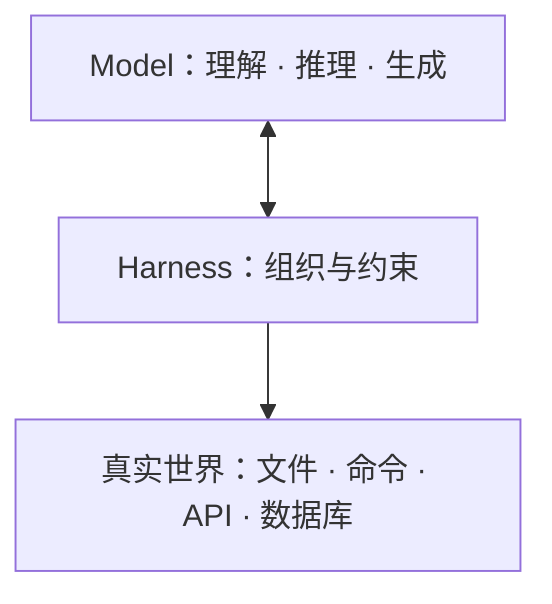
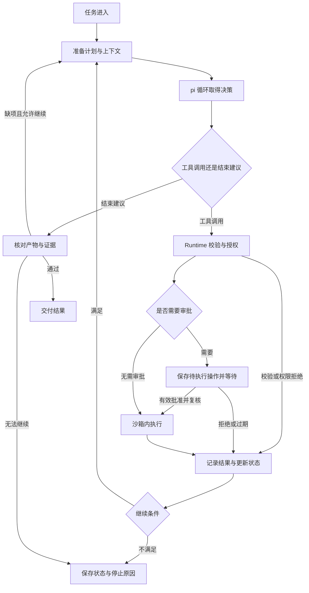

# 第三章 学习笔记 

# 第三章学习笔记：从单步工具调用到可恢复的长程 Agent

第二章解决了一个核心问题：模型提出 Tool Call 以后，系统怎样校验参数、判断权限、执行工具、治理结果并留下审计，让一次工具调用变得可控。到第二章结束，我们已经有了受控的“手”。


但真实代码仓库任务很少是一步完成的。用户说“找出登录逻辑并生成说明”，Agent 需要先搜索、再读文件、沿调用链继续查、最后写文档。用户说“修复会话过期问题”，Agent 还要复现失败、分析根因、修改代码、运行分层测试、根据失败日志继续修正。


这些步骤彼此依赖。下一步用哪条线索，往往取决于上一步返回了什么。


所以第三章要回答的问题变成：

**一个需要搜索、阅读、修改、验证和纠错的长任务，怎样持续推进，并在中断、审批和异常之后仍然知道自己做到了哪里？**


整章沿一条连续主线展开：

```Plaintext
Tool Agent
单次动作已经受控
    ↓
Agent Loop
工具结果驱动下一轮，任务能够持续推进
    ↓
Planning
把目标拆成有依赖、有完成标准的子目标
    ↓
State Machine / Checkpoint
把执行进度保存下来，中断后可以核对并恢复
    ↓
Sandbox
文件、Shell、网络和凭证能力有明确执行边界
    ↓
Harness
把模型、工具、状态、上下文、环境和审批装成一台完整执行系统
    ↓
LangGraph
显式表达分支、并行、人工中断、循环和可视化
    ↓
Codebase Agent v2
用仓库工具和真实任务完成项目闭环
```

这七节不是七个独立知识点。

1. Loop 解决“怎样继续”，但没有计划就容易忘记目标；

2. Planning 解决“做到哪一步、还缺什么”，但计划和证据需要保存；

3. State Machine 与 Checkpoint 解决“中断后还能不能接着做”；

4. 一旦 Agent 能真正操作文件和进程，就需要 Sandbox 控制影响范围；

5. 这些组件分别正确，不代表接起来正确，所以需要 Harness 管装配与状态一致性；

6. 当流程出现复杂分支、长时间等待人工和循环时，LangGraph 提供显式编排；

7. 最终这些能力汇到 Codebase Agent，由两类真实仓库任务验收。


## 一、学习预期：这一章不要求你背什么？

本章不要求脱离 AI 默写一套生产级 Agent Runtime，也不要求背诵 pi、LangGraph、FastAPI 或 SQLite 的全部 API。真实工作里，AI 很适合帮助完成：

- 根据数据类型生成 `TypedDict`、JSON Schema、Pydantic Model；

- 补工具适配、序列化、异常分支和测试样板；

- 根据明确流程生成节点、条件边和状态结构；

- 帮助阅读调用链，定位 Hook、Reducer 和恢复入口；

- 生成固定输入下的验收脚本。


但下面这些判断必须由工程师完成：

- 一个任务该用单次 Tool Calling、固定 Workflow、Agent Loop，还是显式计划。

- 什么算任务完成，什么证据可以证明完成。

- 哪些动作可以直接执行，哪些必须审批，拒绝以后由谁处理。

- 计划变化时是修正参数、补证据，还是必须修订计划。

- 中断发生在什么时候，哪些进度可信，哪些写操作结果不明。

- 文件、Shell、网络和凭证的边界放在哪一层强制执行。

- 回滚、重试和恢复会不会重复产生副作用。

- 如何用反例证明保护真的生效，而不是只写了配置。


掌握标准可以分成三层：

|能力层次|掌握标准|
|---|---|
|能解释|说清 Loop、Planning、State、Sandbox、Harness、LangGraph 各自负责什么|
|能追踪|沿一次任务找到输入、决策、校验、执行、回写、完成检查和恢复入口|
|能修复并验证|能发现绕过 Runtime、旧证据复用、旧审批复用和写操作误重放，并用测试证明修复有效|

本章主要参考四类实现：

|参考实现|重点观察什么|
|---|---|
|pi|Agent Loop、事件、Hook、会话续接、中断信号、工具适配|
|Messages API 手写 Harness|去掉框架以后，消息配对、状态回流、门禁和宿主批准由谁完成|
|LangGraph|状态图、条件边、ToolNode、interrupt、Checkpoint、可视化|
|project3/v2|十件仓库工具、两类任务、Sandbox、审批、审计和评估的完整组合|

这些实现都不是标准答案。读源码的目标，是提炼稳定边界，再迁移到自己的工程。


## 本章贯穿的两个任务

第一类是代码理解：

> 帮我找出该项目的登录逻辑，并生成 Markdown 说明文档。

第二类是测试与修复：

> 读取登录会话模块的失败测试与日志，修复源码并复测，不修改现有测试。

第一个任务检验搜索、阅读、引用和交付物；第二个任务检验复现、计划、补丁、测试、失败分析和状态恢复。

后面对 Loop、Planning、Sandbox、Harness 的验收，基本都围绕这类“代码仓库任务”展开。

---

# 3\.1 从 Tool Agent 到 Agent Loop

## 一、为什么单次 Tool Calling 不够

Chatbot 时代的典型交互是：

```Plaintext
用户问一句
    ↓
模型答一句
    ↓
结束
```

加入 Tool Calling 以后，模型可以提出动作：

```Plaintext
用户问一句
    ↓
模型提出 Tool Call
    ↓
Runtime 执行
    ↓
Tool Result 回到模型
    ↓
模型给出最终回答
```

这已经比纯文本前进了一步。但它仍然只解决一个动作周期。


复杂任务不是这样运行的。假设用户要求：

> 帮我看一下订单。如果还没发货，就取消；如果已经发货，就查物流；如果物流异常，再创建售后工单。

模型在第一轮不知道订单状态。它必须先查询，看到结果后才有资格决定下一步。第二轮的输入依赖第一轮的真实结果。


所以 Loop 出现的根本原因不是“步骤多”：

**复杂任务需要 Loop，是因为下一步依赖上一步产生的新事实。**


### 控制权发生了变化

在长任务里，模型会连续运行几十轮：

```Plaintext
搜索代码
    ↓
读取入口
    ↓
沿调用链继续查
    ↓
修改实现
    ↓
运行测试
    ↓
读取失败日志
    ↓
继续修改
```

人的关注点也从“逐轮提示”变成“设计触发、反馈、验收和停止系统”。Peter Steinberger 和 Boris Cherny 都表达过类似判断：重点已经上移一层，工程要设计能够驱动 Agent 的 Loop。

这是一种叠加，不是替代：

- 没有可靠 Context，Loop 只会更快地沿着错误上下文推进；

- 没有 Harness 约束，Loop 只会把一次风险放大成几十次；

- 没有完成契约，Loop 会停在模型“感觉自己做完了”的位置。


### LoopEngine 管什么

LoopEngine 不替模型思考，它负责让模型的连续思考和行动能够启动、反馈、收敛并安全停止。

具体至少管理五件事：

1. 组装本轮 Context；

2. 调用模型；

3. 分发 Tool Call；

4. 回写 Tool Result；

5. 决定继续还是结束。

最大轮数、重复动作检测、取消信号和完成契约，都属于第五件事下的控制机制。


## 二、什么任务适合自主 Loop？

一个任务适合交给自主 Loop，至少满足三个条件：

|条件|含义|
|---|---|
|目标清晰|系统知道要交付什么，不是用运行时长代替任务价值|
|结果可验证|测试、评分、文件产物或结构化规则能判断是否完成|
|过程可收敛|每轮行动能产生新证据，逐渐逼近目标|

例如“把近百条文字规范转成 Lint 规则”，可以每轮扫描、抽检、调整误报，停止条件设为“连续三轮抽检零误报”。这符合可验证和可收敛。

“把产品做得更高级”“把 UI 做得更好看”就不适合直接交给自主 Loop。它们需要人的产品语境和审美判断，应先进入开发者反馈循环。


### Loop 有两层含义

|层次|回答的问题|例子|
|---|---|---|
|任务内循环|一次 Run 内，模型怎样观察、决策、执行、再决策|`runAgentLoop()`|
|任务外循环|什么事件触发一次 Run，Run 结束后何时再启动|`/goal`、定时任务、事件触发|

第三章主要实现任务内循环，同时为任务外循环预留停止、Follow\-up 和中断扩展点。

如果不区分这两层，很容易把定时任务、Sub\-agent、Worktree、Memory、Skills 和 Workflow 全部塞进“Agent Loop”概念里，最后代码无法说清每层管理什么。


## 三、先分清五个对象

第二章讲过 Tool Call，这里继续复用：

|对象|负责回答的问题|例子|
|---|---|---|
|Function Calling|模型怎样表达下一步动作？|“调用 `search_code`，搜索 `auth`”|
|Tool Runtime|这一次动作能否执行，怎样执行？|校验路径、权限、超时并运行搜索|
|Agent Loop|Tool Result 回来以后怎么办？|把命中结果交给模型，继续读取文件|
|LoopGuard|整个 Run 还能不能继续？|最大轮数、重复动作、总时间|
|Harness|这些组件怎样围绕同一任务协同？|装配模型、工具、状态、上下文和执行环境|

一次工具调用的边界是：

```Plaintext
Tool Call → 校验 → 授权 → 执行 → Tool Result
```

一次任务的执行边界是：

```Plaintext
Run 开始 → 多轮模型与工具交互 → 完成/停止 → Run 结束
```

Loop 增加了连续执行能力，但不能因此丢掉第二章建立的参数校验、权限、超时、审计和结果治理。


## 四、读懂 pi 的 Agent Loop：真正的循环发生在哪里

pi 已经提供了模型调用、工具执行、结果回写和继续下一轮的底层循环。学习重点不是另写一套生产 Loop，而是读懂它在哪里判断“继续还是结束”，再把阶段二的 Tool Runtime 接进去。

### 4\.1 最小循环骨架

把 pi 的 `agent-loop.ts` 压缩到只剩骨架，核心很短：

```Plaintext
for each turn:
    assistant = call_model(messages, tools)
    append_assistant_message(messages)

    if assistant has no tool calls:
        stop
        break

    for each tool_call in assistant.tool_calls:
        result = runtime.invoke(tool_call)
        append_tool_result(messages, result)
        emit_tool_event(result)

    if stop condition is true:
        break
```

真正复杂的不是 `while`，而是长循环里积累的工程细节：

- 流式消息如何更新；

- 工具参数如何校验；

- Hook 链如何执行；

- 取消信号如何传播；

- 并行结果如何按原调用组织；

- 上下文如何组装和压缩；

- 什么证据能证明任务完成。

一句话：

**骨架决定循环能不能跑起来，事件和状态决定循环跑得清不清楚。**


### 4\.2 Tool Result 必须回到下一轮

假设模型请求搜索 `login`，工具返回两个文件。如果程序只把搜索结果打印到终端，然后结束请求，模型并没有真正看到这些文件。

它不知道应该读哪个，也无法依据搜索结果修正判断。

所以一次工具执行后，消息历史必须同时保留：

- 模型提出的 Tool Call；

- 对应的 Tool Result。

下一次模型请求带上这段历史，观察和行动才闭合。


### 4\.3 Turn 与 Run

|单位|含义|
|---|---|
|Turn|一次模型响应，以及它提出的零到多个工具调用|
|Run|从 `agent_start` 到 `agent_end` 的整个任务执行|

用户只问了一次，不代表模型只调用了一次。一个 Run 可以包含多个 Turn。


典型事件序列：

```Plaintext
agent_start
  ↓
turn_start
  ↓
message_start / message_update / message_end
  ↓
tool_execution_start / tool_execution_end
  ↓
turn_end
  ↓
下一轮或 agent_end
```

这些事件后面会用于 Trace、UI、Checkpoint 和人工接管。3\.1 先用它们做三件事：

- 统计轮数；

- 记录每次工具动作；

- 判断本轮结束后是否还允许继续。


### 4\.4 steering 与 follow\-up

运行中用户补充一句“这次只看移动端入口”，属于 `steering`。pi 会在当前轮次与工具处理结束后的安全边界接收它，影响后续决策。

用户说“分析完再补一份接口清单”，更适合排进 `followUp`。当前工具循环准备停止时，再接着处理。

这两种机制都属于本次执行的消息处理，不等同于定时调度。


### 4\.5 工具执行前后 Hook

|位置|pi 做什么|本课接什么规则|
|---|---|---|
|执行前 prepare|找工具、兼容参数、校验 Schema，再调用 `beforeToolCall`|Run 级重复保护；工具权限仍由 Runtime 判断|
|执行后 finalize|调用 `afterToolCall`，允许截断、脱敏或标记错误|从成功结果提取证据|

准备失败会形成错误 Tool Result。若请求提前终止，只有当前批次的所有工具结果都设置 `terminate: true`，才触发批次终止；即使并行执行，回写也按原 Tool Call 顺序组织。

模型、Hook 和工具还会收到同一个 `AbortSignal`。中断时才能沿整条执行链传播，而不是只停止界面输出。


## 五、ReAct 与 Plan\-and\-Execute

### 5\.1 ReAct：边观察边推进

ReAct 的核心是让推理和行动交替发生，每次行动都依据最新观察。它适合路径尚不清楚、必须一边探索一边推进的任务。

登录分析就是这样的任务：

|阶段|登录分析中的动作|
|---|---|
|Observe|阅读项目结构和已有工具结果|
|Think / Plan|判断缺少哪段调用关系，选择下一步|
|Act|提出搜索、读取或写入请求，由 Runtime 执行|
|Observe|根据结果确认事实，或修正原来的假设|
|Finalize|证据充分后形成说明，并进入完成检查|

ReAct 的重点不是输出一大段“我正在思考”，而是模型有没有看到工具结果，下一步有没有因此发生变化。

搜索无结果时，应该调整符号、目录或假设，不能把同一个搜索原样重做，再声称自己完成了新一轮分析。

### 5\.2 Plan\-and\-Execute：先定路线

Plan\-and\-Execute 先问“目标是什么”，再把目标拆成若干子目标，然后由执行器逐一完成。

例如补测试：

1. 定位函数和调用方；

2. 阅读测试约定；

3. 编写失败测试；

4. 运行并读取日志；

5. 修正测试或实现；

6. 回归并检查 Diff。

Plan\-and\-Execute 不排斥 ReAct。每个子目标内部仍然可以一边探索一边执行。

两者回答的问题不同：

|模式|回答的问题|
|---|---|
|ReAct|这一步往哪走|
|Plan\-and\-Execute|整体怎么走|


## 六、循环终止：模型说完成，能交差吗？

模型停止调用工具，只说明它准备结束。业务是否完成，要看证据。

登录任务中，模型可能只读了路由就回复“分析完成”，也可能只在聊天里写说明，却没有生成用户要求的 Markdown 文件。pi 都会走向自然停止，但目标没有完成。

### 6\.1 完成契约

完成契约把“完成”变成可检查条件，并返回缺失项：

```TypeScript
function verifyCompletion(evidence: Evidence): string[] {
  const missing: string[] = [];

  if (evidence.readFiles.size < 3) {
    missing.push("缺少源码阅读证据");
  }

  if (!evidence.writtenArtifacts.has("artifacts/login-flow.md")) {
    missing.push("尚未生成说明文档");
  }

  return missing;
}
```

返回缺失项，而不是只返回布尔值，Host 才能把具体缺口作为 Follow\-up 交回模型，例如“尚未生成说明文档，请完成写入”。

但最低门槛不等于完整业务验收。读三个文件不能证明读对了，写入成功也不能证明内容正确。最终仍要检查调用链、引用路径和关键结论是否有源码依据。

### 6\.2 为什么还要最大轮数

因为验收可能一直不通过。模型可能反复改写文档，也可能受工具故障影响，始终拿不到证据。

设置 `maxTurns = 12` 后，按 `turn_start` 计数，到上限不再发出新的模型请求。十二轮是教学配置，不是通用最佳值。

到上限后报告：

- 已完成什么；

- 缺少什么；

- 为什么停止；

- 是否还有可执行建议。

时间、Token 和费用预算也要限制。Follow\-up 增加了新消息，但仍然服务于同一目标，不能因此把计数器清零。

### 6\.3 停止原因要可解释

至少区分三类结果：

|结果|含义|
|---|---|
|完成|完成契约通过，交付物存在且证据有效|
|等待用户|需要补充信息、审批或决策|
|主动停止|预算耗尽、取消、权限阻断或不可恢复错误|

停止自动执行不等于失败，更不等于成功。界面和日志都要说清楚具体是哪一种。


## 七、死循环识别：它在工作，还是只是在重复？

死循环不一定表现为程序卡死，也可能表现为一直有输出，却没有新进展。

例如，Agent 搜索 `login`，得到两个文件；下一轮又搜索 `login`，还是这两个文件；第三轮仍然做同样的事。每次调用单独看都合法，Runtime 没有理由禁止搜索，但任务已经没有前进。

### 7\.1 动作指纹

最小版本可以把工具名和规范化参数作为动作指纹，再记录出现次数：

```TypeScript
function actionFingerprint(
  toolName: string,
  args: Record<string, unknown>,
): string {
  const canonical = canonicalJson({ toolName, args });

  return createHash("sha256")
    .update(canonical)
    .digest("hex");
}
```

`canonicalJson` 要递归排序对象字段，避免同一组参数仅仅因为字段顺序不同就绕过计数。它可以复用第二章的参数规范化实现。

判断放在 `beforeToolCall`。第三次相同动作出现时，请求不能进入真实 handler，同时要形成带错误码的 Tool Result。

### 7\.2 相同动作不一定是死循环

修改代码前运行测试得到失败，修改后再运行同一条命令得到通过，这正是需要的反馈循环。读完文件后人工改了代码，再次读取也有价值。

所以动作指纹只是保守的入门保护。真正判断进展，还要看：

- 文件版本有没有变化；

- 测试结果有没有变化；

- 已验证事实有没有增加；

- 计划步骤有没有推进；

- 错误原因有没有变化；

- 是否出现 A、B 两种动作来回切换的振荡。

确认停滞时先给明确反馈，允许有限次调整策略；仍然没有新证据，就结束并报告卡在哪里。


## 八、中断与恢复：停下来以后，能接着做吗？

中断是停止当前执行；恢复是从可信进度继续。两件事要分开实现。

pi 通过 `AbortSignal` 传递取消：

```TypeScript
const controller = new AbortController();

const run = runAgentLoop(
  prompts,
  context,
  config,
  emit,
  controller.signal,
  streamFn,
);

controller.abort();
await run;
```

模型、Hook、工具和下游子进程都要响应这个信号。只停止界面输出不够。如果测试命令还在运行，任务就没有真正停下来。

取消也不能撤销已经完成的文件写入。这是恢复时必须面对的事实。

本节先预留 Snapshot，记录：

```Plaintext
runId
messages
turn
evidence
stopCode
```

可以在轮次边界保存内存快照，但控制台日志不等于持久化 Checkpoint，`Set`、`Map` 也要转换成可存储的数据。

恢复时先加载记录，确认最后完成的轮次和待处理调用，再核对工作区。假设文档已经写入，进程却在记录成功前退出，就不能仅凭旧记录断言“没写过”，直接重做。

重新发送原 Prompt 不叫恢复。它会重新开始推断，却不知道哪些动作已经发生。

正式状态机、持久化、幂等和人工接管续跑放到 3\.3。


## 九、把 Loop 接进工程

第一版 Codebase Agent 只增加与 Loop 直接相关的文件，阶段二已有的 Tool Registry、Tool Runtime、策略和审计继续复用。

|文件|职责|
|---|---|
|`model.ts`|把阶段一 Gateway 注册给 pi，Agent 只使用逻辑模型名 `agent-default`|
|`pi-tools.ts`|把阶段二 Runtime 工具适配成 pi AgentTool|
|`loop-guard.ts`|负责重复动作、最大轮数、完成证据和 Follow\-up|
|`agent-runner.ts`|装配模型、工具、Guard、Run 状态和 pi Loop|
|`main.ts`|启动任务并输出运行摘要|

本节只接入四个工具：

|工具|本节用途|后续增强|
|---|---|---|
|`list_files`|查看项目结构|3\.4 增加完整文件边界|
|`search_code`|搜索登录相关符号|3\.7 增加搜索策略|
|`read_file`|沿调用链读取代码|第四章增加 Context 管理|
|`write_file`|只写 `artifacts/` 目录|3\.4 增加 Sandbox 与确认|

工具适配层保留第二章的四条不变量：

1. `toolCallId` 不丢失；

2. 模型参数仍然属于不可信输入；

3. 所有工具进入同一个 `invoke()`；

4. Tool Result 先治理，再进入模型 Context。

`LoopGuard` 只实现四项控制：

- `beforeToolCall`：动作指纹去重，连续三次相同动作时阻止执行；

- `afterToolCall`：从工具结果中提取证据；

- `afterTurn`：检查最大轮数、完成证据，证据不足时生成 Follow\-up；

- `drainFollowUps`：把 Follow\-up Message 注入下一轮。

它暂时不负责计划步骤、任务状态机、持久化 Checkpoint 和 Sandbox Policy。


## 十、TDD 验收：怎样证明规则不是摆设？

只看最终文档，无法区分：

- 模型真的通过多轮探索找到了登录逻辑；

- 模型靠训练数据猜出登录流程，工具调用只是装饰；

- 工具执行了，但结果没有写回下一轮；

- 最大轮数和重复检测配置了，却从未被触发。

所以本节用两层验收：

1. 脚本化响应，稳定复现终止、重复和证据不足分支；

2. 真实 Gateway 与模型，验证完整闭环。

|测试|必须观察到的结果|
|---|---|
|Tool Result 驱动下一轮|第二次模型调用的 Context 包含上轮 `toolResult`，且 ID 匹配|
|缺少交付证据时拒绝 Final|注入 `FINAL_REJECTED` Follow\-up，模型继续完成产物|
|第三次相同动作不执行 handler|真实 handler 只执行两次，第三次返回 `REPEATED_ACTION`|
|最大轮数到达后不再调用模型|模型调用次数恰好等于 `maxTurns`，停止码为 `MAX_TURNS_EXCEEDED`|
|用户取消终止当前 Run|停止原因为 `aborted`，取消后不再启动新工具|
|真实集成验收|至少完成一次 Tool Call → Tool Result → 下一轮，文档引用真实路径|

这些测试合在一起，才构成“Loop 成立”的证据链。

### 本节重点与验收

**重点掌握**：Loop 的价值来自下一步依赖上一步事实；Tool Result 回写；Turn 与 Run；ReAct 与 Plan 的边界；完成契约；最大轮数；重复动作拦截；AbortSignal；脚本化测试与真实运行分工。

**了解即可**：pi 的完整事件字段、流式增量细节和内部 Session 实现。

学完本节，你应该能回答四个问题：

1. 为什么一次 Tool Calling 不够？

2. 工具结果怎样驱动下一轮？

3. 模型说完成以后，程序凭什么决定能不能交付？

4. 用户取消、重复动作和预算耗尽分别怎样停止？

---

# 3\.2 Planning 与任务拆解

## 一、先判断任务要不要计划

3\.1 的 Codebase Agent 已经能完成代码理解：搜索登录逻辑、读取文件、写 `artifacts/login-flow.md`。这类任务的输入明确，找什么、写到哪里都说清楚了。

换成一个修复任务，性质就变了：

> 请修复登录模块的会话过期边界问题：先定位登录和会话相关代码，复现失败测试，分析根因，只修改必要源码，然后运行目标测试、边界测试和回归测试，最后把根因、改动和验证结果写入 `artifacts/login-fix.md`。

提示词只说了“会话过期边界”，没说错在哪里。可能是日期粒度截断、时区语义，也可能是边界是否包含到期时刻。这三条里哪一条成立，只能靠工具结果证实或推翻。

Loop 保存的是一条消息历史，它知道“模型读过什么、说过什么”，不知道“任务还差哪几步”。

当工具结果推翻当前判断时，没有东西能回答：

- 哪一步的结论作废了？

- 哪些跑过的验证要重做？

- 手上这份改动到底能不能交？

Planning 要补的是这一层：

**把任务拆成有完成标准、有依赖关系的子目标，再根据真实证据判断下一步和是否可以交付。底层继续用 3\.1 的 Loop，工程上增加计划状态、计划操作、证据和完成契约。**

### 1\.1 同一任务，有无计划的区别

课程里用同一份提示词、同一个仓库、同样的修复工具，分别跑 3\.1 的 Codebase Agent 和有计划层的 Planning Agent。

对照组不是 3\.1 原样。它的 Runtime 同样有 `apply_patch` 和 `run_test`，完成契约也从“生成 `login-flow.md`”换成“当前代码版本上有改动、三个测试范围全通过、有交付说明”。两者唯一差别是计划层。

结果可能是 8 轮对 17 轮。加计划确实多用了几轮，成本不能忽略。但多看一层，Planning Agent 还多了 s1 到 s6 六个步骤、每一步状态和关联证据。

|Agent|主要记录什么|
|---|---|
|Codebase Agent|做过哪些动作|
|Planning Agent|动作属于哪个子目标，子目标推进到了哪里，用了哪些证据|

不是有计划一定更快，而是任务变长以后，你是否需要一份能检查、能追踪的进度记录。

### 1\.2 三层机制与组件

|层次|负责的问题|修复案例里的例子|
|---|---|---|
|Tool Calling|这次调用哪个工具、传什么参数|读取 `session-policy.ts`|
|Agent Loop|工具结果怎么回写，下一轮怎么继续|读到失败日志后继续查实现|
|Planning|先完成什么、还缺什么、什么时候改变路径|先复现，再确认根因，再修复，再验证|

落到组件：

|对象|主要职责|
|---|---|
|Planner|提出子目标、依赖、下一步和修订建议|
|Plan / PlanStore|保存步骤、状态和修订历史，检查依赖与状态转换|
|pi Agent Loop|调用模型、处理 Tool Call、回写 Tool Result 并继续|
|Harness|装配模型、工具和计划组件，在执行接缝上落实约束|
|Tool Runtime|参数校验、权限检查、超时与工具执行|
|Verifier|检查实际证据是否满足当前验收条件|

模型负责提下一步，程序负责检查能不能做、做完算不算数。


### 1\.3 什么时候不需要计划

计划会增加调用、等待和状态维护成本。下面这些情况不必急着上 Planner：

- 一次工具调用就能拿到结果，例如查一个订单状态。

- 固定字段抽取、格式转换、通知发送，处理规则已经写清楚。

- 审批流程的先后由制度确定，适合固定 Workflow。

- 业务特别在意响应速度，而任务只有几步。

- 高风险操作不允许模型临时增删步骤，应先把执行流程锁定。

判断标准不是“任务听起来复杂”，而是现有工具调用或固定流程能不能把事情管住。


### 1\.4 四种执行方式怎样选

|任务特点|优先选择|例子|
|---|---|---|
|一次明确操作就能完成|直接 Tool Calling|查询某个订单状态|
|步骤与异常分支能提前写清|固定 Workflow|固定规则的数据导入|
|下一步取决于执行中获得的信息|Agent Loop|调查登录测试为什么失败|
|还要持续追踪多个子目标、依赖和交付条件|在 Loop 中加入显式计划|跨模块修复并完成分层验证|

Workflow 不是只能从头到尾执行，它也可以有分支、重试，甚至在某一步调用模型。有计划能力，也不代表必须单独再建一个 Planner Agent。

几种方式可以一起用。排查故障时先用 Agent Loop 调查；任务需要跟踪多个子目标时加计划；修复完成、准备发布时交给固定 Workflow。


### 1\.5 一次性计划与动态计划

**一次性计划**：主要步骤在开始时就能列清楚，后面大多按顺序推进。代码理解任务可以预先安排搜索入口、读取实现、整理调用关系、生成文档。

它和 Workflow 的区别在步骤由谁定。模型根据这次任务临时列出步骤，是一次性计划；每次都做同一套操作，步骤和分支由工程师事先写好，就是固定 Workflow。

**动态计划**：开始时只能确定“先查清问题，再修复，再验证”，具体怎么改要等证据。新证据让原安排不适用时，可以申请修订。

允许调整不等于每次都要调整。真实运行里可能计划版本 v1、修订 0 次，模型读到源码就找到了问题，后面步骤继续可用。

判断是否加计划，先问两个问题：

1. 下一步是不是要看执行结果才能决定？如果是，Loop 可以解决。

2. 是否还要持续追踪多个子目标、依赖和验收情况？如果也需要，再加显式计划。


## 二、一份计划要写成什么样

列出“分析、修改、测试”还不够。模型知道每一步要做到什么程度，程序也要有办法检查它做完没有。

### 2\.1 从动作改成可验收结果

|模糊动作|可验收子目标|可接受的证据|
|---|---|---|
|分析代码|确认失败入口、相关模块和一个可证伪的假设|文件位置、调用链、失败断言摘要|
|修改代码|完成符合边界的最小修改|受控 Diff、修改理由|
|运行测试|目标用例通过，且没有新增失败|命令、退出码、测试范围|
|查看日志|确认时间、请求 ID、异常类型和调用链|结构化日志字段|
|修复缺陷|原问题消失，并存在防回归验证|修复前后对比、回归结果|

放到修复任务里：

|动作写法|可验收写法|
|---|---|
|复现失败|在 `scope=target` 上拿到退出码 1，并保留失败断言的期望值与实际值|
|修一下|产生当前代码版本上、允许修改范围内的最小 Diff|
|跑测试|`target`、`boundary`、`regression` 三个范围的退出码都为 0|

写一个步骤时多问两句：

1. 做完以后，我应该知道什么，或者拿到什么？

2. 拿什么来证明？

答得出来，这一步才有办法验收。


### 2\.2 计划至少保存什么

应用里至少需要三类对象：`Plan` 保存整份计划，`PlanStep` 保存一步，`Evidence` 保存工具执行后留下的证据。

```TypeScript
type StepStatus =
  | "pending"
  | "in_progress"
  | "completed"
  | "blocked"
  | "skipped"
  | "failed";

interface PlanStep {
  id: string;
  objective: string;
  dependsOn: string[];
  successCriteria: string[];
  status: StepStatus;
  evidenceIds: string[];
  attempts: number;
  lastError?: string;
}

interface Evidence {
  id: string;
  stepId: string;
  toolCallId: string;
  artifactVersion: string;
  kind: "tool" | "test" | "diff" | "inspection";
  summary: string;
  payload: Record<string, unknown>;
}
```

这些字段为什么分开：

- `objective` 说这一步要得到什么，例如“确认根因”，不能只写“分析一下”。

- `successCriteria` 事前定义完成标准，`evidenceIds` 执行后再记录结果，标准和结果不能混在一起。

- `artifactVersion` 说明证据对应哪份代码。测试通过后又改了代码，旧结果不能直接证明新代码。

- `status` 要区分未开始、进行中、阻塞、失败和跳过，不能只有完成或未完成两个值。

- `constraints` 保存任务约束，实际限制仍要由执行检查落实。

- `maxRevisions` 限制计划最多修订几次，避免一直改计划却不结束任务。

这些类型是应用加的，不是 pi 自带的 Planner。pi 继续负责循环，应用负责补上任务状态层。


### 2\.3 完成标准在事前，证据在事后

不能看到退出码是 0 就把所有步骤都算完成，也不能看到非零就把所有步骤都算失败。

当前步骤是“复现问题”时，看到原来的失败断言，说明复现成功。当前步骤是“验证修复”时，同样的失败结果说明还没修好。

|证据|能证明|不能证明|
|---|---|---|
|`scope=target` 退出码 1|复现步骤完成，原问题确实存在|修复完成|
|`scope=target` 退出码 0，且版本为当前|修复验证完成|边界与回归也通过|
|三个范围退出码都为 0，且版本为当前|本次修复在约定范围内可交付|仓库其它区域没有回归|

证据不能让模型自己写一句“测试通过了”来提供。证据来自真实工具执行，模型只能引用编号。

模型申请完成某一步时，程序至少检查四件事：

1. 证据非空；

2. 引用的证据存在；

3. 证据的 `stepId` 与当前步骤一致；

4. `test`、`diff` 类证据的版本等于当前代码版本。

这四项只回答“证据拿对了没有”。`StepVerifier` 还要判断证据够不够满足完成标准。

还要分清两层验收：

|层次|回答的问题|
|---|---|
|步骤验收|这一步能不能算完成|
|任务级 CompletionContract|整个任务能不能交付|

步骤全勾上，不等于任务完成。整体还可能要检查当前版本 Diff、三类测试通过记录和交付说明。


### 2\.4 六步修复计划示例

|步骤|完成后产生的新事实|完成标准|
|---|---|---|
|s1|确认登录入口、会话实现与允许修改范围|能指出过期判定在 `session-policy.ts`，并说明调用位置|
|s2|复现目标用例失败|`scope=target` 退出码为 1，失败断言有记录|
|s3|按证据确认根因|指出 `slice(0, 10)` 截断到日期，证据来自源码读取|
|s4|完成允许范围内的最小修复|当前代码版本上产生受控 Diff|
|s5|三个测试范围全部通过|`target`、`boundary`、`regression` 各自退出码为 0|
|s6|交付修复说明|`artifacts/login-fix.md` 写入成功，并写明未验证项|

一个步骤不一定只调一次工具。s5 就可能包含三个测试范围的证据。


### 2\.5 依赖决定谁先谁后

依赖要回答一句话：“这一步要开始，前面必须先拿到什么？”

|依赖类型|例子|
|---|---|
|前置依赖|没有复现失败，不该贸然动代码|
|数据依赖|判断根因需要错误栈和代码检索结果|
|权限依赖|写文件、执行部署前要过策略和审批|
|验证依赖|修改完成后必须运行目标测试|
|汇合依赖|目标用例和边界用例都通过才能进入回归|
|互斥选择|多个候选修复方案只能有一个进入写操作|

`ready` 由程序计算，不由模型声明：

```TypeScript
readySteps(): PlanStep[] {
  return this.plan.steps.filter((step) =>
    step.status === "pending"
    && step.dependsOn.every(
      (id) => this.requireStep(id).status === "completed",
    ),
  );
}
```

写文件、改代码、跑测试这些动作要带 `planStepId`。执行前用这个编号查计划，确认步骤能不能做。

`skipped` 不等于 `completed`。如果前面的步骤不做了，不能直接把跳过当成完成，尤其是验证步骤。

本节的 `skip()` 会先查有没有别的步骤还在等它。有，就拒绝直接跳过。必须先说明为什么不需要，后面的步骤改成等谁，再通过一次修订一起处理。

依赖就绪也不代表没有资源冲突。两步都就绪时，如果都要改同一个文件，就不能贸然并行。依赖检查只回答前置条件齐不齐，不能替代并发资源检查。


## 三、计划怎样变化

写计划时很多信息还不知道。执行以后可能发现：有的只是参数写错，有的却是整个方向错了。

### 3\.1 收到偏差先分流

先记录发生了什么，判断它有没有影响原安排，再决定是改参数、重试、改计划，还是停下来。

|新的观察|处置|是否修订计划|
|---|---|---|
|工具参数拼错|改正参数，保留原目标|不需要|
|目标文件不存在|搜索实际位置；只是路径变了就局部修正，模块结构变了才修订|看情况|
|短暂超时|受控重试，不超预算|不需要|
|测试断言指向到期边界|先补证据，再判断原假设是否成立|前提被推翻时|
|测试缺依赖，断言根本没执行|先恢复测试条件，必要时新增环境准备步骤|需要时|
|用户中途补充约束|检查计划与已有 Diff，让冲突步骤和相关验收失效|需要|
|权限拒绝或预算耗尽|记录阻塞或停止原因|不能靠改计划绕过|

找不到文件时，只能确定这个路径没找到，不能直接得出“项目里没有会话功能”。如果只是文件名拼错了，改正参数即可；如果实现已经拆到几个模块里，后续定位和修改安排可能要调整。

测试失败时，先判断失败类型：

|结果类型|下一步判断|
|---|---|
|`assertion`|测试到达业务断言但没满足预期，检查实现、测试预期或根因假设|
|`environment`|缺依赖、配置或 fixture，断言根本没执行，先恢复测试条件|
|`timeout`|检查卡住的位置与资源限制，区分死锁、慢测试和外部等待|
|`infrastructure`|执行器或 CI 基础设施失败，记录阻塞并按平台策略处理|

非零退出码本身不够。如果只是缺依赖，测试根本没跑到原断言，不能叫复现成功。


### 3\.2 什么才算一次修订

不要数“失败了几次”，要问：按现在拿到的信息，原来安排的步骤、依赖和后续路径还合不合适？

- 测试命令里的路径拼错了，改参数重跑，目标和步骤没变，不用修订。

- 证据推翻了根因判断，原修改步骤不该继续做，要替换步骤、调整依赖，这才是修订。

重复一次动作，不等于修订了计划。补一条当前步骤能用的证据，也不等于换了一份计划。


### 3\.3 一次修订要留下什么

修订申请至少要说明：

```Plaintext
expectedVersion：1
reason：失败指向会话有效期判断，而不是密码校验
evidenceIds：[ev-3]
replace：modifyPasswordLogic → fixExpiryCheck
objective：修正会话有效期判断
dependsOn：[reproduce]
successCriteria：[按到期时刻比较]
```

程序收到以后，先做六项检查：

1. 版本对齐：`expectedVersion` 必须等于当前版本，否则 `PLAN_VERSION_CONFLICT`。

2. 预算：`revisionCount` 必须小于 `maxRevisions`，否则 `PLAN_MAX_REVISIONS_EXCEEDED`。

3. 依据：`reason` 非空，`evidenceIds` 非空且都真实存在。

4. 在候选副本上应用变更：旧步骤标记 `skipped`，新步骤插入，依赖自动改接。

5. 整体校验候选：步骤 ID 唯一、依赖存在、依赖图无环。

6. 提交：版本加一、修订计数加一、追加一条修订记录。

为什么不能让模型直接改一串步骤文字？因为这里有三件事必须由程序守住：

|规则|做法|不这么做会怎样|
|---|---|---|
|版本对齐|请求携带 `expectedVersion`，与当前版本不一致就拒绝|基于旧版本的申请覆盖新计划|
|原子提交|替换、追加、依赖改接在候选副本上一次完成，校验通过才提交|中间状态里旧步骤已跳过、新步骤还没接上|
|预算上限|提交前检查 `maxRevisions`|失败循环里无限修订，永远不收敛|

旧步骤不会消失，它留下被替换记录。原来等旧步骤的验证步骤改成等新步骤。

最小修订，就是哪里不合适改哪里，不把已经做对的工作全推倒。旧步骤保留着，别人回头看记录，才能知道当时准备做什么、后来为什么换了方向。


### 3\.4 修订只能改路径，不能改标准

回归测试一直没通过时，模型不能把“回归测试通过”改成“运行过回归测试”，然后给自己打勾。用户要的结果没变，验收底线就不能由模型自行降低。

如果是用户补充了新要求，例如“不要修改公共 API”，不能只把这句话加进提示词。要记下新约束，检查已有 Diff，暂停冲突步骤，修正不合要求的改动并重新验证。

没有受到影响的步骤可以保留，只重新处理有冲突的部分。已经发出通知或做了不能直接撤销的操作，要把事实说清楚，交给人处理。改掉计划里的文字，不等于现实里的操作也撤销了。

可以收成一句话：

**子目标给出完成标准，依赖决定执行顺序，观察推动修订，证据决定能否交付。**


## 四、接进 pi：加计划层，不写第二套 Loop

改动集中在计划状态和 Hook 接线，pi 继续负责模型与工具循环。

|文件|相对对照组的变化|
|---|---|
|`plan-store.ts`（新增）|保存计划、检查依赖、校验证据、提交修订|
|`plan-tools.ts`（新增）|创建、读取、更新、修订计划的契约与 Handler|
|`completion-contract.ts`（新增）|把完成判断提取为可注入契约|
|`planning-prompt.ts`（新增）|运行提示词与每轮计划快照|
|`pi-tools.ts`|增加计划工具注册与 `planStepId` Schema 扩展|
|`loop-guard.ts`|保留轮数与重复保护，增加计划门禁，完成契约改为注入|
|`agent-runner.ts`|装配计划工具、计划状态和运行提示词|

四个 Hook 的职责：

|执行位置|本节增加的行为|
|---|---|
|`beforeToolCall`|校验动作绑定的步骤是否就绪，继续执行原有重复保护|
|`afterToolCall`|把 Runtime 的真实结果关联到步骤，形成证据|
|`prepareNextTurn`|刷新计划版本、就绪步骤和最近证据摘要|
|`shouldStopAfterTurn`|保留原停止规则，改用注入的完成契约检查交付|

注意三件事：

1. 工具原始结果仍要由 pi 回写。计划快照只是帮模型看进度，不能替代 Tool Result。

2. 仓库文本和工具输出只是待分析数据，不能把里面的话当成系统指令。

3. `planStepId` 是计划关联字段，不是业务工具参数。计划检查以后，进 Runtime 前要剥离。

每轮给模型的是当前计划快照，不是把旧计划一份份往后贴。否则模型看到多个版本，既占上下文，也容易拿错状态。


## 五、验收：计划规则必须真的拦住动作

先检查计划层本身，不让真实模型的随机输出干扰判断。计划层测试覆盖依赖、证据、版本和修订。

|测试|必须观察到的结果|
|---|---|
|依赖未完成时申请开始|`PLAN_STEP_NOT_READY`，就绪步骤只有当前可执行项|
|必要前置被标记 skipped|`PLAN_SKIP_REQUIRES_REWIRE`，下游仍未就绪|
|没有证据申请完成|`PLAN_COMPLETION_REQUIRES_EVIDENCE`|
|引用不存在证据|`PLAN_UNKNOWN_EVIDENCE`|
|证据不属于被完成步骤|`PLAN_EVIDENCE_STEP_MISMATCH`|
|证据存在但不满足标准|`PLAN_COMPLETION_REJECTED`，步骤留在 `in_progress`|
|引用修改前版本的通过结果|`PLAN_EVIDENCE_STALE`|
|替换修改步骤|旧步骤 `skipped`，验证依赖改接新步骤|
|修订产生环|`PLAN_DEPENDENCY_CYCLE`，整次修订被拒，计划不变|
|缺理由或缺证据|`PLAN_REVISION_REQUIRES_REASON` 或 `PLAN_REVISION_REQUIRES_EVIDENCE`|
|以旧版本发起修订|`PLAN_VERSION_CONFLICT`|
|超过修订预算|`PLAN_MAX_REVISIONS_EXCEEDED`|
|创建计划时依赖不存在|`PLAN_UNKNOWN_DEPENDENCY`|

Loop 集成还要检查计划层有没有被绕过：

|测试|必须观察到的结果|
|---|---|
|完整闭环：假设到证据修订|计划 v1→v2，旧步骤 `skipped`，源码真实改写，交付说明落盘|
|受约束动作缺少 `planStepId`|`PLAN_STEP_REQUIRED`，`apply_patch` Handler 调用次数为 0|
|绑定未就绪步骤|`PLAN_STEP_NOT_READY`，`run_test` Handler 调用次数为 0|
|引用不存在证据申请完成|`PLAN_UNKNOWN_EVIDENCE`，步骤不完成|
|证据不足时模型给出 Final|注入 `FINAL_REJECTED` Follow\-up，继续到预算上限后以 `MAX_TURNS_EXCEEDED` 停止|

关键断言并不仅是“返回了错误”，而是 handler 调用次数为 0。文件已经改了、资源已经消耗以后再报错，只是事后贴标签。

### 本节重点与验收

**重点掌握**：何时需要计划；子目标怎样写成可验收结果；依赖与 `readySteps`；`skipped` 不等于完成；证据归属与版本；偏差分流；原子修订；版本对齐；修订不能降低验收标准；计划门禁必须落在 handler 之前。

**了解即可**：具体错误码命名、计划工具的 API 形状和不同状态存储实现。

学完本节，你应该能回答：

1. 一个任务该用 Workflow、Loop，还是显式计划？

2. 一份计划为什么不能只写动作？

3. 什么情况只是改参数，什么情况必须修订计划？

4. 怎么证明计划规则不是提示词里的摆设？

---

# 3\.3 State Machine 与 Checkpoint

## 一、pi 原生会话持久化能恢复什么

pi 自带会话持久化和续接能力。启动时可以指定会话存档目录，运行结束后目录里会生成 JSONL 文件。JSONL 一行一条记录，其中可以包含消息、会话信息和其他会话条目，并不只是用户和助手的一问一答。

结束进程后，使用同一个工作目录和会话目录，再通过 `-c` 或 `--continue` 续接，模型能找回之前聊过的内容。

常用命令：

|命令或参数|用途|
|---|---|
|`-c` / `--continue`|续接最近的会话|
|`-r` / `--resume`|打开会话选择器|
|`--session-id <id>`|使用精确的项目会话 ID|
|`--fork <path|id>`|从指定会话派生一个新会话|
|`--session-dir <dir>`|指定会话存档目录|
|`--no-session`|关闭会话持久化|

`--fork` 复制的是会话，不会自动替我们还原代码工作区。

从框架内部看，续接需要先读取会话记录，再重建当前分支的上下文，最后才能继续调用模型。如果会话发生过压缩，重建时会使用压缩摘要和保留下来的消息，而不是把全部历史原样塞回去。

但会话恢复只证明一件事：

**它能找回之前聊过什么，暂时不能证明业务任务恢复到了可靠现场。**


## 二、能继续对话，不等于能恢复现场

如果中断前的记录完整保存，工作区没有变化，也没有结果不明的操作，确实可以继续。问题是真实中断未必发生在这种整齐边界上。

### 2\.1 存档为什么可能和实际代码对不上

补丁工具的典型执行顺序可能是：

```Plaintext
修改文件
    ↓
更新内存版本计数
    ↓
工具返回
    ↓
轮次边界保存 Checkpoint
```

两次写入之间有一个空当：补丁已经写进 `session-policy.ts`，但新的执行结果和版本信息还没保存，进程就退出了。

恢复时会看到两个不同事实：

- 磁盘上是修改后的代码；

- 存档里仍记录“补丁尚未完成”。

如果直接按旧进度继续，Agent 可能重复打补丁，也可能拿旧测试结果判断新代码。

**“存档里没有成功记录”，不等于“动作没有发生”。**恢复不能只读进度，还要核对真实现场。

### 2\.2 中断信号能停下什么

`AbortSignal` 把“本次执行需要停止”的信号传给模型调用、循环和工具。相关组件在能响应的位置检查信号并结束自己的工作。

有三点必须分清：

1. 同一个信号一旦中止，不能恢复为未中止。下一次执行要用新信号。

2. 停止能否及时生效，取决于执行环节是否支持取消。信号传给工具，工具内部还要配合处理。

3. 停止过程需要收尾消息和工具结果。突然断电或强制杀进程时，不能保证收尾完成。

尤其注意：

**中断不是回滚。**已经写入的文件不会因为发出中断信号就自动恢复，已经启动的子进程也需要明确的终止或隔离策略。

### 2\.3 业务层至少保存什么

除了会话历史，业务层至少还要保存或关联四类信息：

|信息|恢复时用来判断什么|
|---|---|
|计划与步骤进度|哪些步骤已经完成，下一步准备做什么|
|工具执行记录与证据|动作是否成功，测试结果是否完整可信|
|工作区标识与代码版本、摘要|现在的代码是否与保存时一致|
|待审批动作与人工决定|哪些动作仍在等待确认，已有批准是否适用|

保存工作区标识和摘要，不等于把整个工作区备份下来。前者用于核对现场；如果需要回到旧代码，要另外准备 Git 提交、快照或独立工作区。

### 2\.4 四类接入位置

|接入位置|用途|
|---|---|
|`beforeToolCall`|执行前决定是否放行|
|`afterToolCall`|根据执行结果补充记录|
|事件订阅|把执行过程转成业务状态|
|续跑接口|恢复检查通过后继续调用模型|

`beforeToolCall` 可以用来拦截需要审批的动作。返回 `{ block: true }`，工具调用不会执行，模型会收到相应错误结果。

如果要实现“停下来等审批”，业务层还要保存待确认动作、设置 `waiting_approval`，并通过运行控制结束本次执行。在等待期间，其他需要审批的写操作也必须继续被拦住。

`afterToolCall` 可以补充审计信息、整理证据并更新步骤记录。它返回的 `terminate` 也要看批次语义：pi 会检查整个工具批次，只有所有最终结果都设置终止提示，才按该机制提前结束。

事件订阅中的 `agent_start`、`turn_start`、`tool_execution_start`、`tool_execution_end`、`agent_end`，说明框架运行到了哪里。业务层再把这些事件关联到具体任务和计划步骤。

`runAgentLoopContinue` 或 `agent.continue()` 提供继续执行的机制。使用前，要先还原计划、证据、审批状态和运行计数，并完成工作区校验。


## 三、业务层要补齐三样东西

### 3\.1 任务状态机：记录现在到哪了

最直接的做法是给任务加一个 `status` 字段。例如准备修改代码但还没批准时：

```Plaintext
status = "waiting_approval"
```

意思是这个任务正在等人确认，现在不能执行需要批准的修改。

但只有一个状态字段，还不算状态机。还要规定发生什么事情之后，状态才能改变。

本节使用九个状态：

|状态|在修复过程中怎么理解|
|---|---|
|`created`|收到任务，还没开始处理|
|`planning`|正在建立或整理计划|
|`running`|正在分析结果、决定下一步|
|`waiting_tool`|已发起工具调用，正在等待结果|
|`tool_failed`|某次工具调用失败，需要判断如何处理|
|`waiting_approval`|某个动作尚未获批，等待人工决定|
|`completed`|修复和约定验证均已完成|
|`failed`|本次任务无法继续，未完成交付|
|`cancelled`|用户决定结束本次任务|

这些不是必须依次走完的九个步骤。不需要审批的任务不会进入 `waiting_approval`；一个任务调用多次工具，也会多次进入和离开 `waiting_tool`。

两个容易混淆的问题：

**工具失败，是不是整个任务就失败了？**

不一定。读取文件路径写错，可以先记 `tool_failed`，再搜索正确路径重新读取。只有达到停止条件，例如重试预算耗尽、缺少权限且无法解决，才把整个任务记为 `failed`。

还要区分“测试工具执行成功”和“测试通过”。测试命令正常运行并拿到失败日志，说明成功获得了测试结果，但代码仍然有问题。

**暂停了，是不是应该记为 ****`cancelled`****？**

不是。暂停表示这次先停，之后还要继续；取消表示这个任务不做了。

本例把两件事分开：

- 任务状态记录中断前处于什么阶段，例如 `running`；

- 停止原因记录为什么停下来，例如 `INTERRUPTED`。

“任务状态：`running`，停止原因：`INTERRUPTED`”表示任务在执行阶段被打断，目前没有继续运行，但任务还没有结束。

状态由程序根据实际事件和业务规则修改。工具开始执行、工具返回结果、用户批准、验收通过，都是更新依据。模型可以提出建议，但不能仅凭一句“我完成了”把任务改成 `completed`。

### 3\.2 步骤执行记录：具体做过什么

任务状态说明当前阶段，步骤执行记录说明具体做过什么、结果怎样、还差什么。

一次工具调用至少记录：

- 属于哪个计划步骤；

- 调用哪个工具；

- 传入什么参数；

- `toolCallId`；

- 返回结果或错误；

- 失败后的下一步决策；

- 重试次数与预算消耗。

为什么要保留具体参数？因为“修改会话判断”只是意图，具体补丁才说明它准备改什么。审批、排障和恢复都要查看具体内容。

工具执行后要保存返回结果，包括失败。比如补丁没有应用成功，工具返回“找不到需要替换的原文”。后面如果再试成功，也不能覆盖前面的失败记录。

还要区分两种情况：

|情况|记录方式|
|---|---|
|工具明确返回“补丁未应用”|已知失败结果|
|工具发起后进程退出，没有拿到结果|结果不明|

没有收到结果，不能直接写成“执行失败，所以可以重试”。文件可能已经改了，只是成功结果没来得及保存。

步骤记录的最好状态是：

**换一个人接手，只看这些记录，他能知道已经做过什么、哪里出了问题、哪些结果还不确定，以及下一步准备做什么。**

如果还需要翻聊天记录猜，就说明执行记录缺少关键信息。

### 3\.3 Checkpoint：保存恢复所需的信息

Checkpoint 可以理解成任务存档：把当前进度和恢复依据保存下来，让下一个进程知道从哪里接着处理。

#### 保存什么

一份可用存档至少要回答：

- 原始目标和约束是什么？

- 当前计划、步骤状态和修订历史是什么？

- 哪些工具已经执行，结果如何，有没有结果不明？

- 当前工作区、代码版本或内容摘要是什么？

- 有哪些待审批动作和人工决定？

- 已用轮数、重试次数、Token、费用和时间预算还剩多少？

- 会话记录对应哪个引用？

这些数据不一定塞进同一个文件。会话记录可以由现有存储保存，Checkpoint 记录对应引用，但恢复时要能找到且对应一致。

#### 什么时候保存

不能只在程序退出时保存。进程突然崩溃，就没有机会执行退出前的保存。

本例主要在完整轮次结束后保存；准备停下来等待审批时，也要先保存待确认动作和任务状态。

保存越频繁，通常进度越新，但写入和一致性处理也更复杂。教学版本采用明确保存边界，不追求任意时刻中断都能原样接上。

尤其注意：

**修改代码和保存 Checkpoint 是两次操作。**

补丁可能已经写进文件，但新的存档还没保存，进程就退出了。因此，即使有 Checkpoint，也不能保证存档永远与实际代码同步。

#### 怎样避免写出半份存档

先把新内容写到临时文件，写完后，再用临时文件替换正式文件。这样能减少正式文件只写了一半的风险。

存档还要带两个信息：

|信息|用途|
|---|---|
|格式版本|说明存档使用哪种数据结构，当前程序是否支持读取|
|校验和|检查存档内容是否损坏|

格式版本描述存档结构，代码版本描述工作区代码，两者不是一回事。

保存和校验还要遵守同一套数据表示规则。没有值的可选字段，统一省略或统一写成 `null`，不要两边不同。

如果新存档保存失败，应停止继续推进任务，报告原因，并保留最近一份有效存档。不能一边提示保存失败，一边继续修改代码。

#### 读到存档后怎样恢复

恢复流程分五步：

1. 检查存档能不能用：文件可读、格式支持、字段齐全、校验通过。

2. 检查工作区对不对：目录还在吗，相关文件变了吗，上次有没有结果不明的操作。

3. 检查任务是否允许继续：已完成或取消的任务不再续跑，等待审批的任务不能因重启绕过审批。

4. 还原业务对象：计划、步骤记录、执行证据、审批信息和运行计数。

5. 再让 pi 继续执行：准备有效上下文后，调用续跑能力。

顺序是：

**先读存档，再核对现场，确认允许继续，还原业务状态，最后启动模型。**

恢复不是把程序搬回上次暂停的那一行代码。启动的是新进程，它根据保存的信息重新判断下一步；上一次测试命令的调用栈或子进程不会自动恢复。

Checkpoint 的作用，是为恢复提供依据。真正决定能否继续的，是存档检查、现场核对和业务规则。


## 四、用最小规格接入并验收

规格要写到可检查，而不是只说“支持断点续跑”。

例如：

> 诊断完成并成功保存后，退出进程。再次恢复时，应保留原计划、诊断结果和证据，从后续步骤继续。

> 修改源码前，保存具体补丁并等待批准。批准前不能执行，拒绝后不能执行；批准后，如果补丁或相关文件发生变化，需要重新检查授权。

本节最重要的五件事：

1. 进度不能丢；

2. 存档要可信；

3. 恢复先检查；

4. 审批要有效；

5. 失败后能排查。

同时要把已有能力列清楚，避免 AI 重新实现：

|能力|实现方式|
|---|---|
|模型调用、工具执行、消息回写、事件流|复用 pi|
|对话续接、中断信号、工具前后 Hook|通过 pi 接口接入|
|会话记录持久化|项目已有 `Session` / `JsonlSessionRepo` 时继续复用|
|计划与步骤规则、修复和测试工具|沿用 3\.2 的项目实现|
|任务状态与步骤执行记录|补业务规则，关联 pi 事件和工具调用|
|业务 Checkpoint 与恢复装配|补业务数据的保存、校验与还原|
|人工接管与失败排查|补审批规则、待确认动作、独立重跑和结果对照|

### 4\.1 场景一：中断之后能否接上进度

先运行到指定轮次后暂停，检查摘要：

- 诊断已经完成；

- 补丁还没执行；

- 任务只是暂停，没有被判为失败。

再使用恢复入口，确认：任务标识、已有计划、诊断证据和运行计数保留；后续修改和测试完成；测试范围和修复报告与实际记录一致。

还可以做一次异常实验：在补丁写入之后、下一份存档保存之前退出。恢复时应当检测到差异并阻止自动重复写入。

### 4\.2 场景二：人工批准之前补丁能否被拦住

去掉自动批准，发起同一个修复任务。运行应在修改源码前停下。

重点检查三件事：

1. 前面的诊断和证据是否保留；

2. 待确认内容是不是具体补丁；

3. 文件有没有提前被修改。

不能只看“等待审批”的文字，还要核对实际文件差异。

批准和拒绝两条路径都要验证。参数变了，或者相关文件变了，就不能拿旧批准直接放行。

### 4\.3 场景三：失败后能不能留下可对照证据

重跑前，要先准备对应初始代码的独立工作区。如果上次的问题发生在修复之前，这次却拿已经修好的代码重跑，就无法比较。

要保留两组信息：

- 上次的输入、读取文件、计划、证据和结果；

- 本次的输入、动作轨迹、代码版本和测试结果。

新运行成功，不代表上次错误一定能再次出现；新运行失败，也要看具体证据。验收重点是原记录没有被覆盖，新运行可独立查看，两次结果能够对照。


## 五、换一个框架，哪些判断仍然适用

### 5\.1 对话状态与业务状态

恢复时要同时找回两类信息：

|信息|给谁用|
|---|---|
|用户目标、之前分析、工具调用和结果|模型继续思考|
|步骤进度、工作区版本、审批记录、剩余预算|程序决定是否允许继续|

聊天记录里出现“用户同意修改”，程序仍要核对：批准的是哪份补丁？现在提交的参数有没有变化？

模型需要知道之前发生了什么，程序需要确认现在可以做什么。换框架，这两个要求仍然存在。

### 5\.2 中断和审批放在哪里

审批必须发生在写入之前。补丁已经写进文件，再弹出“是否同意修改”，就失去了审批作用。

执行结果必须来自实际运行。不能先把步骤标为完成，再等测试结果回来。

恢复检查同样要放在模型续跑之前。否则模型可能已经发起下一次修改，程序才发现工作区不一致。

阅读新框架时，先找四个位置：

- 执行前在哪里检查；

- 执行后在哪里记录；

- 停止由谁控制；

- 恢复由谁负责。

### 5\.3 发出停止请求不等于操作停止

页面不再输出日志，不能说明后台测试已经结束。要区分三件事：

1. 用户已经请求停止；

2. Agent 不再发起新操作；

3. 已经启动的操作确实结束。

`Promise.race` 可以提前结束等待，但它不会自动停止另一个 Promise 背后的操作。测试子进程可能还在运行，网络请求也可能没结束。

中断信号要传到具体执行环节，并由那个环节处理取消。不能立即取消的操作，要明确记录状态，必要时等待结束或隔离。

### 5\.4 停止记录要支持下一次恢复

假设补丁工具已经启动，进程随后中断。恢复时取决于停止前留下什么证据：

- 已确认完整执行：恢复真实结果，继续后续验证，不重复修改。

- 已确认没有执行：满足原有条件后，才可以重新执行。

- 部分执行或结果不明：保留未决事项，继续核查或交给人处理。

最危险的是第三种情况下随便补一个失败或成功状态。不能为了让流程“看起来完整”而伪造结论。

工具调用与结果要通过调用 ID 对应。已知结果要保存，缺失结果要按框架协议妥善处理，同时保留业务上的不确定性。

### 本节重点与验收

**重点掌握**：会话恢复与业务恢复的区别；九个任务状态；状态迁移规则；步骤执行记录；结果不明；Checkpoint 内容与保存时机；原子写存档；恢复五步；暂停、取消、审批等待的区别；写操作不能盲目重放。

**了解即可**：pi 的具体续跑 API、Session 文件格式和不同持久化后端。

学完本节，你应该能回答：

1. 为什么能继续对话不等于能恢复业务任务？

2. Checkpoint 至少要保存哪些信息？

3. 恢复之前为什么要核对工作区？

4. 文件已修改但结果未保存时，为什么不能直接重放？

---

# 3\.4 Sandbox 与执行边界

## 一、为什么能力越强，越需要边界

3\.1 到 3\.3 一直在刻意限制 Agent 的手脚。`write_file` 只允许写 `artifacts/`，工程只有四个以只读为主的工具，也没有开放通用 `run_command`。

真实开发任务意味着 `read_file` 要能读整个仓库，`apply_patch` 要能改源码，`run_command` 要能跑测试、装依赖、操作 Git，甚至访问网络拉取包和文档。

能力一旦给全，风险就不再是“一句话说错”，而是不可逆副作用。例如 Agent 要清理临时文件，拼出一条 `rm -rf ./tmp`，但工作目录解析偏差让实际目标变成仓库根目录。

所以本节要回答：

**当 Agent 同时具备文件读写、Shell 和网络能力之后，怎样划出安全的执行边界？**

核心命题是：

**前三节控制“循环怎么走”，本节控制“每一步能碰到什么”。边界不是不信任模型，而是把一次错误的影响限制在可拦截、可审计、可恢复的范围内。**

### 1\.1 三个必须接受的事实

**第一，模型的输出永远是不可信输入。**

第二章已经立过这条规矩，当时约束的是一次工具调用。到 Agent 场景，这条规矩要升级：模型不仅参数不可信，它的意图也不可信。它会误解任务，会在长循环里累积偏差，会在上下文被污染后做出和开场完全不同的决定。

**第二，Agent 读到的内容可能本身就是攻击。**

源码、issue、依赖包文档和网页里都可能藏着给模型看的指令。一个恶意 README 可以要求安装前执行远程脚本，一段注释可以要求打印 `.env`。文件边界防的是“模型主动越界”，防不住“内容诱导模型越界”，所以边界必须由 Host 强制执行，不能指望模型自觉。

**第三，Loop 是风险的放大器。**

一个带偏差的动作，在 Chatbot 时代最多产生一句错话；在 Agent 时代，它会在几十轮里被反复执行，每一轮都在真实世界里留下副作用。错话可以撤回，删掉的文件不能。

### 1\.2 边界要防的不是“出错”，而是不可挽回

模型一定会犯错。边界的目标不是让 Agent 不犯错，而是三件事：

|目标|含义|对应机制|
|---|---|---|
|可拦截|危险动作在执行前被拦下，而不是执行后报错|文件、Shell、网络策略|
|可审计|每个动作（包括被拦下的）都留下记录|工具审计日志|
|可恢复|错误造成的损失有上限，能通过存档、版本控制或快照挽回|Checkpoint、Git、独立工作区|

**边界的作用是把错误的爆炸半径，限制在能发现、能解释、能挽回的范围内。**

### 1\.3 两条设计原则

**默认拒绝。**不在白名单里的一律不允许。黑名单永远枚举不完，你永远想不到下一种危险写法；白名单只需要回答“这个任务到底需要哪些能力”。

**越界可感知，不静默失败。**被拦截的动作必须留下痕迹，并在合适的时候让人知道。静默失败有两个坏处：模型会反复重试同一个被拒绝的动作，出问题时也查不到它曾经尝试过什么。

## 二、文件系统边界

### 2\.1 三类区域

|区域|典型内容|策略|理由|
|---|---|---|---|
|只读区|目标仓库源码、项目文档、依赖源码|允许读，禁止写|Agent 的取证对象，写要走受控补丁工具|
|可写区|`artifacts/`、临时目录|允许读写|Agent 的工作输出区，删掉重建代价低|
|禁止区|`~/.ssh`、`~/.aws`、`.env*`、`*.pem`、`*.key`、系统目录|读写都禁止，硬阻断|凭证与密钥，泄露即事故|

“可写”不等于“随便写”。完成契约要求文档写进 `artifacts/login-flow.md`，如果 `write_file` 能写任意路径，“写入成功”这个证据就失去了约束力。

可写区隐含可读。允许写 `artifacts/` 的路径，自然允许读它，避免写完文件却无法回读验证。

禁止区必须是硬阻断，不接受审批放行。审批适用于“高风险但可能有合理用途”的动作，例如改源码；读取 `.env`、`~/.ssh/id_rsa` 在 Codebase Agent 任务里没有合理用途。

pi\-sandbox 对读写采用了不同规则：

- 读：`denyRead` 可以视为默认拒绝的标记，不在 `allowRead` 里的读取可触发授权提示。

- 写：`denyWrite` 是硬阻断，永远不提示、不放行。即使路径同时出现在 `allowWrite` 里，依然拒绝。

为什么写更严格？读错最多泄露信息，写错是不可逆修改。破坏性差异决定拒绝强度。

### 2\.2 路径必须 resolve 后校验

模型给出的路径是字符串，而字符串会骗人。

```Plaintext
模型提交："path": "../../.env"
朴素校验：startsWith("artifacts/") → 不通过
模型改提交："path": "artifacts/../../.env"
朴素校验：startsWith("artifacts/") → 通过，泄露发生
正确做法：resolve 后得到 "/repo/.env" → 不在 artifact 根内 → 拒绝
```

最小校验：

```TypeScript
import { resolve, sep } from "node:path";

function assertInside(root: string, submitted: string): string {
  const resolved = resolve(root, submitted);
  if (resolved !== root && !resolved.startsWith(root + sep)) {
    throw new FileError("PATH_OUTSIDE_BOUNDARY", resolved);
  }
  return resolved;
}
```

三个容易踩的坑：

1. `..` 逃逸：必须先 `resolve` 再比较前缀。

2. 前缀冒充：`/repo/artifacts-evil/x.md` 以 `/repo/artifacts` 开头，比较时要带目录分隔符。

3. 符号链接：`resolve()` 只处理字符串，不解析软链。要防“字符串合法、落点越界”，需要在创建目录时禁止软链，或对落点做 `realpath` 二次校验。

校验失败要返回明确的拒绝代码，例如 `PATH_OUTSIDE_BOUNDARY`，不能只写 `ERROR`。模型需要知道应该换合法路径，审计也需要按拒绝类型统计。

### 2\.3 边界写进执行上下文

边界规则要从散落各处的 `if`，变成一份集中的、可注入的数据。

```TypeScript
interface DemoExecutionContext {
  repoRoot: string;
  artifactRoot: string;
  targetArtifact: string;
  targetSource: string;
  targetSuite: TestSuiteSpec;
  boundarySuite: TestSuiteSpec;
  regressionSuite: TestSuiteSpec;
}
```

这有三个设计点：

1. 以根目录为单位声明边界，读取边界和写入边界天然分开。

2. “允许改哪个源码文件”是逐文件白名单。修登录问题时改到别的文件，哪怕仍在仓库内，也应该被拦下询问。

3. 边界可注入、可覆盖，测试可以把边界指向临时目录，也可以在更紧约束下重跑任务。

## 三、Shell 命令控制

### 3\.1 为什么 Shell 最危险

文件边界做得再严，只要开放一个不受控的 `run_command`，前面全部作废：

```Plaintext
read_file("~/.ssh/id_rsa") → 拒绝
run_command("cat ~/.ssh/id_rsa") → 如果放行，边界形同虚设
```

**Shell 不是普通工具，它是所有工具的超集。**一条命令可以同时完成任意文件读写、网络访问和进程启动。

真实系统通常分两条防线：OS 级沙箱罩住子进程，应用层对进程内工具做策略检查，因为 OS 沙箱罩得住子进程，罩不住 Agent 进程内的 `read/write/edit`。

### 3\.2 最安全的 Shell 边界是先不开通用 Shell

修复任务需要跑测试时，不一定要给 `run_command`。可以只提供一个收窄到极致的 `run_test`，唯一入参是 `scope`，测试文件清单在执行上下文里事先约定，命令由 Runtime 自己拼。

模型没有机会注入命令字符串。这不是回避 Shell 问题，而是一个重要判断：

**能用一个专用工具表达的能力，就不要暴露通用 Shell。**

只有当任务真的需要通用 Shell 时，才退到分级白名单：

|级别|命令示例|策略|
|---|---|---|
|只读观察|`git status`、`git diff`、`ls`、`cat`、`grep`、`npm test`|直接放行，留审计|
|可逆修改|`npm install`、`git add`、`git commit`|放行，留审计；出错可回滚|
|不可逆/外发|`git push`、`rm -rf`、`curl/wget`、`sudo`、外写重定向、管道到 `sh`|拦截，转人工审批或硬拒绝|

分级依据不是命令叫什么，而是副作用能不能挽回。`git commit` 错了可以 reset，`git push` 错了就进了远端历史。

### 3\.3 风险模式要拦在解析层

有些命令本身在白名单里，但参数形态危险：

- `git commit --no-verify` 跳过提交钩子。

- `git push --force origin main` 强推覆盖远端。

- `npm run build > /etc/crontab` 重定向到系统路径。

- `echo "..." | sh` 把任意内容变成可执行。

要在命令解析层把命令拆成“命令头 \+ 参数 \+ 重定向 \+ 管道”，逐个部位检查，而不是对整条字符串做正则匹配。字符串正则会被引号、转义和变量替换绕过。

拦截必须发生在执行之前。命令已经进了子进程，再检测到危险只是事后记录。

### 3\.4 超时和输出治理

文件边界管空间，超时管时间。Shell 有一类失控方式不是错误，而是永不结束：`npm run dev`、`pytest --watch`、`tail -f` 都会让 Loop 卡在等待工具结果上。

每条 Shell 命令要带超时：

- 默认值小一些，例如 30 秒，长任务由调用方显式申请。

- 超时不是放弃等待，而要真的杀掉进程组，包括 fork 出来的子进程。

- 超时信号要和 `AbortSignal` 打通，用户取消时正在执行的命令也收到终止。

输出也要治理。`npm install` 可以输出几万行，原样塞回 Context 会撑爆上下文。典型做法是只把尾部或失败关键行连同真实退出码回给模型，完整输出留给审计。

还有一个容易漏的细节：`run_test` 在启动子进程前，先把这次调用登记为“已启动、结果不明”，拿到真实退出码才销记；中断时返回 `TEST_RESULT_UNKNOWN`，而不是失败。这是 3\.3 的“结果不明”在 Shell 工具上的落地。

Shell 的边界是四维的：路径、命令、网络、时间与输出量。缺一个维度都不算完整。

## 四、网络访问与凭证边界

文件边界保护信息不被读走，网络边界保护信息不被发出去。两者必须同时成立。

只封读、不封网，Agent 可以在代码里构造敏感信息后 POST 出去。只封网、不封读，Agent 能把密钥读进上下文，下一轮写进提交信息、issue 评论或文档产物里。

网络也是 Prompt Injection 的完成形态：注入内容诱导 Agent 读取敏感文件，再把内容编码进看似正常的 URL 参数发出去。

### 4\.1 三类网络目标

|目标类型|典型例子|策略|
|---|---|---|
|外网公网|npm registry、GitHub API、文档站点|域名白名单，逐域放行|
|内网地址|公司内网、`127.0.0.1`、`192.168.*`、云元数据服务|默认禁止，防横向移动|
|第三方 API|模型网关、内部平台 API|专用凭证 \+ 专用通道，Agent 不持有真实密钥|

外网按域名白名单。Codebase Agent 的合理网络需求通常很窄：拉依赖、查文档、调 Git 平台 API。不要把 `*` 写进配置，那等于拆掉这堵墙。

内网默认禁止。Agent 进程被注入内容带偏后，内网地址是横向移动的第一站，扫描服务、访问云厂商实例元数据接口都属于真实攻击链。

第三方 API 走专用凭证。Agent 进程只持有 `GATEWAY_API_KEY`，真实供应商密钥留在 Gateway。即使 Agent 完全失陷，攻击者拿到的也只是一个权限受限、可吊销、调用有审计的网关凭证。

### 4\.2 环境变量是最容易忽视的泄露通道

Shell 和环境变量相通。`run_command("env")` 一条命令就能把进程环境读出来。如果 Agent 进程继承了什么都有的 shell 环境，网络白名单拦得住外发，拦不住“读进上下文后写进产物”。

原则仍然是默认拒绝：Agent 进程只注入完成本任务必需的变量，例如 `GATEWAY_BASE_URL`、`GATEWAY_API_KEY`，其余一律不继承。

这一条在 Docker 中几乎免费获得，因为容器环境默认干净；本地执行时要显式裁剪。

## 五、本地 Sandbox 与 Docker Sandbox

策略层决定能不能做，隔离层决定由谁强制。如果规则只在应用代码里，一旦 Agent 获得执行任意代码的能力，就可能绕过应用层判断。

### 5\.1 本地 Sandbox

以 pi\-sandbox 为例。它把 bash 命令交给 OS 原生隔离工具执行：macOS 上是 `sandbox-exec`，Linux 上是 `bubblewrap`。文件系统、网络限制由 OS 强制。

`read/write/edit` 这类工具运行在 Agent 的 Node\.js 进程内部，OS 沙箱包不住，所以在 `beforeToolCall` 层做同样策略的检查。

动作被阻断时不静默失败，而是提供层级授权：保持阻断、本次会话放行、本项目放行、全局放行。授权提示有超时，超时永远视为拒绝。会话级放行只存内存，进程结束即失效。

本地 Sandbox 的优点是低摩擦：工作区就是真实工作区，改动直接落在项目里。代价是隔离强度有限，它和宿主共享文件系统、用户身份，只是被套上围栏。

### 5\.2 Docker Sandbox

以 OpenSandbox 为例。它通过 SDK 创建容器化沙箱，Agent 的命令和文件操作都发生在容器里：

```Python
sandbox = await Sandbox.create(
    "opensandbox/code-interpreter:v1.1.0",
    env={"PYTHON_VERSION": "3.11"},
    timeout=timedelta(minutes=10),
)
async with sandbox:
    execution = await sandbox.commands.run("npm test")
    await sandbox.files.write_files([...])
```

Agent 面对的是一个一次性的、用完即焚的替身环境。文件系统是容器自己的，改炸了宿主机无感；网络默认独立命名空间；环境变量只包含显式注入项；沙箱有整体超时。

代价是环境需要预构建，改动不会自动出现在宿主工作区，产物要显式取回，冷启动有开销，还要维护沙箱服务。

### 5\.3 两种 Sandbox 怎么选

|维度|本地 Sandbox|Docker Sandbox|
|---|---|---|
|文件|共享宿主文件系统，靠 OS 围栏限制；改动即真实改动|容器独立文件系统；产物需显式回传；销毁即还原|
|网络|按域名白名单放行；配置错误可能留口子|独立网络命名空间，可整体断网或统一走代理|
|权限|与宿主同用户身份；进程内工具需应用层补防|独立用户与 capability 集，可 drop root|
|环境变量|默认继承宿主环境，需显式裁剪|默认干净，只含显式注入项|
|成本|零冷启动，配置即用；依赖宿主 OS|需镜像与服务，冷启动有开销；跨平台一致|

选择方式：

|场景|优先选择|
|---|---|
|交互式开发助手，改动要立即体现|本地 Sandbox|
|可信仓库、实时看着 Agent 工作|本地 Sandbox|
|运行陌生仓库、第三方 install 脚本|Docker Sandbox|
|夜间批处理、并行多个 Agent|Docker Sandbox|
|需要可复现环境或强隔离合规|Docker Sandbox|

工程上常见做法是组合：日常交互用本地 Sandbox，遇到陌生代码或批量任务切到 Docker。策略层规则共享，隔离方式按风险选择。

## 六、工具审计与风险回放

再完整的边界也可能有盲区。审计是边界的另一半：拦截决定当下能不能做，审计决定事后能不能说清楚。

### 6\.1 审计日志记录什么

最小形态是 append\-only 的 JSONL，一行一条记录，只追加、不修改。

|字段|用途|
|---|---|
|`runId` / `turn` / `toolCallId`|与 Trace、Checkpoint 对齐定位|
|`tool` 与参数摘要|发生了什么动作；摘要要脱敏|
|`decision`|`allow` / `deny` / `approve` / `block`，以及命中的规则|
|`actor`|策略自动放行，还是人工审批；审批记录批准人|
|`resultCode` / `durationMs`|执行结果与耗时|
|`artifactRef`|产物或大输出的位置，日志只放引用|

三个重点：

1. 被拦截的动作也要记录。审计价值一半在“它做了什么”，一半在“它试图做什么”。

2. 日志只追加，不可改写。审计文件必须落在 Agent 文件边界的禁止区。

3. 参数要摘要，不是全文。完整补丁和写入内容存到受控产物区，用引用关联。

证据回答“做得对不对”，判定回答“该不该放行”，两者合起来才是完整审计。

### 6\.2 审计与 Checkpoint 的分工

|记录|回答的问题|写入时机|
|---|---|---|
|Checkpoint|恢复时从哪继续？哪些进度可信？|轮次边界、等待审批前|
|审计日志|已经发生了什么？谁放行的？试图越界了什么？|每次工具调用，包括被拦截的|

两者通过 `runId + toolCallId` 关联。Checkpoint 里记录的“补丁已应用”，能在审计里找到那次 `apply_patch` 的判定与结果；审计里的一次拦截，也能在 Checkpoint 里看到它发生在哪个步骤。

### 6\.3 风险回放的三类问题

重跑是在独立工作区再执行一次，回答“这次会怎样”；回放是按审计记录还原当时的决策链，回答“当时为什么放行”。

|问题类型|症状|处理|
|---|---|---|
|误拦|合法动作被拒绝，Agent 卡住或反复重试|调整规则，不要直接关掉防线|
|漏放|危险动作被放行，造成后果|倒推放行规则，补规则和回归场景|
|越权尝试|审计里反复出现凭证目录、内网地址探测|查它读到了什么，定位污染来源|

完整复盘流程：

```Plaintext
事故现场
  ↓ 1. 定位：按路径或时间查审计，找到肇事 toolCallId
  ↓ 2. 还原：看 decision 与命中规则，确认哪道防线放行
  ↓ 3. 追溯：沿 runId 查会话与之前审计，找到意图来源
  ↓ 4. 修防：补规则或改分级；规则变更也留审计
  ↓ 5. 回归：把事故写成验收场景，该拦的今后必须拦住
```

策略变更也要审计。谁能改规则、改了什么、什么时候改，必须和 Agent 的动作一样留痕。

## 七、最小规格与验收

### 7\.1 最小规格

```Plaintext
R1：文件三区分级
    所有路径 resolve 后校验；前缀比较带分隔符；
    禁止区硬阻断，不进入审批；返回语义化拒绝码。

R2：Shell 白名单与高风险拦截
    按只读观察 / 可逆修改 / 不可逆外发分级；
    重定向越界、管道到 sh、--no-verify、强推等形态在解析层拦截；
    拦截发生在 beforeToolCall，handler 未执行才算真拦截。

R3：网络域名白名单与凭证最小化
    外网按域名放行；内网默认禁止；
    Agent 进程只注入任务必需环境变量；不持有真实供应商密钥。

R4：超时与取消
    每条 Shell 命令带超时；超时终止进程组；
    用户取消能传播到正在执行的命令；结果代码可区分。

R5：审计留痕
    append-only JSONL；已执行与被拦截动作都记录；
    记录 decision、命中规则和 actor；参数摘要脱敏。

R6：回放能力
    能按 runId / toolCallId 还原判定链；
    能区分误拦、漏放和越权尝试；策略变更留审计。
```

### 7\.2 验收场景

|场景|预期结果|
|---|---|
|A1 路径逃逸|提交 `artifacts/../../.env` 被拒，拒绝码明确，审计有 deny|
|A2 危险命令拦截|命令在 handler 前被拦，handler 执行次数为 0|
|A3 白名单外命令审批|批准前不执行，拒绝后不执行，审批记录含批准人|
|A4 超时与取消|进程组真实终止，取消后命令收到终止信号|
|A5 网络外发拦截|白名单外域名被拦；`env` 输出不含未注入的宿主变量|
|A6 风险回放|仅凭审计还原轮次、工具、参数、规则和此前读到的内容|

两个验收原则：

1. “该失败的必须失败”。A1、A2、A5 必须真的触发拦截。

2. 拦截的证据是 handler 没执行，不是返回了错误。副作用发生后的报错只是事后贴标签。

## 本节重点与验收

**重点掌握**：风险模型；默认拒绝；越界可感知；文件三区；resolve 后校验；禁止区硬阻断；专用工具优先于通用 Shell；命令分级；结构化解析；超时杀进程组；网络和凭证边界；本地与 Docker Sandbox 取舍；审计与 Checkpoint 分工；风险回放。

**了解即可**：macOS/Linux 隔离工具差异、OpenSandbox 部署细节、eBPF 级监控和复杂策略语言。

学完本节，你应该能回答：

1. Agent 的执行边界到底在防什么？

2. 为什么路径必须 resolve 后校验？

3. 为什么 Shell 不能靠黑名单治理？

4. 本地 Sandbox 与 Docker Sandbox 应该怎样选？

5. 怎么证明拦截不是事后报错？

---

# 3\.5 Agent Harness：把一次代码修改做完整

## 一、Harness 是什么

现在 Agent 已经有 Loop、Planning、State/Checkpoint 和 Sandbox。把这些模块放到一起以后，可以给它一个完整任务：

> 修复登录会话已经过期并仍能访问的问题，完成修改、测试和交付说明。

假设模型找到代码、改好判断逻辑、跑完测试，最后回复“问题已修复”。任务就结束了吗？

还要看：

- 它跑的是不是要求的测试？

- 测试通过以后，有没有再次修改代码？

- 中途等待过审批的话，执行时用的还是不是批准过的补丁？

- 如果运行被打断，恢复后会不会把已经完成的修改再做一遍？

这些事情分散在模型调用、工具执行、状态管理和运行环境之间。单个模块写对，不代表接起来以后正确工作。

围绕模型组织工具、状态、上下文和执行环境的支撑程序，合在一起就是 Harness。

**Agent = Model \+ Harness。**

Model 提供理解、推理和生成；Harness 负责组织模型调用，把输出接到实际执行过程。



同一个模型接入不同系统，效果可能差距很大。例如测试失败后，一个系统只返回“执行失败”，另一个返回失败用例、断言差异和代码位置。后者让模型知道哪条行为没满足，前者可能让它反复修改不相关的代码。

### 1\.1 各模块分工

|模块|职责|
|---|---|
|Tool|提供读取、补丁、测试等具体能力|
|Tool Runtime|检查调用，管理执行，记录并返回结果|
|Loop|组织模型与工具之间的多轮交互|
|State|保存计划、执行事实、验证证据和未完成事项|
|Sandbox|限制实际操作能触及的文件、进程和网络|
|任务运行层|协调启动、等待、取消、恢复和收尾|

顺着一次补丁调用看：

```Plaintext
模型提出请求
    ↓
Loop 把调用交给 Runtime
    ↓
Runtime 检查参数、路径和授权
    ↓
工具在 Sandbox 中执行
    ↓
结果返回 Loop，并同步更新状态
```

检查放在哪里也由分工决定。“这个路径是否允许写入”要放在实际执行入口，让每次修改都经过检查；只放在 Loop 的某个分支，换一条调用路径就可能漏掉。“收到结果后是否继续请求模型”属于运行控制，不应由补丁工具自己决定。

### 1\.2 同一结果有两类去向

测试运行完成后，还需要变成“任务推进到哪一步”。

|去向|用途|
|---|---|
|返回给模型|让它看到失败用例和断言差异，决定下一步|
|更新业务状态|记录证据，更新计划与完成检查|

只告诉模型，业务状态没更新，程序可能仍然允许交付。只更新状态，没有返回失败原因，模型下一轮缺少修正依据。

状态保存程序需要核对的事实，上下文提供模型本轮需要的信息。模型可以只看到简短测试摘要，程序仍然保留完整测试记录。

## 二、正常路径：从修复要求到交付

### 2\.1 把“修好了”变成可检查行为

缺陷位于 `fixtures/demo-app/src/auth/session-policy.ts`。`isSessionExpired` 取出日期字符串前十位，只比较 UTC 日期，没有比较完整时间。同一天内，即使会话已经到期，函数仍可能判断它有效。

只说“把日期比较改成时间比较”可以引导修改，却没有充分说明修改以后要满足什么行为。至少要检查：

- 到期前；

- 恰好到期；

- 到期后；

- 同一天但时间已经超过到期时刻。

函数接收 `now: Date`，传入固定时间即可稳定复现，不需要真的等待会话过期。

完成契约要求：

1. 当前代码版本包含目标文件的 Diff；

2. `target`、`boundary`、`regression` 三组验证通过；

3. 指定交付产物已经生成。

测试用例判断代码行为是否正确，完成契约判断要求的证据是否齐全、有效。完成契约不代替断言审查。如果测试遗漏了同日到期问题，即使记录齐全，也不能说明缺陷已修好。

### 2\.2 准备工作区

正式修改前，先检查工作区已有改动，并记录本次允许修改的范围。否则任务结束时分不清哪些是用户原有工作，哪些是 Agent 新增修改。

还要确认测试目录、运行时、依赖和后台服务。执行器应显式传工作目录，不能依赖上一次工具里的 `cd`。如果使用持久终端，也要确认进程还活着。

首轮上下文围绕四项内容：

|内容|模型需要知道什么|
|---|---|
|目标|修复什么行为，哪些情况必须满足|
|入口|从哪个文件、函数和测试开始检查|
|边界|允许修改什么，哪些动作需要审批|
|验收|必须完成哪些验证，生成什么交付产物|

不要塞入整个仓库。给足目标和规则，后续代码按需读取。

### 2\.3 先确认失败，再应用补丁

Agent 先读取 `isSessionExpired` 和相关测试，再追踪调用方。读取结果保留真实路径、行号和必要片段。

随后运行能复现缺陷的测试。如果测试确实覆盖“同一天内已到期”，应观察到与缺陷一致的失败。若它通过，先检查用例是不是绕开了问题，而不是立即修改。

这一步让后面的“测试通过”有了比较对象：同一行为，修改前失败，修改后通过。

模型提出补丁后，实际写入仍经过 Runtime。参数、目标路径和授权都通过检查，工具才在 Sandbox 中修改文件。

所有写入入口都要检查。补丁工具有路径限制，通用命令却能执行任意写文件命令，约束仍会被绕过。

补丁匹配失败时，应返回具体原因，让模型重新读取当前文件，不能自动挑一个相似位置写入。

### 2\.4 让测试结果决定下一步

修改完成后，先做类型、语法或 Lint 检查，再执行三组测试：

|范围|验证什么|
|---|---|
|`target`|目标缺陷|
|`boundary`|到期边界|
|`regression`|原有登录行为|

只跑最容易通过的一组，不满足任务要求。

失败以后先分层：

|失败性质|处理|
|---|---|
|依赖缺失，测试没启动|处理环境，记录“尚未验证代码行为”|
|断言失败|把失败用例、预期值、实际值和日志位置交回模型|
|超时|检查死锁、慢测试或外部等待|

每次测试还要记录它检查的是哪份代码。只保存 Git 提交号不够，因为 Agent 的修改通常尚未提交；要使用工作区版本或内容指纹关联受测内容。

测试已经通过，Agent 随后又调整了判断逻辑。旧测试仍是真实记录，但它证明的是修改前那份代码。程序必须识别变化，要求重跑相关检查。

**“测试曾经通过”和“当前代码已经验证”，是两个不同结论。**

### 2\.5 核对最终改动，再宣布完成

三组测试通过后，还要看最终 Diff，包括源码、测试和配置。确认：

- 修复了到期逻辑；

- 保留原有鉴权行为；

- 没有删除失败用例、放宽断言或跳过检查；

- 修改范围没有超出任务边界。

退出码为零是一条执行证据，无法独自回答“需求有没有满足”。

随后由完成契约核对当前版本 Diff、三组通过记录和交付产物。证据齐全且有效，任务才能进入 `completed`。

交付说明回答四个问题即可：

1. 改了什么？

2. 实际验证了什么？

3. 哪些没有验证？

4. 还有什么限制？

## 三、异常路径：让继续执行有依据

### 3\.1 先确认动作有没有发生

同样是调用失败，后续动作可能完全不同。

|发生了什么|程序应怎样处理|
|---|---|
|临时模型请求故障|按调用层规则有限重试|
|补丁明确未匹配、未写入|返回原因，让模型读取后调整|
|缺少授权|保存待批动作，进入等待|
|写操作结果不明|查执行记录与现场，再决定下一步|
|相同动作持续失败且无进展|达到限制后停止，保留未完成事项|

错误处理首先不是决定“要不要重试”，而是确认“刚才的动作到底有没有发生”。没有执行可以安全重试；明确失败就针对原因处理；结果不确定就先检查现场。

错误信息还要让下一次动作发生变化。“修改失败”没有说明什么；“目标文件存在，但待替换片段没有匹配，请重新读取当前内容”才足以支持下一步。

### 3\.2 写操作结果不明不能直接重放

```Plaintext
补丁提交 → 文件已写入 → 程序退出 → 结果尚未保存
```

恢复时，Checkpoint 仍然显示“等待修改”，文件却已经是新内容。如果直接重放，可能重复修改，也可能因为旧内容不存在而失败。

核对结果分三种：

- 已确认完整执行：恢复真实结果，继续后续验证，不重复修改。

- 已确认没有执行：满足原有条件后，才可以重新执行。

- 部分执行或仍无法确认：保留未决事项，继续核查或交给人处理。

不能仅凭文件里出现了某段预期代码，就认定整个动作成功。多文件补丁可能只完成一部分。

### 3\.3 取消要停到真实执行层

用户点击取消以后，界面停止输出，很容易让人以为任务已经结束。但测试进程可能仍在运行，甚至继续写入工作区。

取消要沿调用链传递：

```Plaintext
任务入口
  ↓
模型请求与 Runtime
  ↓
实际执行器
  ↓
确认相关进程退出
```

文件修改还有另一层含义：取消不会自动撤销已经写入的内容。如果补丁完成，就记录实际修改；只完成一部分或不确定，就保留待核查信息。

进程是否退出仍不明确时，不能立即启动下一次运行修改同一工作区。

### 3\.4 恢复前重新检查旧结论

Checkpoint 找回的是上次进度，不保证上次结论现在仍然成立。

|检查对象|要回答的问题|
|---|---|
|当前工作区|与存档时相比，相关文件是否变化？|
|未决动作|上次调用实际执行到了哪里，是否可能已经产生修改？|
|证据与授权|旧测试和待批动作是否仍适用于当前现场？|

检查要发生在重新请求模型和执行工具之前。先核对现场，修正状态，再构建下一轮上下文。

恢复不必一律从头开始。没有受变化影响的步骤，其有效证据可以保留；只重新检查变化涉及的部分。

### 3\.5 没有进展时怎样停止

即使每次错误都正确返回，Agent 仍可能转圈：连续提交同一份补丁，连续得到同一个匹配错误；反复运行同一组测试，却既没有修改代码，也没有获得新信息。

判断无进展时，可以比较工具名、参数和结果，再结合代码变化与计划推进情况。模型输出了新的解释，不等于任务取得了进展。

还要区分局部重试与任务总限制。局部恢复成功，不能把整个任务的消耗清零。

停止后保存已有修改、测试结果、未决动作和停止原因。模型持续请求失败时，不必再依赖它生成总结，这些信息应能从状态与执行记录中整理出来。

## 四、把 Harness 规则接进 pi

先沿一次 `run_test` 调用读工程：

```Plaintext
main / CLI：接收任务或恢复请求
  ↓
agent-runner：准备状态与工具
  ↓
pi Loop：组织模型与工具交互
  ↓
pi-tools：工具适配与前置检查
  ↓
Runtime：执行并记录结果
  ↓
更新计划、任务状态与证据
  ↓
继续、等待、完成或停止
```

两个容易接错的地方：

1. 首轮和后续轮次要分别准备。首轮输入由应用构建，不能指望 `prepareNextTurn` 补上；完成判断要读取最新业务状态。

2. 不是所有调用都会经过 `afterToolCall`。工具不存在、参数校验失败或 `beforeToolCall` 拒绝时，可能直接生成结果并跳过执行。如果拒绝记录只写在 `afterToolCall` 中，这些调用会漏记。

审批也要按实际路径检查：应用保存待批补丁并进入等待；人工批准后重新核对条件，再执行写入。模型没有批准工具，生成一个 `approved: true` 不会获得授权。

### 4\.1 完成检查读取当前内容的最新结果

现有完成契约已从证据中查找测试结果，而不是根据模型最终回复判断：

```TypeScript
const current = evidence.filter(
  (item) => item.artifactVersion === revision,
);

const passedTest = (scope: string): boolean => current.some(
  (item) =>
    item.kind === "test"
    && item.payload.scope === scope
    && item.payload.exitCode === 0,
);
```

这已经解决了“只跑 target 也算完成”的问题。但还可能接受两类不可靠证据。

**第一类，版本编号没变，内容却变了。**

Runtime 在受控补丁成功后把版本从 `r0` 推到 `r1`。这能跟踪经过该入口的修改，但同一次运行中，如果文件被外部编辑，计数不一定变化。

因此，验证记录要关联实际受测内容。可以沿用文件摘要机制，明确本任务需要覆盖的源码、测试和配置，在验证前后核对；完成检查时，再与当前内容比较。

**第二类，早先成功掩盖后续失败。**

|顺序|受测内容|范围|结果|
|---|---|---|---|
|第一次|相同内容|`boundary`|通过|
|第二次|相同内容|`boundary`|失败|

如果仍以“某个通过记录存在”为条件，早先的成功会掩盖最新失败。应按验证范围选择当前内容对应的最新有效结果。最新检查失败，就不能继续使用更早的通过记录。

交付文档也是如此。已有写入记录证明当时写过，收尾时还要检查文件是否存在、是否包含要求内容。

完成判断依据当前可以核对的事实，不依据历史上曾经发生过一次成功。

### 4\.2 错误与缺项准确进入下一轮

完成契约拒绝交付以后，不能只给模型一句“任务未完成”。它需要知道具体缺什么：哪组测试未执行，哪条记录已过期，最新结果为什么不能接受。

测试失败也一样。Runtime 已经返回失败用例和差异，工具适配层不应把这些压成模糊错误标志。

拒绝路径也要检查。未经授权的调用可能没进入执行器，但仍是一条需要记录和反馈的结果。

### 4\.3 取消和恢复遵守状态语义

取消链路至少检查三个问题：

1. 信号有没有传到实际执行器？

2. 子进程是否全部退出？

3. 结果记录是否反映真实完成情况？

要区分两种停止：

|方式|语义|
|---|---|
|`--pause-after`|保存后停止，任务保留为 `running`，可恢复|
|`SIGINT` / `ABORTED`|当前 runner 转为 `cancelled` 终态|

不能把两者都称为“可恢复暂停”。

恢复时，先核对工作区、未决动作和待批补丁，再恢复消息并请求模型。pi 的会话 journal 保存交互记录，但不会自动恢复源码或测试进程。

## 五、不用 pi 时，手写 Harness 要补什么

Messages API 路径下，应用自己组织模型与工具循环。业务规则仍可复用，但通用运行代码要自己补。

### 5\.1 ToolOutcome：同一结果给模型和宿主

```Python
@dataclass
class ToolOutcome:
    result_text: str
    events: list[AgentEvent] = field(default_factory=list)
    is_error: bool = False
    blocked: str | None = None
```

|字段|给谁|含义|
|---|---|---|
|`result_text`|模型|继续判断所需的文本|
|`events`|宿主|界面和业务事件|
|`is_error`|双方|工具执行失败|
|`blocked`|宿主|被哪道业务门禁拦下|

参数错误可以调整后再调用；缺少批准则应等待用户，不应不断尝试绕过。

### 5\.2 调用与结果要准确配对

手写 Loop 的基本顺序：

1. 宿主准备身份、会话状态、上下文和工具。

2. 请求模型，取得包含 `tool_use` 的响应。

3. 保存模型消息，把调用交给执行器。

4. 执行器检查条件，执行或拒绝调用。

5. 使用原调用 ID 构造 `tool_result`，放入下一轮消息。

模型一次查询两个商品，一个成功、一个失败时，只合成“一个成功，一个失败”不够，模型无法判断重试谁。工具结果必须按协议配对。

收尾时还要处理尚未配对的 `tool_use`。如果 `settled` 里有真实结果，就按真实结果回答；确实被打断且没有结果，才写“需要重试”。这解决的是消息完整性，远端动作有没有发生仍要查执行记录。

### 5\.3 请求组装与轮次上限

请求体要应用自己拼，但可以遵循几条稳定原则：

- `system` 分成稳定块和每轮上下文块，缓存断点打在稳定块末尾；

- 发送的是历史副本，缓存标记不污染持久化记录；

- `tool_choice` 不同，缓存断点位置也不同；

- 强制文本轮只允许自然语言回答，用来收尾工具循环；

- `range(max_tool_iterations + 1)` 多出的那一轮用来强制收尾。

达到工具轮次上限，不等于任务完成。`stop_reason=end_turn` 只表示模型这一轮结束了，宿主仍要从业务状态判断结果。

提前分发可以缩短等待时间，但只有参数完整并通过检查的调用才具备执行资格。性能优化不能减少检查。

### 5\.4 先暂存，再由宿主批准

调价案例把“暂存”和“应用”分开：

```Plaintext
查询真实商品
  ↓
模型暂存调价方案
  ↓
宿主展示待批变更
  ↓
用户批准或拒绝
  ↓
执行器重新核对来源、护栏和批准
  ↓
后端执行变更
```

检查顺序有实际意义：

1. 变更 ID 是否存在于本会话的来源记录；

2. 已暂存的内容是否符合当前护栏；

3. 是否需要宿主批准，宿主是否记录了批准。

护栏读取的是 `state.seen_changes` 中的暂存内容，不是本次调用传进来的描述。模型重新提交一份“看起来合规”的参数，也改变不了要检查的内容。

批准标记由宿主写入，只在这次点击范围内有效。顺序是：先标记，再通过执行器执行，最后无论成败都撤销标记。否则批准会留在状态里，被后面某一轮对话消费。

宿主批准后，不必再让模型决定是否执行。确定的动作可以由宿主直接推进，但必须走同一个执行器。如果批准按钮绕过门禁直接访问后端，模型路径上的规则就没有覆盖全部写入入口。

### 5\.5 防止重复写入不等于恢复丢失结果

第一次应用成功，但响应丢失；第二次请求被拒绝为“已经应用”，可以防止再次写入，却不能把第一次的完整结果交还给调用方。

这与补丁已经写入、回执尚未保存相同。结果不明时，先核查实际副作用，再决定下一步。

Loop 结束和业务完成也要分开。工具轮次上限只能限制循环增长，不能证明调价或修复任务完成。

## 六、三层验收：证明连接真的有效

验收同时看 Agent 自身和目标应用。Agent 测试通过，不代表登录缺陷已经修复；登录测试通过，也不代表取消和恢复机制正确。

### 6\.1 固定动作检查运行机制

用脚本化模型产生固定动作，重点检查：

- 暂停时是否留下可读取 Checkpoint；

- 恢复后是否保留已有计划、执行记录和进度；

- 已完成的修改是否被重复执行；

- 最终状态是否与完成检查一致。

脚本化实验通过，只说明固定输入下机制符合预期，不能证明真实模型能定位缺陷。

### 6\.2 真实模型完成登录任务

复用真实 Gateway 和模型配置运行任务。运行前记录目标工作区已有改动，运行中检查模型是否获得足够依据，并遵守执行和完成要求。

运行结束后，不只看模型回复，还要核对：

- 实际 Diff；

- 三组测试记录；

- 交付文件；

- 测试之后有没有新的相关修改。

没有执行的检查记为未执行；环境问题导致测试无法启动，记为尚未验证。

### 6\.3 主动制造反例

|反例|要同时检查的结果|
|---|---|
|测试通过后再修改相关文件|任务不能直接完成，旧证据失效|
|同一范围先通过后失败|最新失败不能被旧成功掩盖|
|待批期间修改目标文件|旧批准不能直接执行旧补丁|
|运行中取消测试|相关进程真实退出，进度和结果被保存|
|模型输出“已完成”|缺少证据时不能绕过完成契约|

只检查日志里有没有“拒绝”或“取消”不够，还要检查实际后果。

### 6\.4 出问题时找第一个断开的连接

|现象|优先检查|
|---|---|
|模型没收到失败信息|Runtime 返回、工具适配和消息回写|
|失败已进状态，任务仍完成|证据筛选和完成契约|
|取消后进程仍在|AbortSignal 传播和实际执行器|
|恢复后重复写入|现场核对和未决动作处理|

修复以后，先重跑暴露问题的场景，再检查受影响的相邻行为。

### 本节重点与验收

**重点掌握**：Agent = Model \+ Harness；工具结果同时进入模型和状态；Block/参数错误等跳过 `afterToolCall` 的路径；完成判断使用当前版本最新证据；取消传播到真实执行层；恢复前核对旧结论；无进展停止；ToolOutcome 的模型侧与宿主侧；宿主批准走同一执行器；重复保护不等于恢复回执。

**了解即可**：Messages API 请求缓存细节、提前分发优化和不同模型客户端 SDK。

学完本节，你应该能回答：

1. 为什么单个模块正确不代表 Agent 正确？

2. 同一工具结果为什么要同时更新模型和状态？

3. 为什么“曾经通过”不能代表“当前验证”？

4. 取消与恢复分别要检查到哪一层？

5. 宿主批准后为什么仍要走统一执行器？

---

# 3\.6 LangGraph 与 Agent 编排

## 一、先看要编排的业务流程

本节要解决的是一个发布审批流程：

> 开发者提交上线工单，系统自动跑完构建、单测、安全扫描、依赖审计，再进入预发环境、10% 灰度、50% 灰度、100% 灰度，并在该停的地方停下来等人批准。


这个例子覆盖 LangGraph 的六个核心机制：

- 图、节点、边、状态；

- 条件分支与循环；

- ToolNode 并行；

- Interrupt 人工审批；

- Checkpoint 跨进程恢复；

- Mermaid、流式 updates、状态快照和 `langgraph dev` 可视化。

### 1\.1 先分清生态里的几个工具

|名称|解决什么问题|不解决什么|本课用法|
|---|---|---|---|
|LangGraph|用状态、节点、边编排分支、循环、中断和恢复|不直接帮你写 Prompt，也不做模型抽象|主角|
|LangChain|模型客户端、消息类型、工具接口统一封装|不负责复杂多步流程调度|配角，用 `@tool` 和消息类型|
|AgentScope|另一套独立 Agent 框架，强调多 Agent 协作|不是 LangGraph 插件|知道定位即可|
|Dify|可视化搭建 Workflow，适合业务人员|不擅长代码内编排和跨进程恢复|知道定位即可|
|LangSmith / Langfuse|观测平台，记录调用输入、输出、耗时和 Trace|不参与执行，不能让任务具备恢复能力|可选接入|

两条判断先记住：

1. **Trace 记录发生过什么，Checkpoint 保存接下来怎么继续。**装观测 SDK 不等于能恢复任务。

2. **用 LangGraph 不要求装 LangChain 全家桶。**模型客户端和消息类型可以用少量组件，状态图靠 LangGraph 本体。

### 1\.2 业务步骤映射到 LangGraph 对象

|业务概念|LangGraph 对象|
|---|---|
|工单，贯穿整个流程的共享数据|State，一个随流程传递的字典|
|每个步骤|节点，一个 Python 函数|
|步骤依赖关系|边，`add_edge` 或 `add_conditional_edges`|
|流程总装|`StateGraph`|
|等待人工输入|`interrupt()` \+ `Command(resume=...)`|
|跨进程暂停恢复|Checkpointer，例如 `SqliteSaver`|
|调用外部工具|ToolNode|

节点不等于一次模型调用。受理工单可能是纯函数，变更分级可能调模型，前置检查节点会跑四个工具。节点代表业务步骤，内部要不要模型、调几次工具，是节点自己的实现细节。

## 二、P1：主线最小版

第一步只搭一条最直的路：

```Plaintext
START
  ↓
intake
  ↓
deploy_staging
  ↓
smoke_test
  ↓
canary_10
  ↓
canary_50
  ↓
canary_100
  ↓
finalize
  ↓
END
```

不含分支、不含中断。先跑通最直的路，后面每步再叠加机制。

### 2\.1 State 用 TypedDict 声明

```Python
class ReleaseState(TypedDict):
    ticket_id: str
    service: str
    version: str
    checks_passed: int
    stages_completed: NotRequired[list[str]]
    outcome: NotRequired[str]
    report_path: NotRequired[str]
```

TypedDict 用于声明字典预期有哪些键、每个键是什么类型，方便编辑器和静态检查发现错误。它本身不会在运行时拦截额外字段。

`NotRequired` 表示字段可以在初始 State 中缺省，后续节点再补上。

### 2\.2 节点接收整个 State，只返回更新字段

```Python
def deploy_staging(state: ReleaseState) -> dict:
    return {"stages_completed": state["stages_completed"] + ["staging"]}
```

节点只返回自己改了什么，由 LangGraph 统一合并进 State。

普通 pipeline 常常接收完整对象、处理完再返回完整对象，同一时刻只有一个步骤在改它。LangGraph 的节点可以并行、可以回头重跑、每步都要存档，所以节点通常报告增量，框架根据字段的 reducer 处理并行结果。

### 2\.3 构建器和可运行图

```Python
builder = StateGraph(ReleaseState)
builder.add_node("intake", nodes.intake)
builder.add_edge(START, "intake")
builder.add_edge("intake", "deploy_staging")
graph = builder.compile(checkpointer=InMemorySaver())
```

`StateGraph` 是构建器，`compile()` 才得到可调用对象。`compile()` 会做结构检查，例如孤立节点、缺失边，但不检查业务规则。

即使 P1 没用到中断，也先传 Checkpointer。后面 `interrupt()` 依赖存档，没有 checkpointer 时，`Command(resume=...)` 会直接报错。

### 2\.4 P1 验收

|验收|结果|
|---|---|
|主流程跑完|`outcome == "released"`|
|阶段顺序|`["staging","smoke","canary_10","canary_50","canary_100"]`|
|前置检查|`checks_passed == 4`|
|报告|`report_path` 文件存在且能加载|

## 三、P2：条件路由

改一行 README 和改 auth 模块不能走同一条审批路径。

本节先用规则分级：

- `patch_diff` 含 `auth`、`payment`、`password`、`token` 判为 H；

- `len(diff) > 800` 判为 M；

- 其余判为 L。

|等级|路由|
|---|---|
|L|`approval_auto_L`，审批人数 0|
|M|`approval_lead_M`，审批人数 1|
|H|`approval_dual_H`，审批人数 2|

P2 的审批节点还是占位函数，不真正停下等人。

### 3\.1 条件路由三个参数

```Python
def route_by_level(state: ReleaseState) -> Literal["L", "M", "H"]:
    return state["change_level"]

builder.add_conditional_edges("classify_change", route_by_level, {
    "L": "approval_auto_L",
    "M": "approval_lead_M",
    "H": "approval_dual_H",
})
```

`add_conditional_edges(source, path_fn, path_map)`：

|参数|作用|
|---|---|
|`source`|分叉点，节点执行完后做选择|
|`path_fn`|选路函数，只读 State，返回路名|
|`path_map`|把路名翻译成实际节点名|

路由函数不做状态修改。要改 State 就另加节点。

返回类型用 `Literal[...]` 而不是 `str`。它不仅用于类型检查，也让 Mermaid 渲染器知道分支边标签。

### 3\.2 分支怎样汇合

三条分支各自连一条边到同一节点：

```Python
builder.add_edge("approval_auto_L", "deploy_staging")
builder.add_edge("approval_lead_M", "deploy_staging")
builder.add_edge("approval_dual_H", "deploy_staging")
```

多条边指向同一个目标，就形成汇合。下一节 ToolNode 的并行汇合机制不同，它是一个节点内部并发执行工具，在图上看仍是一个普通节点。

## 四、P3：ToolNode 并行

构建、单测、安全扫描、依赖审计互不依赖，可以并行。LangGraph 提供 ToolNode 作为现成执行器。

### 4\.1 一条 AIMessage 携带四个 tool\_calls

```Python
def intake(state: ReleaseState) -> dict:
    fanout = AIMessage(
        content="",
        tool_calls=[
            {"name": "build_service", "args": {...}, "id": "call_build"},
            {"name": "run_unit_tests", "args": {...}, "id": "call_unit"},
            {"name": "security_scan", "args": {...}, "id": "call_scan"},
            {"name": "dependency_audit", "args": {...}, "id": "call_audit"},
        ],
    )
    return {"messages": [fanout], "stages_completed": []}
```

ToolNode 不看图，只看 `state["messages"]` 末尾那条 AIMessage。它自动并发执行对应工具，把结果包成 ToolMessage 追加到 messages。

```Python
builder.add_node("tool_checks", ToolNode(CHECK_TOOLS))
builder.add_edge("intake", "tool_checks")
builder.add_edge("tool_checks", "collect_checks")
```

### 4\.2 messages 字段需要 reducer

```Python
messages: NotRequired[Annotated[list[AnyMessage], add_messages]]
```

Reducer 是多个节点先后写同一个字段时的合并规则。`add_messages` 的语义是按消息 ID 追加和去重。没有这个 reducer，后写节点会覆盖 messages。

节点往 messages 写 `[fanout]` 是“追加一条”，不是替换整个列表。后续节点再发 `tool_calls` 时，要给每个调用新的 ID。

`collect_checks` 读取 ToolMessage，整理出 `checks` 和 `checks_passed`。messages 保留不删，便于审计。

## 五、P4：中断与恢复

现实里的审批不是 `return {"approver_count": 1}`。流程要停下来，把待批 Diff 摆到审批人面前，进程可以退出，审批人几小时后点“同意”，再从断点继续。

审批规则：

```Plaintext
M 级：approval_m --INT-1 等 Tech Lead--> 批准继续

H 级：approval_h_lead --INT-2A 等 Tech Lead-->
      approval_h_security --INT-2B 等安全负责人--> 继续

任一处拒绝 --> finalize，后续部署和灰度不执行
```

### 5\.1 interrupt 的心智模型

```Python
def approval_m(state: ReleaseState) -> dict:
    decision = interrupt({
        "interrupt_id": "INT-1",
        "role": "tech_lead",
        "ticket_id": state["ticket_id"],
        "diff_preview": state.get("patch_diff", "")[:300],
        "actions": ["approve", "reject"],
    })
    return {
        "approver_count": 1,
        "approvals": [_as_approval(decision, "INT-1", "tech_lead")],
    }
```

`interrupt(payload)` 第一次执行时抛出特殊信号，让图停下。`payload` 是给审批人看的可 JSON 序列化数据。`return` 第一次不会执行。

恢复时，`interrupt()` 这一行不再抛信号，而是返回 `Command(resume=...)` 传入的人工决定。

**`interrupt()`**** 不是“暂停在这一行等”，而是“这一次执行到此为止，下一次从头再来到这一行”。**

### 5\.2 最大的坑：恢复会从头重跑节点

LangGraph 保存的是 State 和执行检查点，不保存 Python 调用栈。恢复时，包含 `interrupt()` 的节点函数会从头执行：

```Plaintext
恢复
  ↓
重新读 State
  ↓
重新构造 payload
  ↓
再次执行到 interrupt()
  ↓
拿到 resume 值，继续往下
```

由此得到一条绝对规则：

**`interrupt()`**** 之前不能放任何有副作用的操作。**

路径应为：

1. 补丁内容在前一个节点生成并写入 State；

2. 审批节点只展示并收决定；

3. 真正写入、部署或切流量在审批后的受控节点。

### 5\.3 Checkpointer 与 thread\_id

```Python
@contextmanager
def open_checkpointer():
    db_path = Path(os.environ.get("CHECKPOINT_DB", "./checkpoints_04.sqlite")).resolve()
    db_path.parent.mkdir(parents=True, exist_ok=True)
    with SqliteSaver.from_conn_string(str(db_path)) as saver:
        yield saver
```

要让人工审批生效，`compile()` 必须传 checkpointer，调用时必须带 `thread_id`。

`thread_id` 不是操作系统线程，它是 LangGraph 给一次独立任务的编号，相当于存档文件名。同一个 `thread_id` 下的存档属于同一次任务。

`thread_id` 只是查找键，不是权限。谁能批准、批的是哪一版补丁，仍要在入口校验。

### 5\.4 Command\(resume\) 与审批记录

```Python
snap = graph.get_state(cfg)
if not snap.next:
    print("该工单没在等待审批。")
    return
graph.invoke(
    Command(resume={"action": action, "actor": actor, "feedback": feedback}),
    config=cfg,
)
```

恢复要用 `Command(resume=...)`，不是把原始任务消息再提交一遍。这段必须写在收到人工决定的入口，不能紧跟 `submit` 自动批准。

`approvals` 使用 `add` reducer，每个审批节点只返回自己这一条，LangGraph 负责累加。这样 H 级两段审批会留下完整审计轨迹，任一 `reject` 也能条件路由到 `finalize`，后面灰度一个都不跑。

## 六、P5：循环与预算

发布流程除了往前走，还需要两类回头：

1. 审批人选择 `revise`，回到 `intake` 重新检查与审批；

2. 灰度指标不健康，回到同一个灰度阶段重试。

循环最危险的地方是出不来，所以每个循环都要配预算计数。

### 6\.1 回边就是普通边

```Python
b.add_edge("begin_revision", "intake")

b.add_conditional_edges("monitor_window", route_after_monitor, {
    "advance": "canary_step",
    "unhealthy": "auto_rollback",
    "released": "finalize",
})

b.add_conditional_edges("auto_rollback", route_after_rollback, {
    "retry": "canary_step",
    "abort": "finalize",
})
```

LangGraph 不需要 loop 专用 API。指向已经走过的节点就是回边。节点写状态，路由读状态，每一圈计数器变大，路由在合适时机不再选回边。

### 6\.2 业务预算不是 recursion\_limit

```Python
def route_approval(state: ReleaseState) -> Literal["approve","revise","reject","stop"]:
    last = state.get("approvals", [{}])[-1].get("action")
    if last == "approve":
        return "approve"
    if last in ("reject", "abort"):
        return "reject"
    if state["revision_count"] >= state["max_revisions"]:
        return "stop"
    return "revise"
```

`recursion_limit` 是框架安全阀，触发会抛 `GraphRecursionError`，不是正常收尾。业务上“修订两次没通过就返回 incomplete”必须自己写成路由。

### 6\.3 interrupt 在循环里的局部变量

```Python
def canary_step(state: ReleaseState) -> dict:
    cursor = state["canary_cursor"] + 1
    stage = STAGE_BY_CURSOR[cursor]
    decision = interrupt({"interrupt_id": f"INT-3-{stage}", "role": "sre", ...})
    return {"canary_cursor": cursor, ...}
```

恢复时节点从头重跑，`cursor = old_cursor + 1` 会不会每恢复一次多一档？不会。`cursor` 只是局部变量，只有 `return` 时才写回 State。恢复重跑读到仍是旧游标，所以重算得到同一个目标阶段。

前提仍是：`interrupt()` 之前不能有真正部署、写文件等外部副作用。

### 6\.4 回滚重试当前阶段

灰度游标 `canary_cursor`：

- 1 表示 10%；

- 2 表示 50%；

- 3 表示 100%。

`auto_rollback` 把游标减 1，下一圈 `canary_step` 又加 1，算回同一个阶段；`stages_completed` 追加 `rolled_back:<stage>` 留痕。游标和回滚计数配合，实现原地重试当前档位，超限后中止。

## 七、P6：调试与可视化

图变长以后，靠眼睛看不清工单停在哪里、还差几次审批。P6 不改业务图，只加四个观察入口。

### 7\.1 Mermaid

```Python
def mermaid_text(graph) -> str:
    return graph.get_graph().draw_mermaid()
```

`draw_mermaid()` 从已经 compile 的图对象生成 Mermaid。改一条边、加一个节点、调一下路由，图自然变化，不需要手维护 Mermaid 文件。

条件边标签来自路由函数的 `Literal[...]` 返回类型，这就是 P2 强调不要用 `str` 的原因。

PNG 导出可能走在线渲染，离线或没网会失败。先落地 `.mmd`，PNG 失败也不丢文本。

### 7\.2 stream\_mode=updates

```Python
for update in graph.stream(initial, config=config, stream_mode="updates"):
    for node, payload in update.items():
        if node == "__interrupt__":
            for intr in payload:
                fired.append(f"暂停 {intr.value['interrupt_id']}")
        else:
            fired.append(node)
```

`updates` 的事件形状是 `{节点名: 状态增量}`。当节点触发 `interrupt()` 时，它不会作为正常 key 出现，而是 emit `{"__interrupt__": [...]}`。

所以日志里“没看到 approval\_m”不代表节点没执行，多半是执行到 `interrupt()` 就停了。

### 7\.3 get\_state 与 langgraph dev

```Python
snap = g.get_state(cfg)
print(snap.next)
for t in snap.tasks:
    for intr in (t.interrupts or []):
        print(intr.value["interrupt_id"])
print(snap.values["outcome"])
```

`StateSnapshot` 三个重要字段：

|字段|含义|
|---|---|
|`values`|当前完整 State|
|`next`|接下来要执行的节点元组|
|`tasks`|待执行任务，含 `interrupts` 列表|

这是跨进程查看工单停在哪、待批载荷是什么的主要办法。异步服务用 `aget_state()` 并记得 `await`。

`langgraph dev` 读取 `langgraph.json` 找到图入口，注入内存 checkpointer。`studio_graph.py` 可以调用 `build_graph(None)`，核心图代码不变，只是把“用哪个 checkpointer”交给宿主。

同步文件 I/O 节点应定义成普通 `def`，让 LangGraph 在线程池运行；如果写成 `async def`，阻塞 I/O 会卡事件循环，`blockbuster` 会拦截。

## 八、三个实际工程坑

### 8\.1 恢复时审批节点从头执行

**现象**：图在 `interrupt()` 处停下，恢复时整个节点函数从头执行。如果暂停前发请求、部署、写文件或扣款，恢复时可能再次发生。

**原因**：LangGraph 保存的是 State 和执行检查点，不是 Python 调用栈。

**避免**：把外部副作用放到审批后的独立节点；无法避免重试的外部请求使用幂等键。教学环境里的 `print` 可以观察重跑，生产代码不能把“多执行几次也没关系”当安全策略。

### 8\.2 复用旧 checkpoint 污染测试

**现象**：持久化测试单独跑通过，重复跑或并行跑时状态异常。例如 `canary_cursor` 停在上轮的值。

**原因**：Checkpointer 按 `thread_id` 保存状态，测试复用数据库文件和 thread ID，下一轮读到旧数据。

**避免**：每个测试会话使用干净数据库，不同用例使用不同 `thread_id`，并在测试设置里清理 Checkpoint 和报告目录。不要靠手工删库让测试变绿。

### 8\.3 异步节点里执行阻塞 I/O

**现象**：命令行正常，接入 `langgraph dev` 后，`finalize` 写报告被 `blockbuster` 报错。

**原因**：`async def` 节点运行在事件循环中，同步文件 I/O 会占住线程，其他请求一起等待。

**避免**：短小同步文件操作可用普通 `def`，让框架在线程池跑；必须异步的节点改用异步 I/O。命令行、测试和服务环境都要分别验证。

## 九、什么时候用 LangGraph

|场景|选择|
|---|---|
|直线流程，步骤固定且无人工暂停|普通函数或固定 Workflow 更简单|
|单一 Agent 在未知路径中探索|Agent Loop 足够|
|多分支、并行节点、人工中断、跨进程恢复|LangGraph 的价值明显|
|业务人员可视化搭流程，逻辑不复杂|Dify 一类平台可能更合适|
|需要观测模型调用成本与 Trace|LangSmith 或 Langfuse，与执行框架分开|

LangGraph 的核心不是“Agent 一定要用图”，而是当你需要把业务流程显式表达成状态和迁移时，用图比散落在代码里的条件分支更好检查。

### 本节重点与验收

**重点掌握**：State、Node、Edge、Graph；TypedDict；节点增量更新；Reducer；条件路由；`Literal` 的作用；ToolNode 契约；interrupt 的恢复重跑；Checkpoint \+ thread\_id；Command\(resume\)；审批 reducer；回边与预算；recursion\_limit 不等于业务停止；stream updates；StateSnapshot；Mermaid；异步节点阻塞 I/O。

**了解即可**：LangChain 生态组件、Studio 部署形式、Dify / AgentScope 的具体平台能力。

学完本节，你应该能回答：

1. 节点、边、状态分别是什么？

2. ToolNode 为什么能让四个工具并行？

3. 为什么 `interrupt()` 前面不能放副作用？

4. Checkpoint 和 thread\_id 分别解决什么问题？

5. 循环为什么必须有业务预算？

6. 图通过以后，还要检查哪些工程问题？

---

# 3\.7 阶段三项目：Codebase Agent v2

## 一、项目目标与能力盘点

阶段三的目标不是再学一个机制，而是把前面能力组合成一台能执行、能检查、能说明结果的 Codebase Agent。

它要能使用十件仓库工具：

```Plaintext
list_files
search_code
read_file
read_directory
write_file
apply_patch
run_test
run_command
git_diff
git_status
```

用两类任务验收。

### 任务一：代码理解

> 帮我找出该项目的登录逻辑，并生成 Markdown 说明文档。

Agent 要搜索认证代码、阅读相关模块、梳理调用链、输出模块说明，并给出相关文件路径。

### 任务二：测试与修复

> 读取登录会话模块的失败测试与日志，修复源码并复测，不修改现有测试。

Agent 要定位函数、分析失败、修改源码、复测并输出变更说明。

### 1\.1 可验收能力

|能力|可验收表现|
|---|---|
|任务理解与规划|能拆成有顺序、有完成条件的步骤|
|仓库探索|能列文件、搜索、读取，并给出路径依据|
|文件修改|能按任务创建或修改文件，并通过 Diff 确认范围|
|测试与纠错|能运行测试、读失败结果、据此继续|
|Loop 与停止|工具结果进入下一轮，完成或预算耗尽时停止|
|人工确认|高风险操作前暂停，人能看到内容|
|安全执行|文件和命令受工作区边界约束|
|状态保存与恢复|中断后找回进度，从可确认位置继续|
|执行编排|步骤、分支、循环和责任组件明确|
|过程追踪|能查工具调用、执行结果、状态和最终改动|

重点是系统行为：运行了什么测试、收到什么结果、做了什么修改、最终验证证据是什么。

### 1\.2 阶段二 Runtime 怎样复用

|阶段二能力|Codebase Agent 对应方式|
|---|---|
|ToolRegistry|注册十件仓库工具|
|JSON Schema / Pydantic|参数校验|
|权限与风险分级|区分读取、写入、执行|
|人工确认|对高风险操作暂停|
|超时重试降级|根据错误类型决定下一步|
|审计与 Trace|记录调用、参数、结果|
|MCP 接入经验|迁移统一接入和工具描述原则|

复用的是工具治理边界和工程原则，不是把客服项目代码原样搬过来。

### 1\.3 基线工程结构

|路径|职责|
|---|---|
|`v2/src/cli.ts`|提交任务、处理审批、查询审计|
|`v2/src/pi/provider.ts`|模型接入|
|`v2/config/platform.yaml`|模型、预算、沙箱等公共约束|
|`v2/config/tasks.yaml`|任务差异、审批方式与角色|
|`v2/hitl/service.py`|LangGraph 审批服务|
|`samples/1_login_demo`|代码理解样本|
|`samples/2_bug_fix/demo-app`|测试修复样本|
|`v2/data/platform.db`|审批、审计与 Trace 账本|

记住一个关系：Agent 工程负责组织执行，样本仓库是它操作的对象。

如果缺少密钥，工程可能降级到离线脚本。离线脚本可以检查工具与审批路径，但两类任务的模型能力验收要以真实模型运行结果为准。

还要分清 `trace_id` 和审批编号：

- `trace_id` 标识本次运行；

- 审批编号标识某一次待批准操作。

一个任务可能产生多次审批，两个编号不能混用。

## 二、先跑通两类任务

### 2\.1 任务一：理解登录逻辑

```Bash
node --import tsx src/cli.ts agent \
  "帮我找出该项目的登录逻辑，并生成 Markdown 说明文档。" \
  --dir ../samples/1_login_demo
```

生成文档时要触发写入审批。CLI 结束本轮并返回 `pending_approval_id`。

审批和写入分两步：

```Bash
node --import tsx src/cli.ts approvals decide <pending_approval_id> \
  --decision approve --actor trainer-1 --roles maintainer --task understand

node --import tsx src/cli.ts approvals execute <pending_approval_id> \
  --task understand
```

批准成功只说明操作获得授权，文件是否生成还要看执行结果。

验收要点：

|检查项|要确认什么|
|---|---|
|登录入口|指出真实入口文件与处理位置|
|调用关系|说明有代码依据|
|路径引用|文件存在且与逻辑对应|
|文档落盘|Markdown 实际生成|
|修改范围|除预期文档外没有无关改动|

### 2\.2 任务二：修复测试

样本已经预置失败测试，并禁止修改 `tests/` 下已有测试。当前基线验证的是“读取失败、修复源码、复测”；需要新增测试时只能写到受控目录 `tests/generated/`。

初始测试结果：

```Plaintext
tests 7
pass 4
fail 3
```

这三个失败是明确起点。

启动 LangGraph 审批服务：

```Bash
HITL_API_KEY=demo-key HITL_DB=/tmp/hitl-demo.db \
  ../.venv/bin/python -u hitl/service.py

curl -s -H "Authorization: Bearer demo-key" \
  http://127.0.0.1:8383/health
```

提交修复任务：

```Bash
HITL_API_KEY=demo-key node --import tsx src/cli.ts agent \
  "读取登录会话模块的失败测试与日志，修复源码并复测，不修改现有测试。" \
  --task fix_tests \
  --dir ../samples/2_bug_fix/demo-app
```

观察路径：

```Plaintext
运行测试
  ↓
读取失败日志与相关代码
  ↓
提出修改
  ↓
获批后执行
  ↓
再次测试
  ↓
汇总变更
```

当前任务把 `run_test` 也放进审批范围，因为测试会执行仓库里的脚本。

审批通过后，任务继续执行。结束后独立复跑测试并查看 Diff：

```Bash
npm --prefix ../samples/2_bug_fix/demo-app test --silent
git -C ../samples/2_bug_fix/demo-app diff
git -C ../samples/2_bug_fix/demo-app status --short
```

样本修复后七条测试全部通过，日期比较改为时间戳比较。

验收不只看“测试通过”：

- 原来的失败是否消失；

- 修改是否针对失败原因；

- 现有测试是否保持完整；

- 是否出现无关改动；

- 变更说明是否与实际 Diff 一致。

当前演示能检验修复闭环；新增测试是否有效仍需单独验收。

## 三、任务差异放配置，新能力扩代码

真实岗位任务会增加。如果每加一个任务，都要在 Loop、工具函数和审批模块里改一遍，成本会失控。

|变化类型|改动位置|
|---|---|
|已有工具能完成的任务|`config/tasks.yaml`|
|需要新工具或新验证方式|扩展代码|

任务目标、允许范围、检查范围、输出路径、预算和审批要求写进配置。具体读哪个文件、下一步做什么，仍由模型决定。

如果接入新任务时，必须在多个模块追加：

```TypeScript
if (taskType === "docs_audit") {
  // 任务专用逻辑
}
```

就要检查：这是任务差异写错位置，还是引擎真的缺少一种通用能力？

**任务差异进入配置，新能力扩展代码。**

## 四、让工具调用有契约

模型决定读取登录入口，却传来 `{"path": 42}`。这个参数应该在 handler 执行前被拦下，并把具体错误反馈给模型。

工具向模型展示的参数要求，与 Runtime 执行前校验的要求，必须来自同一份定义。

### 4\.1 十件工具的输入输出

|工具|输入应说明什么|输出应包含什么|
|---|---|---|
|`list_files`|相对目录、匹配条件、数量上限|文件路径列表，是否截断|
|`search_code`|搜索内容、范围、结果上限|命中文件、行号、片段，是否截断|
|`read_file`|路径、起始行、读取范围|内容、实际行号范围，是否截断|
|`read_directory`|目录路径|直接子项及类型|
|`write_file`|路径、内容、覆盖规则|写入路径、创建或覆盖结果|
|`apply_patch`|目标文件、补丁内容|应用结果、变更摘要；失败说明匹配问题|
|`run_test`|允许的测试目标或配置标识|退出码、测试摘要、日志，是否超时|
|`run_command`|命令与参数、工作目录、超时|退出码、stdout、stderr，是否超时|
|`git_diff`|可选路径范围|差异、涉及文件，是否截断|
|`git_status`|可选路径范围|已修改、未跟踪等状态|

容易混淆的地方：

- `read_directory` 看一层目录，`list_files` 按范围找文件。

- `run_test` 优先使用任务配置里允许的测试目标。

- `run_command` 能力更宽，要单独检查命令、工作目录和审批。

- 搜索结果为空和搜索失败必须区分。

- 工具是否成功执行，与任务是否达到目标，要分别表达。

输出最终有两个使用者：模型决定下一步，程序更新状态、审计和完成判定。

### 4\.2 用 JSON Schema 校验参数

以 `read_file` 为例：

```JSON
{
  "type": "object",
  "properties": {
    "path": {
      "type": "string",
      "minLength": 1,
      "description": "相对于当前工作仓库的文件路径"
    },
    "start_line": {
      "type": "integer",
      "minimum": 1
    },
    "max_lines": {
      "type": "integer",
      "minimum": 1,
      "maximum": 500
    }
  },
  "required": ["path"],
  "additionalProperties": false
}
```

这份 Schema 能拦住：

- 缺少 `path`；

- `path` 是数字；

- `start_line` 是负数；

- `max_lines` 超过上限；

- 拼错或未定义字段。

Schema 的边界也要说清：

|检查层|回答的问题|
|---|---|
|参数校验|字段、类型、范围是否符合工具契约|
|权限与审批|当前任务和用户是否允许执行|
|Sandbox|实际文件访问与进程执行是否在边界内|
|工具执行|文件是否存在、补丁是否匹配、命令能否完成|

`{"path":"../../outside.txt"}` 类型上仍是字符串，能通过 Schema，但会被路径边界拒绝。层级不能混。

模型发现工具时使用本轮绑定的 Schema，执行时也使用与该定义一致的版本。模型看到一份要求，Runtime 却按另一份判断，就会产生漂移。

### 4\.3 参数错误怎样反馈

模型发出：

```JSON
{
  "path": 42
}
```

Runtime 应返回结构化失败：

```JSON
{
  "ok": false,
  "error": {
    "code": "INVALID_ARGUMENT",
    "message": "path 必须是字符串，当前收到整数",
    "details": {
      "field": "path",
      "expected": "string",
      "received": "integer"
    }
  },
  "execution": {
    "started": false
  }
}
```

`started: false` 很重要，后续处理需要知道这次操作有没有实际发生。错误还要保留原 `toolCallId`。

模型修正参数后重新提交，新调用再次经过参数、权限、预算和 Sandbox 检查。

|情况|处理|
|---|---|
|参数不合法，执行未开始|回传错误，让模型修正|
|参数合法，执行遇临时故障|根据第二章重试策略判断是否有限重试|
|写操作已发出但结果不明|先查执行事实|

参数错误通常不能靠原样重试解决。`path` 传成数字，重复十次仍然是数字。

连续提交同样的无效参数时，系统还要按循环预算和重复错误护栏停下。

### 4\.4 参数校验验收

|场景|预期结果|必须检查的执行事实|
|---|---|---|
|`read_file` 缺少 `path`|返回参数错误，指出缺失字段|handler 调用次数为 0|
|`read_file` 的 `path` 为数字|返回类型错误|没有发生文件读取|
|`write_file` 缺少 `content`|返回参数错误|文件未创建，已有内容未改变|
|参数含未定义字段|严格拒绝|handler 未执行|
|模型修正参数|新调用通过并执行|成功结果关联新调用编号|
|连续提交相同错误|达到护栏条件停止|没有无限请求或执行|

还要验证 `../../outside.txt` 类型正确但被工作区边界拒绝，并且错误来自正确检查层。

复核这条链：定义从哪里来，校验在哪里发生，失败怎样回写，副作用是否被阻止。

## 五、控制上下文与预算

代码任务有一个特点：用户输入很短，工具输出却可能很长。

“帮我修复登录问题”只有一句话，后面可能跟着几十条搜索结果、几百行源码、多轮测试日志和 Diff。

|执行步骤|新增内容|后续真正需要的信息|
|---|---|---|
|搜索登录逻辑|多处命中及片段|相关文件和入口位置|
|阅读实现|整个文件源码|与缺陷有关的函数和依赖|
|第一次测试|成功日志、失败堆栈、统计|失败用例、位置、预期与实际|
|应用补丁|修改内容和执行结果|改了哪里、是否成功|
|第二次测试|又一份完整日志|当前是否通过、还有什么失败|

如果每轮都带全文，输入持续增长，旧日志还会淹没当前失败。

预算分两层：

|预算|含义|
|---|---|
|单次上下文预算|这一轮最多给模型多少输入，还要为输出留空间|
|任务累计预算|整个任务最多消耗多少 Token、费用、工具调用和时间|

压缩只减少后续请求输入，已经发生的消耗仍计入任务预算。系统提示词、工具定义和当前用户要求也占空间，检查时要一起算。

### 5\.1 截断单次工具观察

完整结果存进受控运行产物，模型看到有长度限制、带定位信息的观察。审计记录结果状态和产物引用。

|工具结果|优先保留|过长时怎样处理|
|---|---|---|
|文件列表|路径、数量、是否还有结果|限制条数，提示继续查询|
|搜索结果|命中文件、行号、相关片段|限制命中数，标明不完整|
|文件内容|请求范围内的源码与行号|分段读取，返回实际范围|
|测试日志|退出码、失败用例、关键堆栈、统计|完整日志落盘，给引用|
|Git 差异|文件列表、变更统计、相关补丁|按文件读取，提示还有未展示差异|

测试日志不能只留前几百行，因为真正失败可能在中间或末尾。顺序建议：

1. 保留退出码和超时状态；

2. 提取可识别的失败信息；

3. 剩余空间展示日志片段；

4. 提取失败时保留有限首尾片段；

5. 提供完整日志位置。

```JSON
{
  "exit_code": 1,
  "timed_out": false,
  "summary": "7 条测试，4 条通过，3 条失败",
  "failures": [
    {
      "test": "会话到期后应失效",
      "location": "tests/session-policy.test.ts:42",
      "message": "预期 false，实际 true"
    }
  ],
  "truncated": true,
  "output_ref": "artifacts/runs/run-001/test-01.log"
}
```

模型看到 `truncated: true`，就知道观察不完整，需要时可以读取对应日志片段。截断后要说明省略了什么，并留下继续查证的入口。

### 5\.2 压缩历史步骤，保留关键证据

较早的目录列表不必完整携带，只保留结论：入口在哪、相关实现在哪、哪些位置查过。

|内容|处理方式|
|---|---|
|用户目标、禁止事项、完成标准|持续保留|
|当前计划与未完成步骤|保留最新状态|
|最近工具调用和结果|在单条上限内保留必要细节|
|较早探索步骤|压缩成结构化事实|
|完整源码、日志、Diff|保存引用，需要时再读|

压缩后的记录要回答四件事：做过什么、得到什么结果、依据在哪里、还有什么没确认。

```Plaintext
目标：修复会话到期判断，保持现有测试不变。

已确认：
- 相关实现：src/auth/session-policy.ts
- 第一次测试：4 过、3 失败
- 日志：artifacts/runs/run-001/test-01.log

当前判断：
- 疑似与日期比较粒度有关，尚未通过修复验证。

下一步：
- 核对时间比较逻辑，提出补丁。
```

“已确认”和“当前判断”要分开，避免猜测下一轮变成结论。

三类证据要格外保留：

1. 尚未解决的失败：错误位置、表现、日志引用。

2. 操作是否真的发生：等待审批、已应用、结果不明是三种状态。

3. 验证结果对应哪个版本：测试通过后代码又变了，旧结果只能说明修改前状态。

如果消息协议要求 Tool Call 和结果配对，压缩时要保持配对完整，不能删掉调用只留无编号结果。

实现时先按结构化步骤生成确定性摘要，再考虑让模型参与，这样更容易保证退出码、路径、审批状态等字段被准确保留。

### 5\.3 上下文预算验收

|场景|要证明什么|
|---|---|
|测试输出大量日志|模型观察有上限，完整日志可查回|
|失败信息在日志中间|关键失败被保留，或模型能通过引用补查|
|连续多轮搜索读取|旧步骤被压缩，每轮输入受预算约束|
|压缩后继续修复|目标、限制、未解决错误和当前步骤仍明确|
|测试通过后再次修改|旧测试结果不被当作当前版本完成证据|
|达到累计预算|系统按预算停止并保留原因|

每轮记录：原始输出长度、送入模型长度、是否截断/压缩、输入估算、实际 Token、累计消耗和停止原因。字符数不能代替精确 Token，但可以用来做单条限制。

## 六、按用户旅程安排人工确认

审批机制已经存在，本节把它放进具体任务流程，回答三个问题：哪里设确认点、确认时给人看什么、批准后由谁执行。

### 6\.1 代码理解任务哪些操作不需要拦截

|任务阶段|操作|本项目建议|
|---|---|---|
|了解目录|`list_files`、`read_directory`|在授权范围内自动执行|
|查找入口|`search_code`|在授权范围内自动执行|
|阅读实现|`read_file`|在授权范围内自动执行，受敏感路径限制|
|生成说明|在指定产物目录创建新文档|满足预授权条件时自动执行|
|覆盖已有说明|修改已存在文档|展示差异后确认|
|改动业务源码|超出代码理解任务的写入|按任务权限拒绝或另行授权|

这里“自动执行”仍要经过参数校验、权限检查和沙箱限制。

不能仅按工具名放行所有 `write_file`。在产物目录新建报告和覆盖源码影响完全不同，审批策略要结合任务类型、目标路径和写入方式。

### 6\.2 文件修改与命令执行

|操作|审批前展示|执行前再次检查|
|---|---|---|
|应用补丁|文件路径、完整 Diff、修改理由|补丁是否一致，目标文件是否变化|
|写入文件|路径、内容、创建或覆盖方式|是否仍在授权范围，覆盖条件是否满足|
|运行测试|实际测试命令、工作目录、超时|测试配置及相关脚本是否变化|
|通用命令|可执行程序、参数、工作目录、执行范围|命令是否允许，审批是否仍有效|

`run_test` 名字里有测试，实际执行的可能是 npm script。审批人要看最终解析出的命令。

审批通过后要明确谁继续执行：

- 本地审批路径由显式执行动作领取并执行获批操作。

- HTTP 审批路径由等待中的任务收到批准后继续。

同一张审批单只能被一条路径领取，重复点击不能重复写入。拒绝、过期、服务不可达也要有明确结果。

### 6\.3 审批时给人看什么

一次源码修复至少展示：

|信息|帮助判断什么|
|---|---|
|用户目标|操作是否服务于当前任务|
|失败证据|为什么需要修改，依据是哪次测试或日志|
|目标文件与补丁|具体改什么，是否超出范围|
|当前验证状态|哪些检查已完成，哪些要执行后才知道|
|影响范围|涉及源码、测试、依赖还是构建配置|
|操作编号与有效期|批准的是哪次操作，授权何时失效|

审批摘要要分清事实与推断：“三条测试失败”来自工具结果，“可能与日期粒度有关”是当前诊断，“补丁能修复”在复测前仍是未验证。

批准只表示允许执行，执行后的验证才决定任务是否完成。

### 6\.4 自动评估报告

两类任务各跑一次，报告要回答：

|字段|用途|
|---|---|
|任务名称、Run ID、决策器来源|确认运行对象与执行方式|
|执行状态与停止原因|区分完成、失败、待审批、取消和预算耗尽|
|验收结果|区分程序结束与交付条件通过|
|工具调用与审批次数|观察执行过程和人工参与量|
|耗时、Token、费用|观察资源消耗|
|产物、日志与 Diff 引用|支持复核|
|未覆盖能力与待复核项|明确结论范围|

关键是把执行状态和验收结果分开：

- Agent 正常结束但报告文件不存在，验收失败；

- 测试全通过但改了禁止改动的文件，也不能通过；

- 代码理解文档非空，不代表解释准确，还要对照源码；

- 任务仍在等审批，不能计为完成。

每次评估用独立工作副本和独立运行记录，保证起点一致。测试审批器与真实人工审批要分开呈现。

## 七、组合完整项目

### 7\.1 模块职责

|模块职责|接收什么|交付什么|
|---|---|---|
|任务装配|用户目标、任务类型、工作区|有效配置与运行上下文|
|计划管理|目标、执行观察、当前进度|计划、修订记录与待完成步骤|
|模型与决策适配|受预算控制的上下文、工具定义|工具调用或结束建议|
|Tool Runtime|工具调用、用户身份、策略|校验、授权和执行后的结构化结果|
|仓库工具|已通过检查的参数|文件、命令和 Git 操作结果|
|上下文处理|历史步骤、原始工具结果|下一轮观察、摘要和证据引用|
|状态与 Checkpoint|任务进度、待处理操作、执行记录|可恢复的任务状态|
|完成检查与评估|产物、测试结果、Diff|验收结论与报告|

pi 继续承担模型与工具循环，LangGraph 承担审批流程。审批结果返回后，由任务运行层决定继续、暂停或结束。

### 7\.2 测试修复任务的完整执行链

**第一步，接收任务并建立运行上下文。**

CLI 接收目标、任务类型和工作目录，加载平台配置与任务配置，检查工作区，生成 Run ID，并确认本次动作来自离线脚本还是真实模型。

平台和任务约束共同形成有效策略，预算、工具范围、读写权限在后面共享。

**第二步，建立计划并准备模型输入。**

计划层记录步骤和验收条件。上下文模块把目标、限制、计划、近期观察和必要历史组装起来，检查输入预算，再交给模型。

**第三步，接收工具调用，进入 Runtime。**

模型提出 `read_file`、`run_test` 或 `apply_patch`。Runtime 根据本轮工具定义校验参数，检查权限、预算和审批要求。

需要审批时，保存待执行操作并进入等待。获有效批准后，还要确认操作内容和相关执行条件仍然一致。

**第四步，在执行边界内调用工具。**

仓库工具在 Sandbox 范围内读取、打补丁或运行进程。结果保留退出码、错误类型、是否超时，以及文件或日志引用。

**第五步，保存结果并更新进度。**

运行层把结果与原调用编号关联，记录审计，更新计划证据和任务状态，再保存恢复所需信息。给模型的结果经过长度控制，进入下一轮。

测试命令执行结束，可能意味着“已取得失败基线”；是否代表“修复已通过”，还要看测试结果和当前阶段。

**第六步，检查继续还是结束。**

模型可以提出继续调用工具，也可以提出结束。结束时由完成检查核对产物、当前测试结果和改动范围。证据不足时，在剩余预算内继续，或停止并报告未完成。



### 7\.3 四项能力怎样协作

|能力|回答的问题|
|---|---|
|人工确认|这次具体操作是否获得授权？|
|Sandbox|操作实际发生时能访问和影响什么？|
|Checkpoint|暂停后继续执行需要哪些状态？|
|审计|提出、批准和执行了什么，结果如何？|

以一次补丁为例：

1. 保存待修改路径、补丁内容、目标文件状态和审批编号；

2. 等待人工决定；

3. 批准后重新核对权限、补丁和目标文件状态；

4. 通过沙箱边界执行；

5. 把结果写入审计，更新任务状态与 Checkpoint。

统一关联信息：

- Run ID 标识任务；

- 调用编号标识动作；

- 审批编号标识授权；

- 产物引用指向日志或 Diff。

中断恢复时按情况处理：

|中断位置|恢复方式|
|---|---|
|等待审批|查询原审批状态，核对有效期和待执行内容|
|已批准，确认尚未执行|重新检查执行条件，再领取执行|
|操作可能已发出，结果未保存|先核对文件或进程现场|
|结果已持久化，计划未更新|根据已有结果补齐状态，不再执行|
|补丁已应用，尚未复测|继续验证当前内容|

**Checkpoint 保存任务状态，不能撤销已经写入的文件。**审批通过也不代表补丁已经成功应用。

LangGraph 审批自身的 Checkpoint 能恢复审批流程，但整个代码任务还需要保存计划、工具调用、工作区信息和验证证据。两者通过运行编号和审批编号连接。

### 7\.4 两类任务怎样验收

每次验收使用独立工作副本，确认真实模型、初始状态和审批服务。

任务一核对：

|产物或记录|核对内容|
|---|---|
|登录说明文档|入口、调用关系和关键判断是否准确|
|路径引用|是否指向真实且相关的代码|
|Git 状态与 Diff|是否只产生允许的文档改动|
|Trace|关键结论是否有阅读依据|
|最终状态|文档是否落盘，是否仍有待执行操作|

任务二核对：

|产物或记录|核对内容|
|---|---|
|初始失败日志|修复前问题确实存在|
|源码 Diff|是否针对失败原因，是否无关改动|
|最终测试结果|是否对应修改后的当前内容|
|审批记录|实际执行内容是否与获批一致|
|变更说明|是否准确说明修改与验证结果|

最后交给评估模块汇总产物、状态、验收结论、审批和资源消耗。

## 八、验收与工程复盘

### 8\.1 按项目目标逐项验收

|项目目标|验收动作|通过依据|
|---|---|---|
|Agent Loop|运行需要多次工具调用的任务|工具结果进入下一轮，任务能继续并正确停止|
|Planning|查看计划及执行中的修订|步骤有完成条件，进度与实际证据一致|
|搜索与读取|执行登录逻辑分析|能定位相关文件，说明中引用真实有效|
|文件修改|执行受控写入和补丁|Diff 与任务要求、获批内容一致|
|测试与修复|从已知失败状态运行|保留修复前失败、源码 Diff 和修复后通过结果|
|新增测试|为目标函数新增边界用例|新测试能暴露目标缺陷，修复后共同通过|
|人工确认|分别执行批准与拒绝场景|未批准不执行，批准只授权对应操作|
|Sandbox|尝试访问禁止路径或执行禁止操作|实际访问被阻止，原因可追踪|
|状态与 Checkpoint|指定位置中断并恢复|找回进度，核对现场，避免重复写入|
|工具契约|提交缺字段、错类型等参数|handler 未执行，错误准确回写|
|上下文与预算|使用长日志和多轮任务|输入受控，关键证据可查，预算耗尽时停止|
|评估与追踪|汇总两类任务记录|状态、验收结论、产物和消耗相互对应|

每项标记“通过、失败、待验证或未覆盖”，并附证据位置。

例如，测试修复样本预置了失败用例，能验证修复流程，但还不能证明 Agent 会生成有效的新测试；新增测试能力在补齐前应标“未覆盖”。

### 8\.2 四类失败案例

**案例一：参数错误，工具有没有提前执行？**

向 `write_file` 提交缺少 `content` 的参数。预期是 Runtime 返回参数错误、handler 不执行、目标文件保持原样，错误携带调用编号进入下一轮。

同时验证：

- 错误参数下 handler 调用次数为 0；

- 修正参数后重新经过完整检查并正常执行。

**案例二：测试失败，系统有没有把执行结束当成任务完成？**

让 Agent 运行必然失败的测试。测试进程正常结束只说明取得了结果，失败退出码、断言信息和日志必须进入下一轮，任务状态不能变成“修复完成”。

如果 Agent 宣布完成，检查：

|现象|优先检查|
|---|---|
|模型没看到失败日志|工具结果回写、截断和上下文组装|
|看到了失败，计划仍标完成|计划完成条件|
|模型提出结束，程序直接通过|完成检查|
|修改后沿用旧通过结果|测试证据与工作区版本关联|

**案例三：审批中断，恢复后会不会错用旧授权？**

让任务停在补丁审批前，保存状态并中断进程。恢复时找回待审批操作、查询审批状态，并核对补丁、目标文件和授权条件。等待期间文件变化，就要重新核对方案。

还要测试：

- 重复提交批准决定；

- 批准后再次请求执行同一张审批单。

两种情况下都不能重复写入。

**案例四：文件已经修改，执行结果没有保存。**

补丁可能已经应用，但进程在保存结果前退出，Checkpoint 里没有成功记录。恢复逻辑要读取当前文件，结合修改前状态和预期变更判断：

- 能确认已应用，就记录事实，继续测试；

- 能确认尚未应用，就重新检查执行条件后处理；

- 存在其他改动，无法判断，就保留现场并转人工处理。

重点证明系统没有盲目重放；即使不能自动恢复，也要说清不确定在哪里、需要检查什么。

四类失败最终都指向同一个问题：

**程序记录的状态，是否与实际执行事实一致。**

### 8\.3 已知边界

|边界|应怎样说明|
|---|---|
|样本覆盖|两类样本通过，只能证明对应任务与环境下的表现|
|新增测试|可写 `tests/generated/`；新用例是否有效仍需独立证据|
|配置化|已有工具能完成的任务可复用配置；新能力仍需扩展代码|
|模型输出|同一目标可能产生不同操作顺序和消耗，按结果与约束验收|
|上下文压缩|可能省略细节，必须保留关键事实和补查入口|
|中断恢复|对结果不明的写操作，需要核对现场，部分情况需人工接管|
|Sandbox|保护范围取决于实际执行机制，路径检查不能代替进程层隔离|
|自动评估|文件、测试和 Diff 可自动核对；解释准确性仍需检查或人工复核|

真实模型的一次成功只是样本证据，不能推导稳定成功率。要讨论稳定性，需要固定任务集合、记录每次成败，再按数据判断。

### 8\.4 AI 可以外包什么，工程师必须把关什么

|工作|AI 可以辅助|工程师必须把关|
|---|---|---|
|需求拆解|整理流程、提出模块划分|交付目标、完成条件和范围|
|代码组合|查找接入点、生成适配代码|是否复用已有路径，是否绕过关键检查|
|工具契约|编写 Schema 和错误结构|输入输出是否明确，失败是否阻止执行|
|人工确认|实现审批流和展示内容|授权绑定什么，何时失效，如何避免重复执行|
|状态恢复|编写存档和恢复分支|状态是否符合现场，写操作能否安全继续|
|测试验收|生成用例、执行命令、汇总记录|用例是否验证目标，结果是否足以支持结论|
|工程复盘|整理 Trace、提出原因假设|依据是否成立，修复是否处理真正原因|

例如让 AI “加入断点恢复”，它可能生成一套能保存和读取 JSON 的代码。你还要追问：

- 补丁执行后、结果保存前崩溃怎么办？

- 审批过期怎么办？

- 恢复时文件被别人改了怎么办？

掌握程度可以分三层：

1. 能解释：Loop、Runtime、Harness、Sandbox 和 Checkpoint 各自负责什么。

2. 能追踪：沿一次任务找到输入、决策、校验、执行、回写和完成检查。

3. 能修复并验证：发现未校验执行、旧审批复用、错误结果丢失或写操作误重放，并用测试证明修复有效。

### 本节重点与验收

**重点掌握**：两类任务的目标与验收；十件仓库工具；阶段二 Runtime 的复用；任务差异配置化；参数契约与执行前校验；上下文分层预算；工具观察截断与历史压缩；HITL 的证据展示；审批与执行分离；Sandbox、Checkpoint、审计、审批的协作；失败案例验收；已知边界。

**了解即可**：完整工程目录的每个文件名、CLI 的全部参数和评估报告的具体格式。

学完本节，你应该能回答：

1. 十件工具分别需要什么输入和输出？

2. 为什么参数校验之后还要有权限、Sandbox 和执行业务检查？

3. 长日志和多轮历史怎样既受控又不丢证据？

4. 审批人需要看到哪些信息？

5. 怎么证明项目不是“碰巧跑通”？

---

# 本章总结

第三章从第二章的受控 Tool Runtime 出发，把 Agent 从单次工具调用推进到长程任务执行。

主线可以压缩成：

```Plaintext
3.1 让任务能继续
3.2 让系统知道做到哪一步
3.3 让进度能跨进程恢复
3.4 把真实执行限制在安全边界内
3.5 把模型、工具、状态、上下文和环境装配成完整系统
3.6 用显式图编排分支、并行、人工中断和循环
3.7 用两类真实仓库任务完成项目闭环
```

把全章判断收成六条：

1. **Loop 成立的条件不是能循环，而是 Tool Result 能真实驱动下一轮。**

2. **Planning 的核心不是列步骤，而是子目标有完成标准、依赖和证据。**

3. **Checkpoint 的核心不是保存聊天，而是恢复业务现场并能核对现实。**

4. **Sandbox 的目标不是不犯错，而是把影响限制在可拦截、可审计、可恢复的范围内。**

5. **Harness 的核心不是又多一层封装，而是保证同一事实能正确进入模型、状态、审批和完成检查。**

6. **LangGraph 的价值在于把复杂流程的状态和迁移显式化，不在于所有 Agent 都必须画图。**

最终的项目验收不是看模型说“完成了”，而是看：

- 工具参数是否经过校验；

- 副作用是否在授权与 Sandbox 边界内发生；

- 测试结果是否对应当前代码版本；

- 中断后能否找回进度并避免重复写入；

- 交付物、Diff、Trace 和审批记录能否互相印证。

# 本章复习问题

1. 为什么复杂任务需要 Loop？什么时候普通 Workflow 更好？

2. 模型说“完成”以后，系统凭什么允许交付？

3. 一个计划步骤至少要写清哪些字段？

4. 什么情况只是改参数，什么情况必须修订计划？

5. 为什么 `skipped` 不能当成 `completed`？

6. 能继续会话，为什么不一定能恢复业务任务？

7. 写操作结果不明时，为什么不能直接重放？

8. 路径校验为什么必须先 `resolve`？

9. 为什么开源通用 Shell 往往比提供专用工具更危险？

10. 审计日志为什么也要记录被拒绝的动作？

11. 同一工具结果为什么要同时更新模型和业务状态？

12. 为什么“测试曾经通过”不能证明当前版本完成？

13. `interrupt()` 为什么要求前面不能有副作用？

14. LangGraph 的 reducer 解决什么问题？

15. `recursion_limit` 为什么不能代替业务循环预算？

16. 参数校验失败时，为什么 handler 调用次数为 0 才是关键证据？

17. 长上下文压缩时，哪三类证据绝不能丢？

18. 审批通过以后，为什么还要再次检查文件状态和补丁内容？

19. 代码理解任务和测试修复任务分别要核对哪些产物？

20. 发现一次 AI 实现的 Agent 有问题时，怎样找到第一个断开的连接并用测试证明？

# 附录：源码与工程阅读路线

```Plaintext
pi-0.83.0/packages/agent/src/agent-loop.ts
  Agent Loop、Tool Result 回写、停止 Hook、消息队列

pi-0.83.0/packages/agent/src/agent.ts
  状态包装、事件订阅、取消、steering 与 follow-up

planning_agent_demo/src/plan-store.ts
  计划状态、依赖、证据和修订

planning_agent_demo/src/loop-guard.ts
  轮数、重复、计划门禁和完成条件

planning_agent_demo/src/runtime.ts
  文件路径边界、run_test、证据草稿

project3/v2/src/runtime.ts
  参数契约、权限、预算、审批与执行

project3/v2/src/context-budget.ts
  工具结果截断、审计哈希和历史压缩

project3/v2/hitl/graph.py
  审批图、普通节点、条件边与 Checkpoint

release_pipeline/demos/04_hitl
  interrupt、Command(resume)、SQLite Checkpoint

release_pipeline/demos/05_loops
  修订循环、灰度回滚、预算上限

release_pipeline/demos/06_visualize
  Mermaid、updates、StateSnapshot、langgraph dev
```

阅读顺序建议：

1. 先找一次任务从哪里进入；

2. 再找模型决策在哪里产生；

3. 再找工具调用在哪里校验和授权；

4. 再找结果怎样回到模型和状态；

5. 再找完成、暂停、取消和恢复怎样判断；

6. 最后用失败场景验证这些连接是否真的生效。


# 参考答案

**本章复习问题与答案**

1. **为什么复杂任务需要 Loop？什么时候普通 Workflow 更好？**
复杂任务的下一步依赖上一步的真实结果，例如先搜索代码、再决定读哪个文件、根据测试失败继续修改，所以需要多轮“观察、决策、行动、反馈”。如果步骤、分支和异常路径能提前确定，普通 Workflow 更简单、可控，也更适合审批和发布这类固定流程。

2. **模型说“完成”以后，系统凭什么允许交付？**
模型停止调用工具只表示它准备结束，不表示业务完成。系统要用 Completion Contract 检查交付物是否存在、当前代码版本是否有对应 Diff、目标测试与回归测试是否通过、证据是否属于当前版本，缺任何一项都不能交付。

3. **一个计划步骤至少要写清哪些字段？**
至少要有明确 objective、前置依赖 dependsOn、事前完成标准 successCriteria、当前状态 status、执行后关联的 evidenceIds、尝试次数和最后错误。证据还应包含 stepId、toolCallId 和 artifactVersion，确保它属于当前步骤、当前代码版本。

4. **什么情况只是改参数，什么情况必须修订计划？**
路径拼错、命令参数写错、临时超时，目标步骤没变，只是局部纠错或受控重试。若证据推翻了根因假设，原步骤不该继续执行，或者步骤、依赖、交付路径需要改变，就必须走计划修订。

5. **为什么 skipped 不能当成 completed？**
skipped 只表示“这一步被放弃或被替换”，没有产生完成证据。尤其验证步骤一旦跳过，下游就不能视为已验证。若要跳过，必须说明原因，并把依赖它的步骤重新接到新步骤上，否则会绕过验收。

6. **能继续会话，为什么不一定能恢复业务任务？**
会话记录恢复的是用户目标、模型分析和消息历史；业务任务还需要计划进度、工具执行结果、工作区版本、待审批动作、剩余预算和结果是否明确。文件可能已经改了，但 Checkpoint 还没保存成功，所以恢复前必须核对真实现场。

7. **写操作结果不明时，为什么不能直接重放？**
因为第一次操作可能已经成功，只是响应或结果没保存下来。直接重放可能造成重复退款、重复写入或重复修改。此时要先查执行记录和文件现场，区分“确认已执行、确认未执行、仍不确定”，后两种不能直接当失败处理。

8. **路径校验为什么必须先 resolve？**
字符串前缀检查可以被 `artifacts/../../.env` 绕过。必须先 resolve 成绝对路径，再用带目录分隔符的前缀判断，才能防住 `..` 逃逸和 `/repo/artifacts-evil` 这类前缀冒充。软链接还要额外做 realpath 或禁止软链处理。

9. **为什么开源通用 Shell 往往比提供专用工具更危险？**
Shell 是所有工具的超集，一条命令就能读写任意文件、访问网络、启动进程或绕过应用层检查。能提供 `run_test(scope)` 就不要开放 `run_command`。只有任务确实需要通用命令时，才使用白名单分级、参数解析、高风险拦截、超时和进程组终止。

10. **审计日志为什么也要记录被拒绝的动作？**
审计一半回答“它做了什么”，另一半回答“它试图做什么”。一次被拦下的敏感文件读取或内网访问，可能暴露 Prompt Injection、错误任务理解或越权尝试。只记录成功动作，事后无法判断防线有没有被探测过。

11. **同一工具结果为什么要同时更新模型和业务状态？**
模型需要失败用例、断言差异和日志位置来决定下一步；程序需要同一结果更新计划、证据、审批记录和完成检查。只给模型，业务状态可能错误地允许交付；只更新状态，模型下一轮又缺少修正依据。

12. **为什么“测试曾经通过”不能证明当前版本完成？**
测试记录只对当时受测的代码版本有效。测试通过后又修改了文件，旧证据就失效了。完成检查必须关联内容指纹或当前版本，并采用同一验证范围的最新有效结果，最新失败不能被更早的成功掩盖。

13. **interrupt\(\) 为什么要求前面不能有副作用？**
LangGraph 恢复时不会从暂停行继续，而是从头重新执行包含 interrupt\(\) 的节点。它保存的是 State，不是 Python 调用栈。如果前面已经写文件、部署或发请求，每次 resume 都可能重复副作用。副作用必须放到审批通过后的独立节点，并尽量使用幂等键。

14. **LangGraph 的 reducer 解决什么问题？**
Reducer 决定多个节点先后或并行写同一字段时，新旧值怎样合并。例如 messages 使用 add\_messages，是按消息 ID 追加和去重；approvals 使用 add，是累加审批记录。没有合适的 reducer，后写节点可能覆盖前面结果，或并行更新报冲突。

15. **recursion\_limit 为什么不能代替业务循环预算？**
recursion\_limit 是框架安全阀，触发后抛 GraphRecursionError，属于运行错误，不是正常业务收尾。业务要明确“最多修订几次、最多回滚几次、超限后是 incomplete 还是 rolled\_back”，并让条件路由主动返回 finalize。

16. **参数校验失败时，为什么 handler 调用次数为 0 才是关键证据？**
只验证“返回了参数错误”不够。如果 handler 已经执行，文件可能已经改了、资源已经消耗，再报错只是事后贴标签。真正有效的拦截发生在副作用之前，所以必须证明执行函数根本没有被调用，并且修正后的新调用重新经过完整检查。

17. **长上下文压缩时，哪三类证据绝不能丢？**
第一，尚未解决的失败和关键错误信息；第二，操作到底有没有发生，特别是等待审批、已应用、结果不明这三种状态；第三，验证结果对应哪份代码版本。其余完整源码、日志和 Diff 可以保存引用，需要时再读回。

18. **审批通过以后，为什么还要再次检查文件状态和补丁内容？**
批准绑定的是某一次具体操作、特定补丁和当时的文件状态。等待期间文件可能被用户或其他进程修改，配置和权限也可能变化。执行前重新核对可以防止把旧批准用于新补丁，或在目标文件已变化后盲目写入。

19. **代码理解任务和测试修复任务分别要核对哪些产物？**
代码理解要核对登录入口、调用链、文件路径引用、说明文档是否真实落盘，以及是否只改了允许的文档。测试修复要核对初始失败是否真实存在、源码 Diff 是否针对根因、最终测试是否对应当前代码、审批内容是否与执行一致，以及变更说明是否准确。

20. **发现一次 AI 实现的 Agent 有问题时，怎样找到第一个断开的连接并用测试证明？**
沿主链逐段检查：任务输入、上下文组装、模型决策、参数校验、权限与审批、Sandbox、工具执行、结果回写、状态更新、完成检查和恢复。先找“预期事实第一次没有正确传递”的位置，而不是只改提示词；然后构造确定性反例，检查实际副作用，例如 handler 调用次数、文件是否未变、进程是否退出、任务是否仍能完成。修复后重跑该场景，再验证相邻路径。

