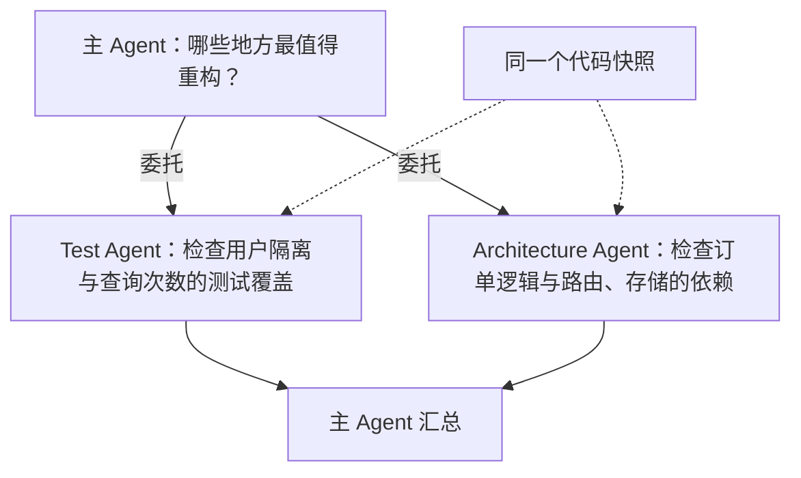
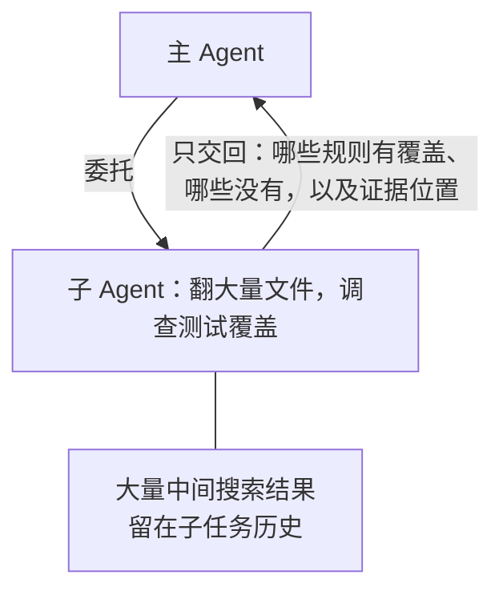
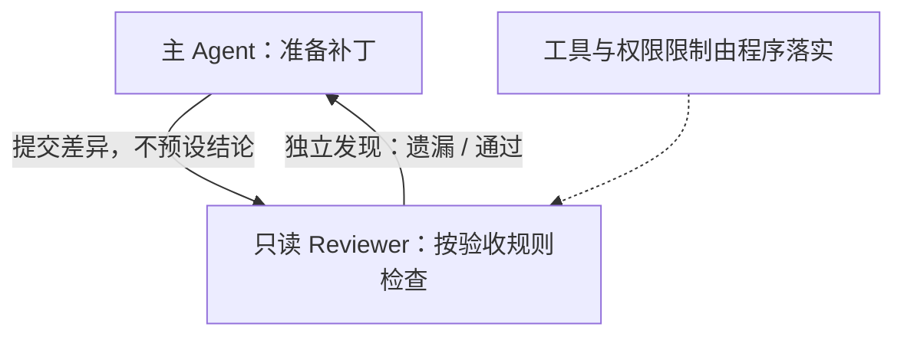
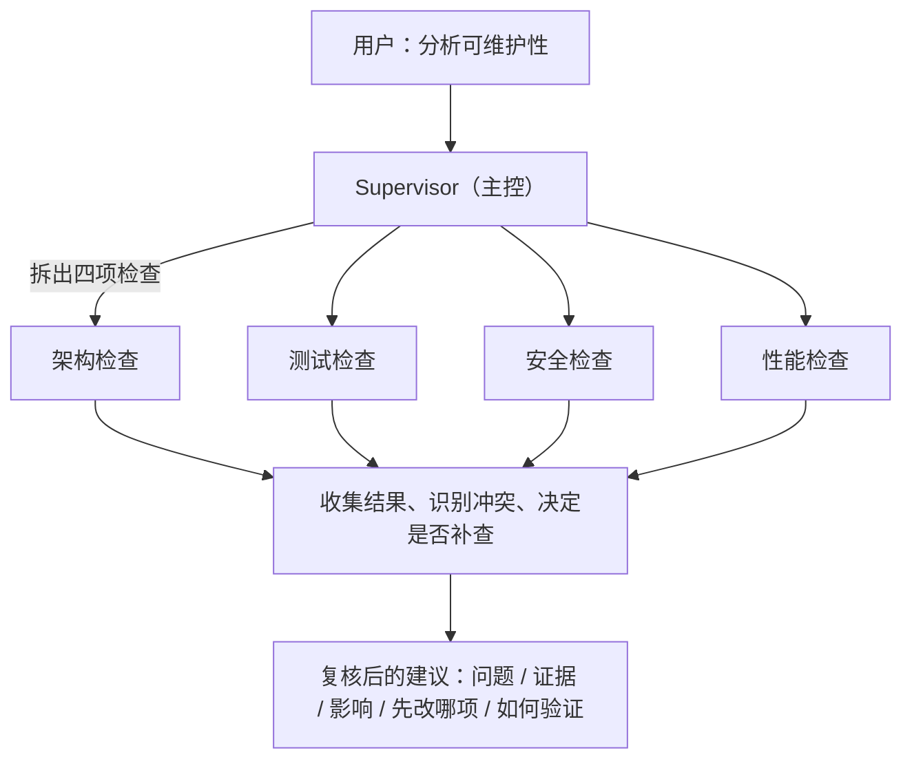
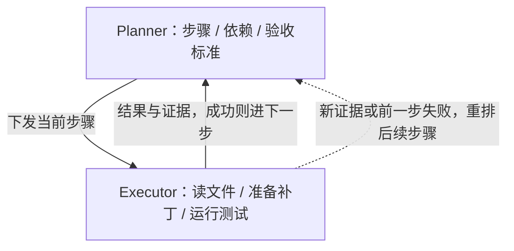
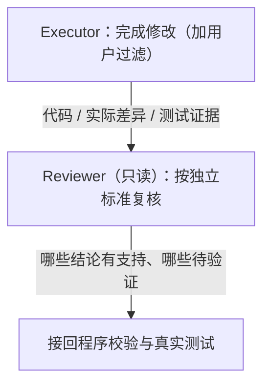

# 5\.1 PPT

# 5\.1 Multi\-Agent 与 Subagent

## 开篇


**本章目标：**理解单 Agent 与多 Agent 的边界，掌握复杂任务拆解、子 Agent 协作、结果聚合和冲突处理；同时建立可量化、可回归、可持续优化的 Agent Eval 体系。


第四章我们解决了信息怎么用的问题——搜代码、读取文件、改代码、运行测试这类任务，一个 Agent 就能完成。


但是，当用户换一个要求：“请分析这个项目的可维护性，并给出可执行的重构建议。”时，单靠读取代码就不够了。我们还要看模块依赖、测试遗漏、鉴权边界和性能问题。


容易出现两种情况：

一是上下文里出现"测试通过"字样，就容易过早结束；

二是上一阶段已经形成一个“决策依据”，后面的分析极可能围绕它展开。


但是，多 Agent 不是万能的，Agent 的数量不是能力指标，任务完成质量才是。


所以**只有任务确实存在可以独立处理的部分，而且分工收益超过协调成本，才值得增加 Agent。**


## 一、先判断能否用单 Agent 完成

演示代码：

> 它的核心是一个订单查询函数 `list_orders`，接口按用户查询订单列表，每条订单再带上商品明细。
> 数据放在两张表里：`orders` 记录订单号和所属用户，`order_items` 记录订单下的商品。业务规则写在 `docs/current.md`：只能返回当前用户的订单，订单和明细合计最多查询两次且不随订单数增长，查询参数必须绑定；同时规定审查阶段只读，修复只允许修改 app/orders\.py，不得改动现有测试。
> 项目里还有一份测试 `tests/test_orders.py`，以及一份已经废弃的旧规则文档，不能作为验收依据。
> 
> 


哪些需要单 Agent，哪些需要多 Agent ？

第一个任务是“给订单查询补上当前用户过滤，并通过相关测试”。


同样的，**文件多也不等于需要多 Agent。**


多 Agent 适用场景：

1. 子任务能否独立产出结果？

2. 各自需要的信息是否明显不同？

3. 最后的结果能否按统一规则合并？


**需要协作，并不等于要同时启动多个 Agent。**

---


## 二、什么时候把子任务交给 Subagent

概念辨析：
Multi\-Agent 是一种协作形态：一个任务拆成几块，多个 Agent 分别承担、互相配合。
Subagent 是这种形态里最典型的一种关系，它强调主从关系。


还是以订单项目的综合审查为例。用户的问题是“分析这个项目的可维护性，并给出可执行的重构建议”，主 Agent 要先回答“哪些地方最值得重构？”，其中一项工作就是检查测试覆盖。


启用 Subagent，三个判断依据：


第一种是能**让互不依赖的调查同时进行**。




第二种是把大量中间信息留在子任务里。




最后一种是需要单独的检查视角或工具范围。




如果只是补一个查询条件，读源码、修改和测试都围绕同一处代码，主 Agent **直接完成**通常更省事。


给子 Agent 写提示词也有技巧：**委托说得越清楚，它越可能一次做对。**


比如：

> 给 Test Agent 的提示词可以是：“检查用户隔离与查询次数是否有测试覆盖，找出缺失项，并提供测试名称、文件位置和未验证事项。只读，不修改文件，不运行命令。”
> 
> 


判断它是不是 Subagent，要看是否有单独运行的任务状态和工具循环，不能只看模型名称或角色名称。

---


## 三、三个常见模式分别解决什么问题

第一种，Supervisor Pattern，也就是主控模式。




第二种，Planner / Executor Pattern，也就是计划与执行分工。




第三种，Reviewer Pattern，也就是执行之后增加复核。




这三种模式可以组合，但不要一开始就堆起来。如果涉及完整的代码审查流程，可以先用 Supervisor 完成只读审查，再用 Reviewer 复核发现；用户授权修复后，才进入计划与执行。

---


## 四、并行要看依赖，隔离要靠程序


分工要跑起来，还取决于两个前提：任务之间的依赖关系决定谁能并行、谁必须等待；多个 Agent 之间的上下文、工具和权限需要真正隔开。


并行依据是依赖关系，不是角色数量。


“同时做时怎么互不干扰”，也就是隔离。


隔离要分三层理解。

上下文隔离，是每名子 Agent 使用独立消息历史，不把未经复核的其他结论默认当成自己的依据。


工具隔离，是每名子 Agent 只获得任务需要的工具。


权限隔离，是执行时继续检查允许的路径、命令、网络和写入范围。


如果多个执行者确实需要修改代码，应使用独立工作目录或工作树，分别保留补丁与被测快照，最后再按顺序合并和测试。不要让它们在同一个可变目录里同时改同一个文件。

---


## 五、预算和冲突决定系统能否可靠结束

每个子任务都要设置最大执行时间、最大模型调用次数、最大工具调用次数和 Token 上限。


主任务还要有全局预算，不能允许每个子任务分别不超限，合起来却远超总额。


什么是冲突呢？比如：

业务资料对管理员与普通用户的范围规定不同，先核对当前身份与接口用途。不能把管理员能力套给普通用户；要求仍有冲突时，向有权确认规则的人交接，并保留未完成项。

---


## 六、直接运行 pi：观察委托与并行


```Bash
export PROJECT_DIR="/absolute/path/to/order-project"

pi install npm:pi-subagent-extension

mkdir -p ~/.pi/agent/agents

cat > ~/.pi/agent/agents/course-scout.md <<'EOF'
---
name: course-scout
description: 只读检查订单源码或测试，返回可核对的发现。
tools: read, grep, find, ls
---
按委托范围读取文件。结论附文件位置与原文摘要。
不修改文件，不执行命令。不把未测试写成测试通过。
EOF

cd "$PROJECT_DIR"
```

pi\-subagent\-extensio 的文档地址：https://pi\.dev/packages/pi\-subagent\-extension


进入 pi 并切换到订单项目后，输入下面这段指令：

```Plaintext
使用 subagent 工具的 parallel 模式，委托两个 course-scout：
第一个检查 app/orders.py 是否按当前用户过滤；
第二个检查 tests/test_orders.py 是否覆盖用户隔离、明细完整性和查询次数。
共同规则：只返回当前用户订单，完整返回明细，SELECT 最多两次。只读取，不修改，不运行命令。
每项返回：已读取文件、具体发现、证据、没有验证的事项。
主 Agent 收集后解释两份发现能否互相支持，不得声称已经修复。
```

运行之后，重点不是看它答得好不好，而是看它有没有按委托真的执行。

重点看三个位置：1\. 主 Agent 是否真的调用了 `subagent`；2\. 参数是否采用 `tasks` 数组；3\. 返回结果是否分别保留两项检查。模型只说“我会并行”，不能证明并行发生。

如果没有调用，补充一句“请实际调用 subagent 的 parallel 模式”；如果工具根本没有注册，先检查扩展加载错误，不把普通回答当演示成功。任务较慢时，使用课前真实录制的过程讲解，保留执行记录和版本。

这次演示只证明委托、独立上下文和结果返回。只读工具列表不等于操作系统 Sandbox；没有测试工具，也不能证明接口验收通过。

观察完行为，再看一眼它的实现，就能把现象和原理对上。

最后打开示例 `index.ts`，搜索 `runSingleAgent`、`spawn` 和 `mapWithConcurrencyLimit`。先看单次委托怎样创建独立 pi 子进程，再看并行怎样限制同时运行数量，最后看取消怎样终止子进程。这里只讲函数职责，不需要背源码。

记住三条经验：子任务要独立状态，并发要有上限，退出和取消要有回传。不过示例只是示例：证据复核、全局预算、权限隔离还得靠 Harness 补上，不能因为它能并行，就以为平台已经完整。

## 小结

今天我们建立了一个边界：目标集中、依赖紧密的任务，先用单 Agent；存在独立检查方向、信息范围不同而且结果可以汇总的任务，再考虑分工。

Subagent 帮主 Agent 执行明确的子任务。Supervisor 管拆解和决策，Planner 与 Executor 区分计划和执行，Reviewer 检查结果。程序负责状态、隔离、预算和取消，证据决定结论能否成立。

一句话收尾：多 Agent 不是越多越好，而是该拆才拆、拆了还能管得住，才值得。

