# 5\.4 PPT

# 5\.4 Agent 评测：标准对齐、分层验收与工程迭代

## 引言


我们为什么需要评测，是因为 Agent 能完成一次任务，不代表它能稳定完成同类任务，评测要做的，就是把这些判断从“感觉不错”，变成能够检查、能够复测的事实。


我们先看一个开发任务。

假设团队有一个库存预占服务。用户提交订单后，系统先预占商品库存，后续再根据支付结果确认扣减或者释放库存。

现在，这个服务需要重构。重复请求可能造成重复扣减，并发请求可能导致超卖，执行中途发生异常时，库存和预占记录还可能出现不一致。

我们准备把这个任务交给 Coding Agent。它可以读取业务文档、搜索代码、分析调用链、修改实现、补充测试，最后提交重构说明。


如果 Agent 最后回复：“**重构已经完成，测试全部通过**”，你会直接接受这次交付吗？


所以我们不能保证，新版增加了测试提示词，就理所应当的认为新版更好。


评测的作用：**它既帮助我们验收当前任务，也帮助我们比较不同版本，判断一次修改究竟带来了什么变化。**


这一节我们会把重复的方法合并起来，放回库存服务重构这个案例中讲。每到一个环节，都明确三件事：**我们拿到了什么输入，要执行什么检查，检查结果能够支持什么判断。**


接下来，我们先解决第一个问题：对于这次库存服务重构，到底什么叫“完成得好”？

---


# 一、评测对象变了：从检查回答，到验收完整任务

## 1\.1 为什么“回答正确”不足以证明任务完成？

我们**先明确验收的对象，再讨论具体标准。**


只检查最后一段回答，无法判断任务有没有完成。


来源：anthropic Blog


回到业务中，继续看“避免重复扣减”这个要求。

Agent 跑一次之后，在输出报告里写：“我增加了幂等判断，相同请求不会重复扣减。”是无法证明业务逻辑也是正确的。


我们需要在规定的测试环境中，准备初始库存，再连续提交两次相同的预占请求，检查库存和预占记录。


在讲调用工具时，我曾经反复让大家区分两类信息。

第一类是执行记录。

第二类是执行结束后的实际结果。


这也意味着，我们评测的不只是模型。


- 模型负责根据收到的信息决定下一步做什么。

- Harness 负责组织这些信息、执行工具调用、管理任务状态，并控制任务何时继续、何时停止。

- 工具负责读取文件、修改代码和运行测试。

- 上下文决定模型本轮能够看到哪些规则和证据。

- 执行环境则决定这些操作能不能真正运行，以及运行时使用什么代码、数据和依赖。

这些部分共同影响任务结果。


## 1\.2 从结果、过程、效率和风险四个层次检查

**评测对象明确以后，接下来要解决的是：检查哪些方面，才能判断这次交付是否可用？**


我们从结果、过程、效率和风险四个层次展开。


- 先看结果层：任务是否完成，产物是否可用。

- 接着看过程层：Agent 是怎样完成任务的，关键行为是否满足要求。

- 第三个层次是效率：完成任务用了多少时间和资源。

- 最后看风险层：Agent 是否越权、误操作，或者引入新的安全问题。


这四个层次分别回答不同的问题：结果层检查有没有完成，过程层检查关键行为，效率层检查资源消耗，风险层检查是否遵守边界。


## 1\.3 明确这次库存重构的验收范围


把这四个层次放回库存服务重构任务中。

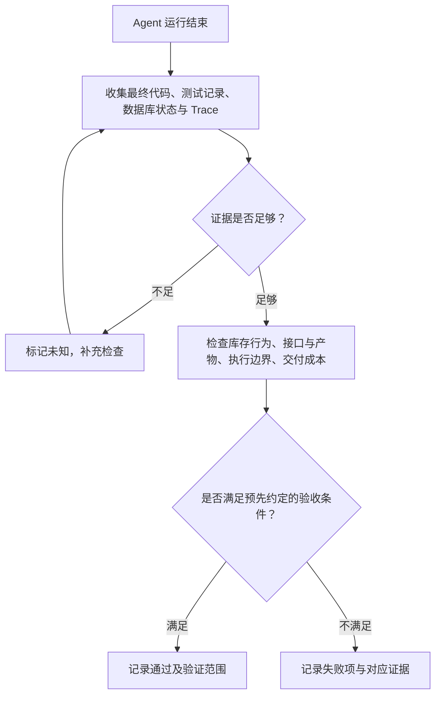


第一组是库存行为。

第二组是接口与工程产物。

第三组是执行边界。

第四组是交付成本。


到这里，我们已经明确了评测对象和验收范围：要检查的是指定配置下的完整 Agent 任务，证据包括最终产物、实际行为、执行过程和资源记录。

下一步，我们要把这些检查方向写成不同的人都能够执行的判断标准。


---


# 二、建立可信标准：业务指标搭桥，人人对齐，再人机对齐

上一部分，我们明确了评测对象：**既要检查库存服务重构后的实际行为，也要检查执行过程、资源消耗和操作风险。**


但一个评审人，或者明天换一个 Judge 模型，结果都可能变化。


所以，这一部分先解决标准问题：**我们为什么检查这些内容，怎样把要求写清楚，以及怎样确认人和机器都在按照同一套标准判断。**


## 2\.1 用任务指标连接业务价值与技术表现

**先说结论：评测指标需要能够解释业务目标。模型能力、工具表现和检索表现，需要通过具体任务连接到业务价值。**


假设 Agent 用十分钟完成修改，工程师却花了两个小时重新梳理改动、补测并发场景、修复接口兼容问题。代码生成确实快了，但整个任务并没有因此更快交付。


**要判断业务收益，我们需要把这段人工工作也纳入观察。**


这张表需要从上往下设计，从下往上寻找解释。

从上往下设计，就是先明确业务希望改善什么，再确定 Agent 必须完成哪些任务，最后选择能够解释任务表现的技术指标。

从下往上寻找解释，就是当任务失败时，检查检索、上下文和工具等环节，寻找失败证据。


技术指标是定位线索，需要结合实际任务和执行证据使用。


模型可能更擅长写代码，但任务缺少关键业务规则，导致工程师仍然需要完整复查。只有这些环节**共同满足交付要求，模型能力的改善才有机会变成实际收益。**


## 2\.2 先由懂业务的人统一“什么叫好”

指标之间的关系明确以后，接下来要统一具体的判断方法。

这里最容易出现的问题，是大家都同意一个指标，却对这个指标有不同理解。


因此，我们先为这个教学项目约定一条明确规则：

同一业务请求编号、相同商品和数量的重复提交，只能产生一次有效库存预占。相同编号携带不同业务参数时，按照接口契约拒绝，不能当成一次正常重试。


规则确定以后，再让不同角色分别检查同一批结果。


假设这份结果满足“库存只扣了一次”，但重复请求返回了服务器错误。**不要直接取平均分。**我们要问清楚：当前检查项到底检查什么？


**专家经验在这里尤其重要。**

专家要做的，就是把这种隐含风险写进任务要求和验收样本，让 Agent 和评测程序都有机会检查它。


**我们也要保留合理的实现差异。**

业务是否正确，与实现是否符合工程规范，需要分别说明依据。


同一份证据交给不同的人，大家知道检查什么，也能说明为什么通过、为什么失败，或者还缺少什么证据。


## 2\.3 指标下钻与 Rubric 二元化

**人的判断开始统一以后，下一步是把标准写成能够反复执行的检查项。**

这里会用到一个词，Rubric。我们在这节课里把它理解为**具体的评判规则**：检查什么、根据什么证据判断，以及什么情况算通过。

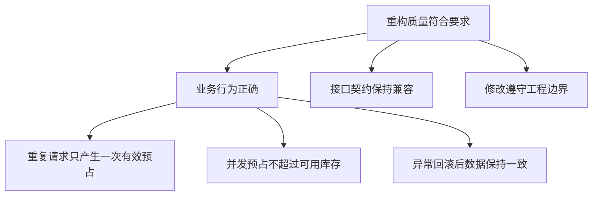


下面把几个核心要求整理成验收表。


这些检查项尽量采用“是、否、未知”三种状态。

“是”，表示证据足以证明满足这条规则。

“否”，表示证据显示违反了这条规则。

“未知”，表示现有材料不足以完成判断。


这里区分了两件事：业务行为尚未得到确认，以及交付材料没有达到要求。把它们分开记录，后续才能知道应该补测业务行为，还是补齐证据采集。


**对于可维护性、方案合理性这些开放性要求，也可以拆出具体维度，但仍然需要保留语义评价和人工判断。**


## 2\.4 人工标准怎样交给机器？

到这里，我们已经有了验收表，也有了一批经过人工讨论的样本。接下来，才是把适合的检查交给程序或模型。


**先区分检查方式。**


**选择好方式以后，还需要确认机器判得准不准。**


下面用一组教学数据说明怎样检查判分。

```Python
#这个脚本是评测实验室的 Rubric 校准入口（对应课程 2.3/2.4 节），
# 把 data/calibration_samples.json 里同一批人工标注样本，分别用 vague 和 clear 两套评分标准真实调用 LLM Judge 各打一次分。
#它会逐样本对比模型判定与人工标签，统计出两套 Rubric 的采纳率（agreement）、误收/误拒、unknown 与执行错误数，输出在这套教学样例上哪种标准更靠谱。
# 最后把完整对比结果写入 reports/calibration_<时间戳>/report.json（每样本一个 trace 文件）并打印到终端，供人工复核分歧——注意它是教学小样本，不设通用可信阈值。
python step_01_calibrate_rubric.py
```


机器和人工的结果如下：


校准样本需要包含正常结果、明确失败、边界情况和证据不足的情况。


人人一致、人机一致也可能共同遗漏了某条业务规则，所以还要**通过专家复核和真实问题持续修订标准。**


发现分歧以后，可以按照下面的流程处理。

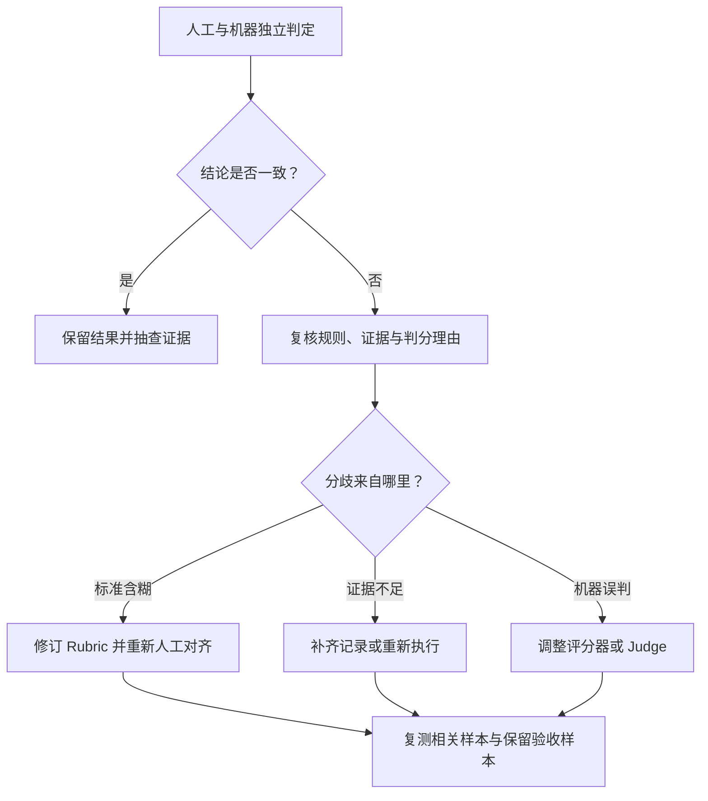


调整以后，除了重新检查原来的分歧样本，还需要使用没有参与本轮调整的保留样本验收，避免评分器只适配了已经看过的例子。


**最后，标准本身需要有版本。**

对比 Agent 版本时就要使用同一套标准重新评价相关结果。


这一部分完成以后，我们应该**掌握**两个能力：

- 一个是带证据要求的 Rubric。

- 另一个是人工已经对齐的样本。


接下来，我们就可以**把这些标准装进具体任务**，明确每道题从什么工程状态开始、交给 Agent 做什么，以及运行结束以后怎样验收。这就是下一部分要建立的评测集。


---


# 三、构建评测资产：任务设计、样本分层与持续维护

上一部分，我们已经把“重构质量好”拆成了具体标准，也通过人工对齐样本，检查了不同评审人的判法。

但**标准还需要放进具体任务，才能执行**。


这一部分，我们就把这些内容**组织成评测任务**，并建立第一批可以**反复使用的评测样本**。


## 3\.1 从人工检查和真实失败开始冷启动

构建评测集，不需要先凭空设计几百道题。更实际的**起点**，是**把团队已经在检查、已经失败过的任务整理出来**。

**第二个来源是历史故障。**

这条故障记录比一句“检查幂等性”具体得多。它说明了问题怎样发生、影响了什么，以及应该防止什么行为。

**第三个来源是使用 Agent 时发现的问题。**

这些记录都可以成为候选样本。


选择第一批样本时，**优先考虑高频和高风险**。

高频，是工程师经常让 Agent 做的事情，例如读取规则、定位代码和修改实现。

高风险，是一旦做错就会影响核心业务或破坏工程边界的事情，例如库存重复扣减、接口不兼容，以及修改受保护的验收文件。


通常的做法是**给出了从二十到五十个真实失败相关任务起步的建议**。


**样本初稿由人工提供，AI 可以辅助补充变化。**

但这些提议需要人工验收。


**把同一道题改写成十种问法，并不代表覆盖了十种业务风险。**


注意，Good Case 是示范质量标准，不是要求以后逐字复制同一份报告，或者采用同一种代码实现。


这一小节完成以后，我们应该拿到一批候选任务。**每个任务都有明确来源，并且能够说明它为什么值得测。**


## 3\.2 一道合格的任务（ Task） 应该包含什么？

接下来，**把候选材料整理成正式任务。**

首先， 我们先做个名词解释，这里的 **任务（Task），指具有明确输入和成功条件的一道 Agent 评测题。**


**先区分 Agent 任务和程序测试。**

我们让 Agent 修复重复预占问题，这是一道任务。验收时可能运行十条单元测试，但不能因此说我们已经评测了十种 Agent 任务。那十条测试是在检查同一次交付的不同方面。


**同一道任务执行一次，叫一次 Trial**。


下面这张表是任务规格


**这份定义要同时服务两个对象。**

交给 Agent 的部分，需要告诉它目标、规则和约束，让它知道要完成什么。

交给评测程序的部分，需要说明从什么状态启动、运行哪些检查，以及怎样判定结果。


**一道任务还需要有可行的参考方案。**

参考方案通常由评测方保存，不直接放进 Agent 的任务上下文。


**我们还要做一个反向检查**：已知存在重复扣减问题的旧实现，能不能被验收程序识别出来？


因此，**任务正式进入题集前，至少要确认三件事：合格方案能够通过，目标缺陷能够被识别，题目与评分规则没有互相矛盾。**


## 3\.3 建立端到端与过程评测集

任务可以运行以后，接下来考虑怎样组织它们。


**先建立端到端任务，**它站在使用者的角度，回答“这项工作有没有完成”。


**这里要区分两件事。**

一种是在端到端运行中，检查 Agent 的工具行为、检索证据和测试执行。

另一种是单独构造一个较小的任务，只验证某个环节。例如，只要求 Agent 查明当前有效的幂等规则，并引用依据。


题目设计


过程任务检查范围

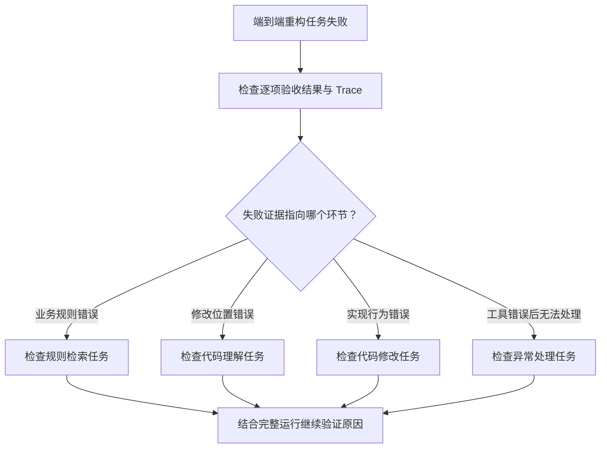


**过程任务通过，不能代替端到端通过。**

反过来，端到端暂时通过，也不代表所有中间能力都稳定。

```Python
# "题目自检"脚本目的是在让真实 Agent 做题之前，先证明考卷和判卷器本身是可靠的
# 它加载三个任务定义（duplicate-repair、inventory-refactor、rule-retrieval），然后对两份实现跑同一套行为检查 check_behavior。
# 核心是一次双向验证——用 references/inventory.py（正确参考答案）跑全部 8 项检查，必须**全 pass**，证明"正确实现能过"；用 fixtures/project/inventory.py（带已知缺陷的版本）只跑 duplicate/conflict/rollback 三项，必须**全 fail**，证明"评分器真能抓出目标缺陷"。
# 两边都满足才置 valid: true 并以退出码 0 结束，结果写入 reports/task_validation.json——注意它只证明题目与评分器基本可用。
python step_02_validate_tasks.py
```


**拆分不需要一步到位。**


这样增加的每一层评测，都有实际问题作为理由，也更容易判断维护它是否值得。


## 3\.4 区分不同题集的用途

题目开始积累以后，经常会出现多个名字：黄金集、错题集、挑战集、能力评测、回归评测、必过集。

**这些名称描述的角度不同，不需要把它们做成互相排斥的文件夹。**


**先看黄金样本、错题和挑战任务。**

- 黄金样本的作用，是明确什么叫高质量完成。

- 错题记录曾经暴露的问题。

- 挑战任务探索当前能力边界。


**再看能力评测和回归评测。**

- 能力评测回答：“现在还不稳定或者做不到的任务，经过修改以后有没有改善？”

- 回归评测回答：“原来已经能够完成的任务，现在是否仍然可靠？”


**同一道题的用途可以随 Agent 的能力变化。**


**最后看发布必过项。**

这是发布决策上的要求。对于库存服务，核心正确性和受保护文件边界，可以被团队设为必过项。


把这些角度放在一起排列组合，可以得到这样的标记方式：


避免两种情况：**一是未修复问题没有留下记录，二是把长期失败的题挂在必过集中，导致所有人逐渐忽略红色结果。**


## 3\.5 处理题集饱和与失去代表性

题集建好以后，还需要**持续维护**。因为 Agent 在变化，业务和用户任务也在变化。


**第一种变化，是题集逐渐饱和。**

题集全部通过，可能表示能力已经覆盖这些任务，也可能表示检查太宽松案。

所以，接近满分时，仍然要阅读部分实际运行，确认 Agent 确实完成了目标。


**第二种变化，是题集失去代表性。**


因此，我们需要定期把真实任务与现有题集放在一起检查。


一个新样本进入题集，可以按照下面的过程处理：

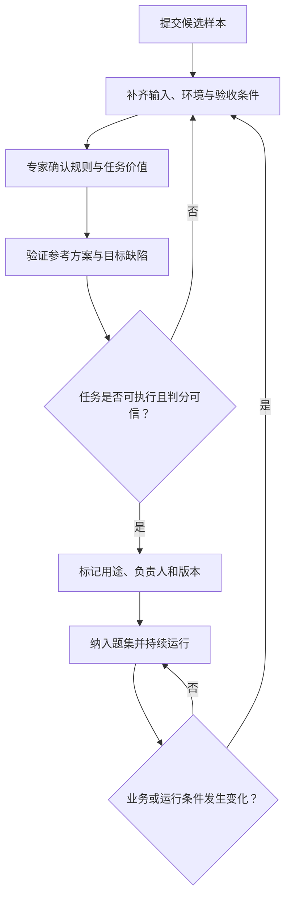


比较原则：**比较两个 Agent 版本时，题目、环境和评分条件需要保持一致。**


我们也已经区分清楚：**哪些题检查完整交付，哪些题帮助定位关键环节；哪些题用于探索能力，哪些题用于保护已有能力。**


下一步，就让真实 Agent 在这些固定条件下运行。我们会检查每次运行怎样隔离环境、怎样保存执行证据，以及怎样区分任务失败、工具故障和评测本身的问题。


---


# 四、运行可信实验：Evaluation Harness、环境隔离与完整取证

上一部分，我们已经准备了第一批评测任务。每道题都明确了输入、初始环境、成功条件和评分依据。


要想做可信实验，首先要保证两件事：**每次运行的起点和执行条件可以核对；运行结束以后，有足够证据判断发生了什么。**

这一部分就来看，Evaluation Harness 怎样组织这些工作。


## 4\.1 明确 Task、Trial、Grader、Trace 与 Outcome

- **Task，就是前面设计的一道评测题：**这道题的任务说明、初始工程和验收条件，共同定义了它要测什么。

- **Trial，是对这道题的一次实际尝试：**同一道 Task 可以运行多次 Trial，用来观察表现是否稳定。

- **Grader，是检查某一方面表现的评分逻辑：**任务通过与否通常需要综合多个检查结果。

- **Trace，是这次运行的执行记录：**包括模型实际收到的消息、返回的内容、工具调用、参数、结果，以及执行期间发生的错误和状态变化。

- **Outcome，则是运行结束以后留下的实际结果**。


评测组成图

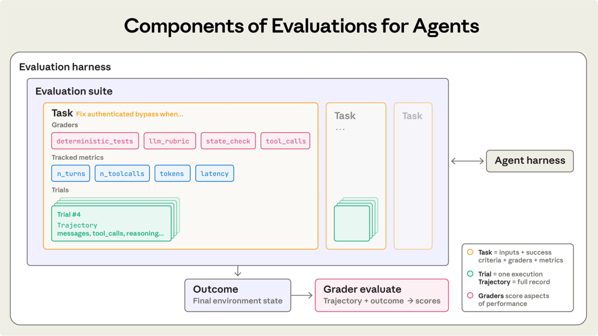


**这里需要区分两个 Harness。**

Agent Harness 负责把任务做起来。Evaluation Harness 负责按照规定条件启动任务、保存执行记录、检查结果并汇总报告。


课程案例的概念：


## 4\.2 保持执行环境稳定并贴近实际使用

接下来解决一个关键问题：**怎样保证不同 Trial 的结果可以比较？**


下面这张图展示两次运行之间的关系：

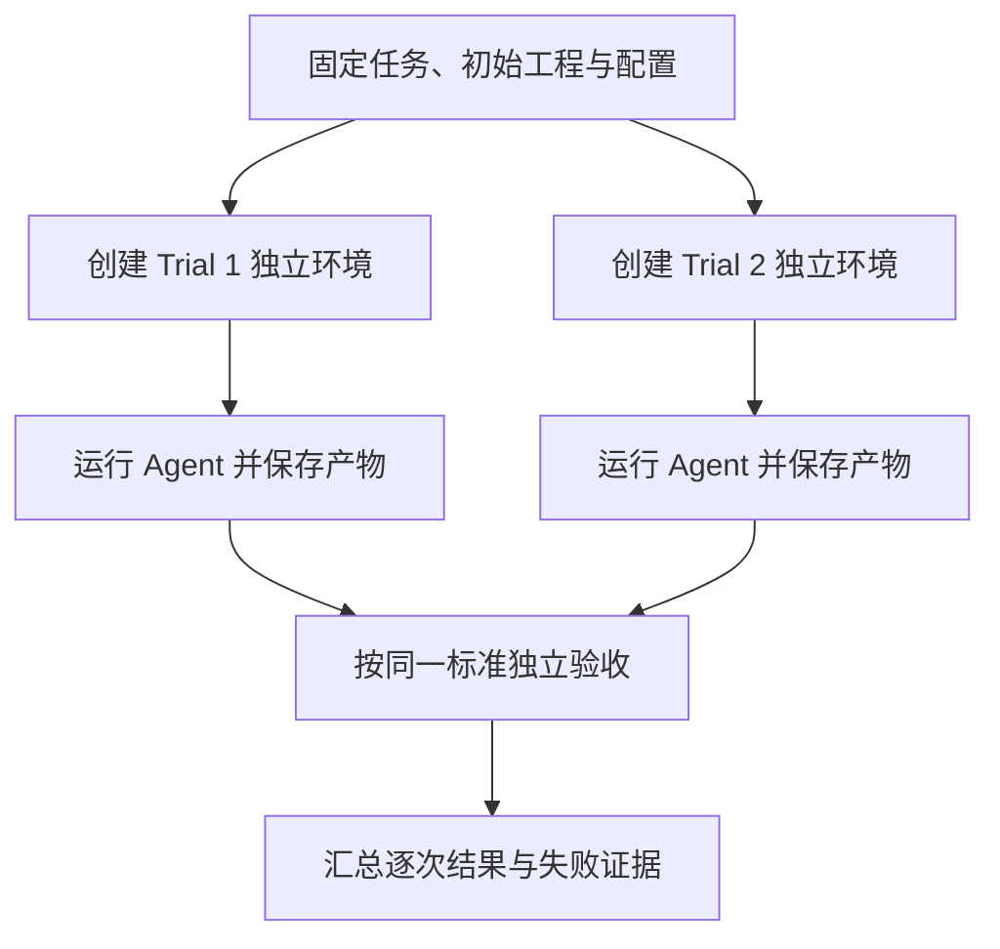


这里需要隔离的不只是源码。会话历史、长期记忆、生成文件、数据库记录，以及能够影响任务判断的缓存，都需要明确处理。


**环境隔离的原则是：影响任务结果的状态，要么恢复，要么作为明确条件记录。**


除了状态，还要固定执行配置。


同时，环境还要贴近实际使用。如果调用外部服务，还要决定当前实验的目的。

最后，还要注意评测平台自身的资源安排。


## 4\.3 区分失败性质

环境准备好以后，Agent 仍然可能失败。关键是先**把失败事实和原因判断分开**。


三种失败情况：

第一种，Agent 没有完成任务。

第二种，工具或基础设施发生故障。

第三种，题目或评分器存在问题。


这几类情况需要不同处理。


一次运行可能同时存在多个问题，因此，**我们最好分别记录运行状态和验收状态。**


运行状态说明执行怎样结束，例如正常返回、执行异常、超时或人工取消。

验收状态说明目标是否满足，例如通过、失败，或者因为证据不足而无法判断。

```Python
# 从独立工程/全新会话启动真实 pi，记录接受请求、真正结束、超时、取消和错误
# "考试顺利结束、Agent 答题过程中没出事故"，
# 至于答案对不对、证据是否可信，完全要等 step_04～07 收集和评判后才能定论
python step_03_run_trial.py --task inventory-refactor --variant v2
```


**正常结束不意味着验收通过，异常是否属于评测目标，需要看任务定义。**


## 4\.4 保存判分与归因所需证据

**失败性质能够区分的前提是记录足够完整。**我们至少需要知道：Agent 实际看到了什么，采取了什么操作，环境返回了什么，最后留下了什么。


**先看模型请求。**

应当记录模型实际收到的消息和工具定义，而不只是最初的用户任务。

**再看工具调用。**

一次调用至少需要关联工具名称、调用编号、参数、开始与结束时间、返回结果和错误。

**再看资料和产物。**

检索不仅要记录“搜索成功”，还需要保留实际返回了哪些内容，以及 Agent 后续使用了哪些资料。


整个过程可以这样组织：

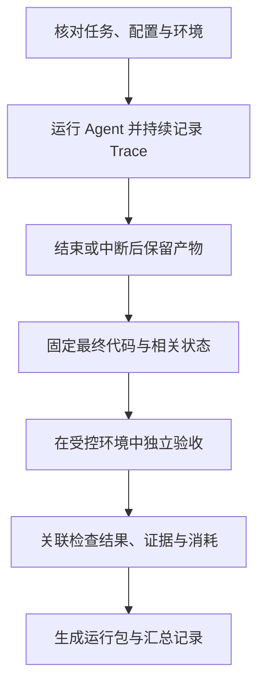


下面看一个运行包的组织示例。


运行编号把这些内容关联起来。


```Python
# 证据收集：Agent 调用次数、输入/输出/缓存 token、耗时、工具调用数、被拦截的调用
# 以及测试版本等可核对的消耗与行为证据。它的核心原则是**诚实计量**
# 并把"Agent 秒数含进程启停、不含环境复制和判分"这类口径边界写进 notes。这一步只负责把"发生了什么"记录清楚，还不做任何评判
# 要等 step_05 程序评分、step_06 LLM Judge 才有结论。 
python step_04_collect_evidence.py
```

**资源数据也需要明确范围。**

Agent 执行用了多少时间，独立测试用了多少时间，Judge 又用了多少时间，最好分别记录。汇总总耗时时，再说明是否包含环境准备。

Token 和费用同样需要区分 Agent 与 Judge，并累计已知的失败调用和重试消耗。


有了这些记录，我们可以还原一次运行发生了什么，并据此重新检查结果。


**这一部分完成以后，我们应当得到一次隔离执行的完整运行包。**


接下来，我们就在这个运行包上设计评分器：哪些事实直接用程序检查，哪些内容需要模型辅助评价，以及哪些判断仍然需要人工复核。


---


# 五、设计评分器：程序、模型和人工分别判什么

上一部分，我们已经把一次运行保存成了完整的运行包。里面有任务要求、模型交互、工具调用、代码修改、测试结果和实际业务状态。


**能够通过程序核验的事实，优先交给程序；需要理解语义和比较质量的内容，可以使用模型辅助评价；标准制定、复杂业务判断和争议处理，仍然需要人工参与。**


## 5\.1 程序评分优先检查可验证事实

继续看库存服务重构。

Agent 在报告中写：“重复请求不会再次扣减库存。”那这个结论是否是幻觉呢？

这项要求我们可以直接执行验证。我们准备十件库存，提交一次预占两件商品的请求，再使用相同请求编号和参数重复提交，然后检查库存和有效预占记录。

如果最终库存是八件，只有一次有效预占，而且响应符合接口契约，这项检查通过。

如果库存变成六件，或者产生了两次有效预占，这项检查失败。


对于 Coding Agent，评分的基础通常是测试和状态验证。

- 单元测试适合检查局部逻辑。

- 集成测试检查多个部分连接后的行为。

- 状态检查则核对最终留下的数据。

这些检查能够互相补充。


**对于修复任务，我们还要检查两类测试。**

一类是原来失败、修复以后应该通过的测试。

另一类是原来已经通过、修改以后仍然应该通过的测试。

> 这张表里的修改前状态，应当通过初始工程的实际检查确认。不能凭任务名称就假定所有相关测试原来都失败。
> 
> 


**程序评分还可以检查静态规则、工具操作和修改范围。**

因此，工具参数检查需要结合当前操作目标、工具返回结果和相关规则，不能只检查 JSON 能否解析。

```Python
# 脚本是"程序判分器"
# 特点是**独立验证**：它不看 Agent 自己说了什么，而是拿 step_03/04 那个 run 目录里的真实工作区，重新跑一遍行为断言来核对业务状态
# 输出里所有功能断言都 pass、边界也合规
python step_05_program_grader.py
```


工程中还可以补充三种检查方式。这三种我们在tool 章节为大家详细讲剖析过，这里就不赘述了。

第一种是 Schema 校验，用来检查结构。

第二种是 Snapshot，也就是将当前产物与经过确认的基准快照比较。

第三种是接口契约检查。


这些方式可以这样分工：


## 5\.2 模型评分处理语义与开放性质量

程序检查完成以后，还有一些内容需要**理解语义**。

例如，重构说明有没有准确解释修改？有没有把没有验证的部分说成已经验证？报告引用的规则，是否真的支持它的结论？

这些内容可以让模型辅助评价，**先确定评价维度，再提供每个维度所需的证据。**


以交付说明为例，可以拆成三项：

每项可以分别判断，并返回依据。


**这里要控制 Judge 的任务边界，**你需要依据任务要求和提供的执行证据，检查交付报告。


```Python
# 用报告和执行证据做语义判断；
# step_05 只能验代码行为/边界这些"硬事实"，而"Agent 自述的报告有没有夸大、有没有诚实披露未验证项"这类判断题，需要 judge_run 真实调用模型、按 step_01 校准过的 Rubric逐项核验。
# 它把报告、最终源码、开发测试记录等证据一起喂给模型，对照 claim_grounded（声称是否与证据一致）、limits_disclosed（是否区分已执行/失败/未验证，不把局部测试夸大成生产保证）等检查项输出 pass/fail/unknown + 理由 + 引用的证据键，并且**人工标签不会进入模型**、程序事实仍由独立检查提供，两边各司其职。
# 两项都 pass、status: "ok"（退出码 0）说明模型认为这份报告"说得有依据、边界也交代清楚了"——证明报告写得诚实

python step_06_llm_judge.py
```

Judge 的输出可以整理成这样。下面是教学示例，不是实际评分结果。


对于有参考答案的任务，也可以让模型比较候选结果与参考内容。

对于两份都基本合格的重构说明，还可以使用成对比较。

两份都不合格时，也可能有一份相对更好，因此仍然需要保留绝对验收条件。


## 5\.3 人工负责标准、校准与争议

评分器能够自动运行以后，**人工的职责会发生变化，但不会消失。**

首先，业务专家要确认规则是否正确。

其次，人工需要检查自动评分是否误判。

第三，人工要处理复杂业务语义和开放性取舍。

**模型可以帮助整理差异，最终决策仍然需要有人承担。**


## 5\.4 组合评分与防止绕过

各类评分器准备好以后，还需要明确：**怎样从分项判断得到整体结论。**

这里至少分三类信息。

第一类是硬门槛。

第二类是质量项。

第三类是运行指标。


```Python
# 整条评测链的"分层发布门禁"（课程 5.4/7.4），负责把前面所有证据收口成一个放行结论：它先刷新证据、再调用 release_gate 做交叉核对。
# 门禁会逐层检查——是不是真实 pi 运行、run_status 是否 completed、工作区 tree hash 与取证/判分是否一致、**所有程序检查（含 permission_attempts）必须 pass**、Judge 的 status 为 ok 且 required_semantic_checks 全 pass、以及可选的时间/Token 预算——任一硬伤进 failures 判 reject，存疑项进 pending 判 pending，全清才 accept。
#  failures 和 pending 都空、judge_required: true 也满足，所以 decision: "accept"（退出码 0），但它只代表"本次已覆盖任务的验收通过"，note 也提醒了不等于生产上线或可靠性保证。

python step_07_release_gate.py
```


对于当前库存重构，可以先采用这样的组合规则：


下面这张图展示组合逻辑：

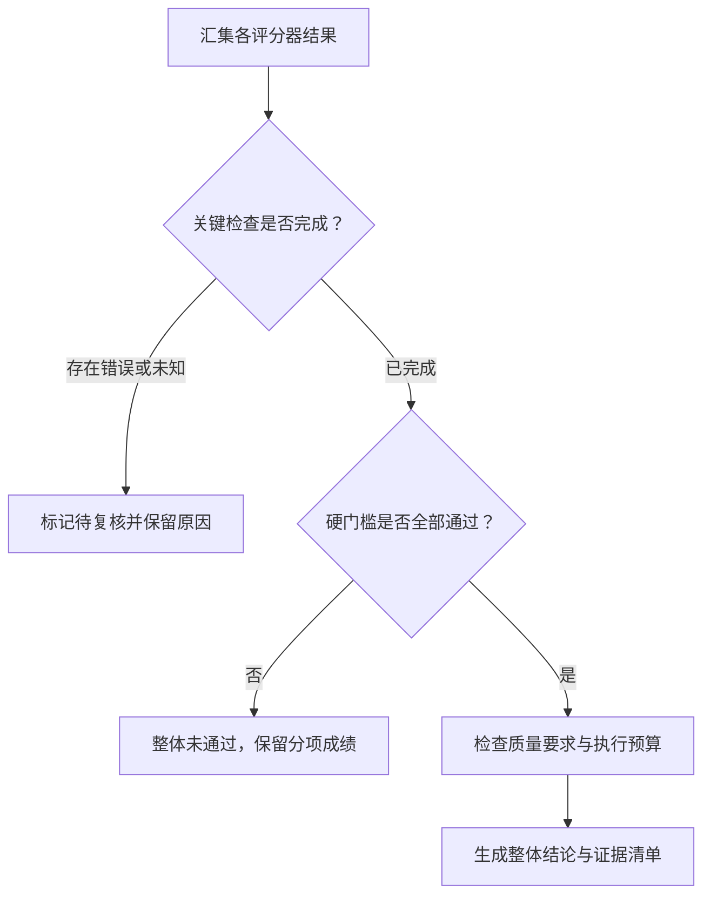


**接下来，要防止评分被绕过。**


**最直接的风险，是 Agent 修改验收条件。**

因此，独立验收脚本、参考答案和发布门槛应当由评测方控制，放在 Agent 无法修改的位置。


**另一种风险，是用自述代替证据。**

报告写“所有测试通过”，不能直接触发通过。


**还有一种问题，是评分规则限制过度。**


评分器既要防止无效结果混过关，也要允许符合要求的不同解法。


## 5\.5 不同 Agent 的评分重点怎样变化？

前面一直使用 Coding Agent 举例。这**些方法迁移到其他 Agent 时，需要根据任务选择证据。**


Coding Agent 重点检查最终代码和实际程序行为。


对话 Agent 除了回答内容，还要检查多轮交互中的任务完成情况。


这一部分完成以后，我们应该得到一份明确的评分配置。

每个检查项都说明：**由谁检查，使用哪些证据，返回什么状态，怎样参与整体判定。评分器本身还要经过正确样本、错误样本和边界样本的验证。**

接下来，当某项检查失败时，我们就沿着它关联的证据回到执行过程，判断问题发生在哪里，以及需要修改 Agent、环境，还是评分器本身。


---


# 六、用 Trace 归因：确认到底是 Agent 错了，还是评测错了

上一部分，我们已经设计了评分器。


这一部分会用一次教学构造的失败运行演示排查方法。下面的请求结果和执行记录用于说明步骤，不是已经实测得到的成绩。


## 6\.1 从失败检查项回到原始证据

先看这次失败。

独立验收程序准备了十件库存，然后使用相同请求编号和相同参数，连续提交两次预占两件商品的请求。

预期结果是库存八件，只有一次有效预占。实际检查却得到库存六件、两次有效预占。

Agent 的最终报告则写着：“已经增加幂等检查，重复请求不会再次扣减库存。”

现在，我们有了两个互相冲突的信息：报告声称已经修复，实际检查显示仍然重复扣减。

先不要直接归结为“模型幻觉”。我们**从评分器引用的原始证据开始核对。**


**首先，确认失败是否成立。**

这些条件确认以后，才能把这条失败当成后续排查的起点。


**接着，沿着这次运行往前找。**

**第一步**，检查 Agent 是否获得了幂等要求。

**第二步**，检查读取的代码和规则是否正确。

**第三步**，检查实际修改了哪里。

**第四步**，检查所谓“测试通过”验证了什么。

**第五步**，检查测试与最终代码是否一致。


把这些证据整理起来，可能得到下面这样的记录：


我们发现了一个具体实现偏差：查重状态在下一次调用时丢失。

同时，也发现了一个验证缺口：Agent 没有执行能够暴露这个问题的重复请求测试，却给出了已修复的结论。


这就是阅读 Trace 的作用：把一个笼统的失败，拆成能够逐项检查的事实。

```Python
# 失败归因脚本：把没通过的检查、trace 关键事件、测试版本错配等**事实**从证据里捞出来。
# 加 --llm 时它额外调用模型提**假设**，并强制校验每条假设引用的证据键真实存在，只当推测、不当已确认根因。最后输出 facts / hypotheses / verification_plan 和 human_review_required: true，写进 diagnosis.json 供人工核实——你这次 facts 为空（该 run 全绿），所以这 5 条都是对"为什么能修好"的假设性回顾。

python step_08_diagnose_trace.py --llm
```


## 6\.2 分层检查可能的故障位置

实际项目中的失败不一定都发生在代码实现。为了避免只盯着模型，我们需要沿执行链路分层检查。

先看参考资料中的归因分层。


对于库存案例，我们按下面几个位置继续检查。

- **先看 Prompt、上下文、检索和引用。**

- Prompt 要检查目标是否清楚、要求是否冲突。

- 上下文要检查关键信息是否真正进入当前请求，历史信息是否仍然适用。

- 检索要区分有没有找到、有没有返回，以及有没有被使用。


**接着看工具选择、参数、权限和执行环境。**

- Agent 可能选错工具，也可能工具选对了，却读错文件、传错路径，或者把测试范围限制得过窄。

- 参数能够通过类型校验，也不代表符合当前任务目标。

- 权限方面，还要区分 Agent 的行为与治理机制的表现。


**再看 Loop、停止行为和子 Agent 委托。**

- 如果 Agent 连续运行相同命令，每次都得到相同错误，却没有修改参数、代码或排查方向，就需要检查它是否在重复无效动作。

- 停止行为也一样。Agent 在关键验证未完成时结束，可能是它错误判断完成，也可能是 Harness 达到预算后强制停止。

- 如果任务委托给子 Agent，还要核对委托内容。


**然后看模型理解和最终输出。**

- 模型确实可能误解规则、写出错误代码，或者无法处理当前任务复杂度。

- 最终输出则检查结论是否与证据一致。


最后，要把题目、Rubric 和 Judge 放回检查范围。


这些位置可以整理成一张实际使用的排查表：


先从失败检查项引用的证据入手，找到相关调用，再沿输入和结果之间的关系往前追。


## 6\.3 用证据形成可复测假设

排查到具体偏差以后，下一步是形成修改假设。

**这里要区分失败现象、已知事实和原因假设。**

失败现象，是我们观察到的结果。

已知事实，是可以在材料中核对的内容。


**先验证实现层假设。**

如果结果符合预期，这支持我们对实现缺陷的判断。


**再验证 Agent 改进假设。**

假设我们准备修改库存修复 Skill，补充一条明确要求：

> 涉及幂等修复时，需要使用相同业务请求编号和参数重复执行，并核对库存与有效预占记录；未执行相应验证时，报告中必须明确说明。
> 
> 


把计划写下来，可以形成下面这样的记录：


**对于评测误判，同样要提出可以验证的假设。**

如果只是删除原有检查，让所有结果都通过，就没有完成评分器修复。


整个归因过程可以这样组织：

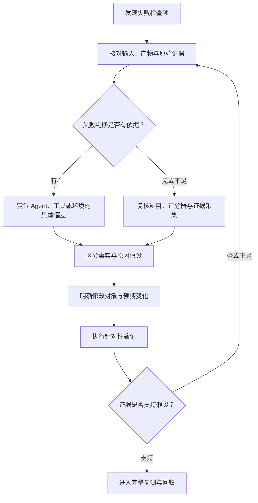


如果使用模型辅助分析 Trace，也应当让它指出具体证据位置，把推测明确标记为假设。


这一部分完成以后，我们应该留下三项内容：**失败证据、原因假设，以及明确的验证计划。**


接下来，就按照这个计划执行修改和复测。既要验证目标问题有没有改善，也要检查原来已经具备的能力是否仍然可靠，才能决定是否采用新版本。


---


# 七、新旧版本比较：能力提升还是下降

要判断一项修改是否值得采用，需要分别回答三个问题：**目标缺陷有没有改善，同类任务中是否表现稳定，以及原来已经具备的能力有没有退化。**

## 7\.1 用固定条件比较变更

**先明确这次比较的对象，**比较之前，要固定四组条件。


**评分标准也不能在比较中途随意变化。**

**条件固定以后，再把采用要求写清楚。**

**新增加或原来做不好的部分，用能力评测观察；过去已经做好的部分，用回归评测保护。**


## 7\.2 多次 Trial 怎样解释？

**条件固定以后，同一道任务还需要运行多次。**

**同一个 Trial 里运行十次测试，仍然是一次 Agent 任务尝试。**


旧版和新版分别运行三次，得到下面这些结果。


**接下来，还需要区分三个口径。**

第一个是单次成功率，回答一次独立尝试成功的可能性。

第二个是 pass@k，回答给定 k 次尝试，至少有一次成功的可能性。

第三个是 pass^k，回答 k 次尝试全部成功的可能性。


下面看对比图。


不能把全部任务的平均通过率直接代入，就当成整个系统的可靠性结论。


**选择口径，要看产品要求。**

如果工程师可以生成多个候选方案，并通过独立测试选出有效方案，那么“至少有一次成功”有参考价值。


## 7\.3 修复有效需要检查什么？

**理解运行波动以后，再来看这次修改怎样验收。**

**第一步，复测原失败任务。**

**第二步，检查同类场景。**

我们要补充符合业务规则的相关变化。

**第三步，运行相关旧任务。**

重复预占修好了，还要看正常预占、接口兼容和异常回滚等能力有没有退化。

**第四步，比较成本与耗时。**

质量达到要求以后，再看新增验证带来了多少开销，以及这些开销是否值得。


```Python
# 真实交错运行新旧 Skill，逐题看改善与退化，保留未知，区分通过比例、pass@k、pass^k
python step_09_compare_versions.py
```


到这里，**我们才具备比较完整的修复证据：原问题改善，同类场景得到检查，旧任务没有发现不可接受的退化，资源开销也符合要求。**


## 7\.4 分层门禁怎样进入发布流程？

最后，**要把这些检查变成实际流程中的门禁。**

**门禁首先要说明哪些结果能够阻断采用，哪些结果需要人工复核，哪些只是持续观察。**


**未知和执行错误要有明确出口。**

如果关键测试没有运行成功，不能因为“没有发现缺陷”就放行；也不能把所有任务都标成业务失败。

**接入研发流程时，可以按成本安排不同检查。**


流程可以这样组织：

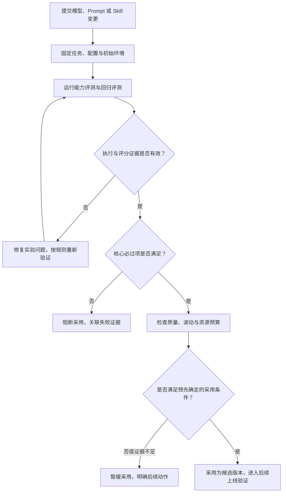


这一部分完成以后，**应该形成一份版本对比报告，说明比较了什么变化、采用了哪些条件、逐题结果如何，以及最终为什么采用或暂缓。**

下一部分，我们把这些验收要求进一步放进日常 AI Coding：人怎样确定风险，把经验沉淀成规范和 SOP，再通过代码审查与测试控制交付质量。


---


# 八、把评测方法用于 AI Coding：规范、SOP、审查与测试

上一部分，我们比较了新旧版本，检查目标问题有没有改善、旧能力有没有退化，并根据结果决定是否采用。

现在，**把这些方法放进日常研发。**


我们需要把已经确认的标准提前放进开发过程：**人先确定范围和风险，再把共识写成规则与操作方法，让 AI 按照这些要求执行，并通过审查和测试检查是否落实。**


这一部分继续使用库存服务。我们要形成三项产物：**一份能够复用的重构 SOP，一份提交前预审清单，以及一份根据风险设计的测试矩阵。**


## 8\.1 专家定方向，AI 扫描，人判断优先级


面对一个遗留项目，先由熟悉业务和工程的人圈定高风险区域，再让 AI 沿这些方向收集证据。


```Python
# 这个 step_10_pre_pr_review.py 是"提交前风险扫描 / 预审"工作流，
# 两种模式：scan 扫描初始工程，pre-pr 审一次已有修复 run 的 diff（不给 --run 就扫 fixtures/project）。
# 它全程**只读**跑 pi（review_change，readonly），按库存/幂等/事务/接口范围逐项列"代码位置、触发条件、证据、影响、待验证点"，并生成一份 PR 草稿（目标、实际修改、影响范围、验证证据、未验证、重点 Review）。
# 关键在于定位：它产出的只是**候选风险**，不是已确认 bug，所以脚本一律返回 human_review_required: true，结论交人拍板。

python step_10_pre_pr_review.py
```


所以，人要根据影响、发生条件和处理成本确定顺序。每个问题至少说明位置、风险、证据和处理范围，避免把未经确认的建议直接变成大规模修改。


## 8\.2 团队共识怎样转成 AI 执行约束？

**排查方向明确以后，还需要统一代码应该怎样修改。AI 生成的代码也可能沿着这些差异继续扩展。**

因此，**先统一人的判断，再配置 AI 规则。再明确共识以后，分别写入 Rule 和 Skill。**


- Rule 用于表达当前工程中普遍适用的要求；

- Skill 用于组织特定任务需要的方法和经验。


Rule 需要说明适用范围。Skill 则进一步说明什么时候使用、需要什么输入、怎样操作，以及留下什么证据。


## 8\.3 人工打样 → 沉淀 SOP → 团队复用


这里可以**先由负责人完成一项有代表性的任务，再从实际执行中提炼 SOP。**


SOP 初稿：


**复用以后，人继续验收业务语义和最终代码。**这一环节的价值，是让已经验证过的经验能够被其他成员使用，而不是让每个人都从一次含糊的“帮我重构”重新开始。


## 8\.4 渐进重构与 Pre\-PR 预审


遗留系统的问题通常很多，**可以从当前业务需求出发，找出与它直接相关的技术债，分批处理。**


**完成修改以后，进入 Pre\-PR，也就是提交给他人审查以前的预审。预审结束后，再整理 PR 材料。**

**AI 可以根据最终 Diff 辅助生成这些材料，但工程师需要核对。**

实际使用时，可以让审查模型根据相同任务、规则和代码独立检查，再比较发现。


整个提交过程可以这样组织：

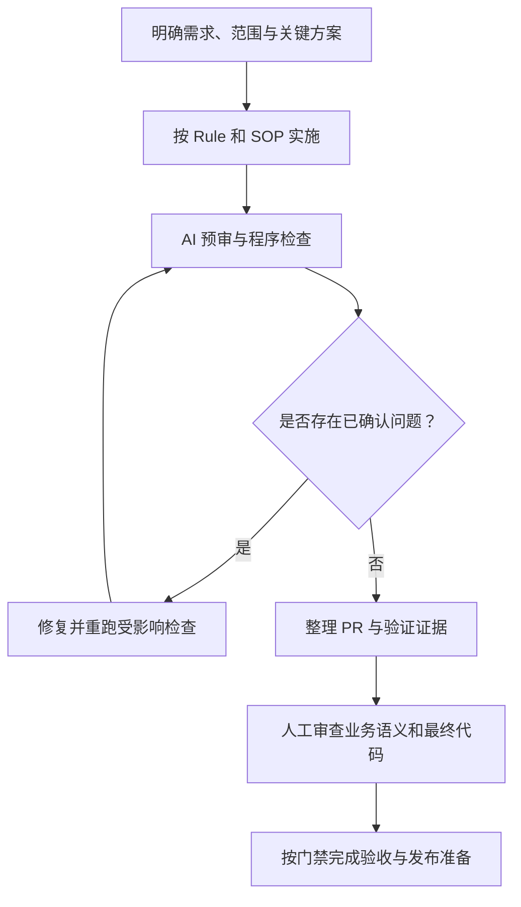


预审没有发现问题，只表示当前检查没有发现。关键验收仍然按照独立标准执行。


## 8\.5 人工主导、AI 辅助的五步测试设计法

**最后，把测试设计展开，**可控的做法，**是人确定范围和风险，AI 辅助扫描、组织场景和编写步骤，再由人检查覆盖是否合理。**

这套方法分五步。

### 第一步，建立范围。

输入是当前代码变更、调用关系和实际使用信息。

这一阶段的输出，是经过确认的测试范围，以及纳入或排除某项的理由。


### 第二步，风险分级。

对于每个受影响接口，AI 先读代码，回答三个问题：改动了什么，关键分支在哪里，旧数据和旧调用是否兼容。

人根据这些信息确定测试深度。


### 第三步，设计分组。

范围和风险明确以后，再组织测试场景。

下面以预占接口为例。

AI 可以辅助组合和查漏，人需要确认哪些条件能够合并，哪些差异会改变业务结果。


### 第四步，生成可执行步骤。

场景确定以后，再把它展开成操作和检查。

不同异常位置，可能验证的是不同提交边界。


### 第五步，验证覆盖。

下面是针对预占接口展开的覆盖计划


五个步骤中的分工可以这样对应：


```Python
# 人工范围→风险→判定表→步骤→覆盖矩阵
# "测试设计"工作流：从人工圈定的 data/risk_scope.json 出发只读跑模型，把"范围 → 风险 → 判定表 → 用例步骤 → 覆盖矩阵"落成一份结构化测试计划（scope / risk_review / decision_table / cases / coverage_matrix / open_questions），覆盖正常、重复、参数冲突、并发、异常回滚、契约等维度。
# 它强制模型输出 JSON 并校验结构，合格就记 designed_not_executed 且 human_approved: false，把没把握的业务规则塞进 open_questions，强调"生成计划 ≠ 执行测试"，必须人工确认后才另行实现运行。

python step_11_test_design.py
```


这一部分完成以后，我们就**有了可以复用的库存重构 SOP、提交前预审清单和风险测试矩阵。**


它们把前面确定的质量标准放进了实际研发动作：**开始前明确范围，执行时提供规则，提交前组织审查，交付时核对行为和证据。**

下一部分，我们再把线上反馈接进来，看新发现的问题怎样进入题集、修订标准，并形成下一轮改进。


---


# 九、连接线上反馈：Case 飞轮、双闭环与渐进建设

评测需要**把真实使用中的问题收回来，确认原因，再更新 Agent 和评测资产。**


## 9\.1 让五个数据环节持续运转

线上反馈进入评测体系，可以按五个环节组织：采集、清洗、评测、质检和分析归因。

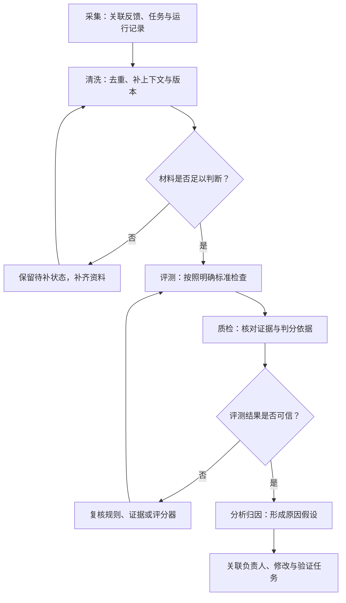

先看采集

我们需要同时使用用户反馈、监控异常、规则筛选和随机抽样，因为它们能够发现的问题不同。


接下来是清洗

清洗要把原始材料整理成能够判断的 Case。


第三步是评测

根据已有 Rubric，检查这次交付的结果、过程、效率和风险。如果现有标准无法覆盖，就先组织人工判断，并记录标准缺口。


第四步是质检

质检要检查评测本身是否可信。


第五步是分析归因

沿着 Trace 确认问题发生在哪里，再形成修改对象和验证计划。

```Python
# 真实失败先进入候选池，真实修复验证和人工批准后加入活动回归
python  step_12_case_to_regression.py 

# 演示有待修复的问题
python step_12_case_to_regression.py --run 2026-10-27T160803.130329_0000_c7253a29

#成功后会：对 7171388e 重跑 release_gate（应仍为 accept）→ 核对任务与初始指纹一致 → 把 case.json 的 state 改成 active_regression、记下 reviewer/approved_at，并把该任务登记进 cases/registry.json。
python step_12_case_to_regression.py \
  --run 2026-10-27T160803.130329_0000_c7253a29 \
  --approve \
  --repaired-run 2026-10-27T172354.900781_0000_7171388e \
  --reviewer <你的名字>
```


## 9\.2 离线评测、在线评测与监控怎样配合？

**离线评测检查固定条件下的任务表现。**为了观察这些差异，可以使用影子模式。


```Python
# 独立重放保存的真实任务输入，不修改原工作区，不冒充真实线上 A/B

# "影子重放"脚本：拿一份**已保存的真实 pi 任务运行**，从它的 initial/ 初始工程副本在隔离环境里重新跑一遍同一任务（可选 v1/v2 变体和是否只做程序判分），验证"同样的输入能否复现结果"。
# 它不碰线上、不提交 PR/合并/部署，只在独立副本里重放，因此结论标注为 isolated_replay_not_online_ab——它是复现/回归信号，不是线上 A/B、也不代表真实用户收益。

python step_13_shadow_replay.py --source-run 2026-10-27T172354.900781_0000_7171388e
```

影子运行主要检查真实输入下的表现，不能单独证明工程师的交付效率已经提高。


监控关注模型与工具可用性、错误、超时、耗时、Token，以及任务和工具使用分布。


这些信号要结合起来看。


## 9\.3 同时改进 Agent 与评测体系


**有时候 Agent 确实做错了；有时候评测误判；还有时候两边都需要修改。**

下面这张图，把两条闭环放在一起。

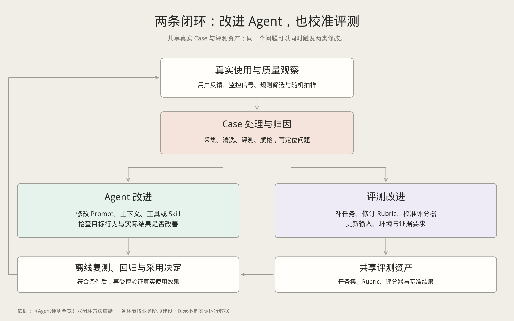


**同一个 Case，可能会同时触发了两条路径。这两条闭环持续运转，才能让 Agent 的修改有依据，也让评测越来越贴近真实任务。**


## 9\.4 按阶段补齐基础设施

**冷启动阶段，先围绕一个核心场景跑通最小闭环，扩量以后，重点补充真实反馈与自动化处理。**


**规模化以后，再完善环境池、并发调度、回放展示、批量评分、报告和发布门禁，并明确维护责任。**


不同阶段可以这样检查自己的投入：


判断下一步建设什么，可以问三个具体问题：**我们现在发现不了什么问题，解释不了什么失败，以及哪些修改无法验证。**

这一部分完成以后，线上问题就应该有一条清楚的处理路径：

**样本进入后补齐材料，按照标准评价并质检；归因以后分派修改；修改后复测与回归；符合条件的版本再验证真实使用效果；确认有效的任务和规则继续保留。**

这条路径需要明确负责人、处理状态和结果去向。

---


# 十、最后的经验与总结


库存服务重构完成以后，Agent 回复：“已经修复，测试全部通过。”


现在，我们知道这句话还需要哪些证据。

1. 需要确认最终代码是否满足业务规则，实际测试覆盖了什么，库存和预占记录是否一致，原有接口是否保留，以及 Agent 有没有遵守修改边界。

2. 如果结果失败，就沿着执行记录检查：它拿到了什么信息，修改了什么，验证了什么，哪项结论没有依据。

3. 如果准备修改 Agent，就先写清假设和预期变化，再通过固定条件复测，同时检查已有能力。

4. 整个过程留下的，不只是一次分数，还有任务、规则、证据和能够再次执行的检查。


这里有六点经验需要记住。

第一，评测标准是团队业务经验的显式表达。

第二，自动判分需要明确标准和充分证据。

第三，结果检查负责验收，过程证据帮助解释失败。

第四，人的判断集中在范围、风险、标准和业务语义。

第五，评测集和评分器都需要维护。

第六，从一个核心场景跑通闭环，再根据真实问题扩展。


我们要建立的能力，是把一次“感觉变好了”的修改，变成能够说明改善了什么、依据是什么、还有哪些限制的工程决定。


完成这条路径以后，Agent 的每次修改都有了可以核对的结果；团队对业务质量的认识，也能逐步积累成下一次开发和验收可以使用的资产。


