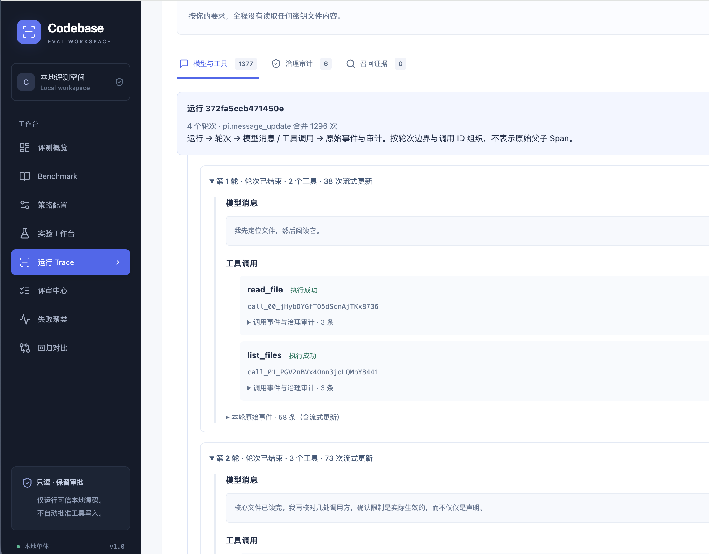

# 5\.5 PPT 

# 5\.5 项目演进路线 阶段五：Multi\-Agent \& Evaluation


**项目背景：** 掌握了单 Agent 构建能力后，需要将其升级为可协作、可评测、可迭代的多 Agent 平台，建立 Agent 质量保障体系。


## 一、引言


这一节课，我会继续沿用前面做好的 Codebase Agent，带大家完成一次更接近真实工作的软件交付。本节直接放进完整项目里用起来。


这一节课主要解决三个实际问题。

第一，公共 Skills，加上我在项目里沉淀的软件交付 Skills，怎么一起接进项目工作流。

第二，怎么通过 subagent 把一份大任务拆给不同角色的 Agent，让它们分别负责检查、产出和交接，再由主 Agent 汇总信息、做最后决策。

第三，怎么把上一节讲过的评测方法，结合这套 Skills 和多 Agent 协作，真正做成一个可以操作、可以复盘、可以留证据的 Eval Web 平台。


接下来始终围绕这个平台展开。我们先把公共 Skills 接进来，然后再接入我自己的软件交付 Skills。最后再按角色分工，实现 Evalution 平台的开发。


---


## 二、找对入口


本节先在 pi 交互入口接 Skills 和 subagent。


|文件|具体看什么|
|---|---|
|`src/cli.ts`|pi 怎样启动，配置路径和工作仓库怎样传过去|
|`src/pi/coding-agent-extension.ts`|项目工具怎样注册给 pi，每次调用怎样交给 Runtime，预算检查和审批怎样接进交互流程|
|`src/platform.ts`|新工具在哪里注册，Runtime、策略和存储怎样装配，以及执行身份怎样生成|
|`src/contract.ts`、`src/policy.ts`|工具参数先看对应工具的 Schema，<br>补充的语义规则看`src/contract.ts` 。<br>权限判断看`src/policy.ts` ，<br>角色权限和 Agent 工具白名单则在`config/platform.yaml` 里配置。|


以下 Codebase 命令都从`codebase/` 执行。先运行原有检查，把改造前的结果留下。

```Bash
npm run check
npm test
```


前面课程，我们只做了源码检查和规划，所以用只读即可完成。

```Bash
npm run cli -- --dir "$PWD" \
  --managed-mode plan --managed-roles reviewer \
  --tools list_files,search_code,read_file,read_directory,git_diff,git_status
```


进入开发阶段时，再按工作包切换执行模式、角色和工具范围。

```Python
npm run cli
```


---


## 三、公共 Skills：把专家经验放进工作的关键步骤

### 3\.1 开始工作之前：先验证计划

开始工作之前，我会先做三件事：追问方案、安全审计、核实接口。


**先用 ****`/grill-me`**** 追问计划。**

**再用 ****`/audit-ticket`**** ****安全审计。**

```Plaintext
/skill:audit-ticket
检查这份 Eval 平台需求是否可以进入开发。
平台用于评测现有 Codebase 的只读源码审查能力。
检查题库、策略、实验、Trace、评分和回归报告是否都有验收条件。
重点找出“完成”“通过”“未知”、取消和费用统计里的歧义。
逐项给出缺口、影响和建议补充的内容。
```

**最后用 ****`/deep-research`**** 核实不确定的接口。**


### 3\.2 提交 PR 之前：先查风险，再查实现，最后收敛代码

平台写出第一版以后，我不会只看页面能不能打开。


先用 **`/security-review`** 看这次变更的边界，给它具体 diff 和相关入口，比一句“全面检查安全”更容易找到可以核对的问题。

接着用 **`/code-review`**** 或 ****`/ultrareview`** 检查实现。

最后才用 **`/simplify`** 收敛重复逻辑。


先拿到可工作的实现和验证结果，再整理代码，通常更容易判断哪些逻辑可以合并。


### 3\.3 收到 PR 评论后：逐条处理，给出对应证据

收到评论以后，我会把评论和对应 diff 一起交给 **`/address-pr-comments`**。


先核实评论是否成立，再决定是否修改。每条评论处理完，都记录：改了什么、依据是什么、怎样验证、还有什么没有解决。


### 3\.4 定期检查时：找那些会随项目变化而失效的内容

平台持续开发以后，我会在合并较大改造后，或者固定的检查周期里，做下面三类检查。

1. 用`improve-codebase-architecture` 查找模块改造机会。

2. 用`security-review` 检查新增能力带来的边界变化。

3. 用`audit-instructions` 检查当前会话里已经加载的指令是否冲突。


检查结果先形成待办：具体位置、依据、影响和建议。


### 3\.5 公共 Skills 的三个最佳实践

第一个，每次调用都给具体对象。

第二个，一次先解决当前最重要的问题。

第三个，技能更新以后，用固定任务试跑。


---


## 四、通过自建 Skills，把全栈开发串起来

### 4\.1 安装技能

我整理的这套技能叫`software-delivery` ，围绕需求、设计、开发、测试和交付组织。


它解决的是：**每个环节单看都能产出内容，但前后接不上。**


```Bash
DELIVERY_SKILLS_SRC=../skills
mkdir -p .pi/skills

for skill_dir in "$DELIVERY_SKILLS_SRC"/software-delivery-*
do
  cp -R "$skill_dir" .pi/skills/
done
```


也可以不复制，启动时直接指定技能目录：

```Python
npm run cli -- --dir "$PWD" \
  --managed-mode plan --managed-roles reviewer \
  --tools list_files,search_code,read_file,read_directory,git_diff,git_status \
  --skill ../skills
```

两种方式选一种，避免同名技能重复加载。


这套技能里有 PM、架构师、后端、前端、移动端、DBA、测试、运维和反向设计。


还要注意，技术栈也要先对齐。本节平台使用 Python 和 TypeScript；技能里的 Java、Maven、Jacoco 等示例，要换成当前项目的目录和实际命令。


### 4\.2 先用 PM 技能，把“做个平台”拆成可以交付的工作包


我先给 PM 技能完整目标，让它拆工作包。

```Plaintext
/skill:software-delivery-pm

为当前 Codebase Agent 规划一个本地 Eval Web 平台。

用户可以管理题目和策略，批量运行任务，查看 Trace，完成程序检查、模型评分和人工评审，比较基线与候选并导出回归报告。

第一版只做可信本地仓库的只读源码审查。复用现有受治理 Agent Loop 和 Runtime；每次运行使用独立工作区和新会话。

执行状态与验收结论分开，失败和未知保留，费用缺失不能填零。程序检查针对回答和工具证据，不执行被评仓库的测试命令。

按数据与评分、Agent 桥接、前端工作台、集成验收拆工作包。每个工作包写清输入、产物、依赖和验收条件。

具体需求参考 @Eval 平台开发需求.pdf
```


### 4\.3 再用架构师技能，先定前后端共同使用的契约


PM 拆完以后，架构师读取工作包和现有 Codebase 入口，核对本地单体方案：Vue 3 前端、Python API、SQLite、独立 Node worker。


这一步我会先看两个结果：运行调用链，以及公共数据契约。


数据契约则要明确下面几个对象。

|对象|这次要保存什么|
|---|---|
|Task|题目、标签、核心任务标记、程序检查、Rubric 和版本。|
|Strategy|Prompt、模型、API 配置、检索配置和价格。凭据只保存环境变量名，不保存密钥值。|
|Experiment|本次选题、策略、重复次数、预算和进度，并关联固定的输入快照。|
|Run|一次实际执行，包括题目与策略快照、源码哈希、回答、Trace、程序检查和消耗。|
|Review|人工评审者、结论、理由和追加保留的历史。模型 Judge 的结果则单独保存在运行记录里。|


### 4\.4 用研发技能实现工作包，用交接文件保存进度


后端技能读取设计，完成存储、运行调度、检索、评分和 worker 桥接；前端技能读取同一份 API 契约，完成题库、策略、实验、Trace、评审和回归页面。


交接时，留下产物位置、实际命令、结果和下一步。共享进度记录可以使用`codebaseEval/check/00-env/pipeline-status.md` 。


### 4\.5 用测试技能检查交付，把失败留下来


测试技能读取原来的验收条件，再回到代码、API 和运行记录逐项核对。

```Python
npm test
npm run test:bridge
npm run test:frontend
npm run check
npm run build
```

**这里的测试验证的是评测平台本身，不是让被评 Agent 执行仓库测试。**


到这里，这套 Skills 已经把全栈开发的交接串起来了。


## 五、通过 subagent，把单 Agent 改造成多 Agent

### 5\.1 先写分工，再接调度


这次先建立一套七个角色的巡检流程。它既能检查我们正在改造的 Codebase，也能检查后面做出来的 Eval 平台。


我先把分工写清楚，减少重复检查。

|角色|具体负责什么|交回什么|
|---|---|---|
|Supervisor Agent|主 Agent 拆任务、调度、核对结果并做最终决定|任务安排、需要补查的事项和最终结论|
|Architecture Agent|目录结构、模块边界、依赖方向和架构问题|调用关系、边界问题和调整建议|
|Test Agent|测试覆盖率、测试质量和缺失测试|已有测试能证明什么，还缺哪些场景|
|Security Agent|鉴权、注入、敏感信息和权限边界|触发条件、源码依据、影响和修复建议|
|Performance Agent|慢查询、循环、缓存和性能隐患|风险位置、判断依据和测量建议|
|Documentation Agent|文档、注释和知识库内容|与实现不一致、过期或缺失的内容|
|Report Agent|合并结果、处理冲突并生成最终报告|保留来源、优先级和未验证项的报告草稿|


### 5\.2  把角色配置放进项目，任务里给明确范围


在 `.pi/agents/` 下创建 architecture、test、security、performance、documentation 和 report 六份配置。Supervisor 使用当前主 Agent，不需要再启动一层主管。


下面以 Architecture 为例，重点看三个地方：职责、工具范围和交付要求。

```Markdown
---
name: architecture
description: 分析当前项目的目录结构、模块边界、依赖方向和架构问题。
tools: list_files,search_code,read_file,read_directory,git_diff,git_status
---

根据本次分配的范围执行架构检查。
先通过 read_file 读取任务指定的 Skill，再阅读相关源码和调用者。

检查模块职责、依赖方向、重复实现和跨模块契约。
需要设计方案时，读取 software-delivery-architect 的流程与模板。

返回检查范围、问题、文件行号、源码依据、影响和建议。
保留冲突、待确认和未覆盖内容。
只读检查，不修改文件，不执行仓库命令，不再次委派。
```

其他专家按同样方式配置，替换职责、关注文件和要读取的 Skill。


### 5\.3 先接通一个子任务，再让 Skill 组织巡检

单个架构任务跑通以后，再增加其他角色。


我会让`ultrareview` 按下面的任务组织巡检：

```Plaintext
/skill:ultrareview
对本次改造执行一次多方向巡检，源码版本保持一致。

通过 subagent 的 tasks 模式，
委派 architecture、test、security、performance、documentation
给每个专家明确检查文件和职责，统一返回问题与证据。

等待全部任务结束或失败，再把结果和失败清单交给 report。
报告保留发现来源、冲突和未覆盖项。

主 Agent 核对关键结论，决定补查、修复或接受。
```


### 5\.4 多 Agent 的六条最佳实践

1. 先拆可以独立完成的任务。

2. 每个任务只带它需要的材料。

3. 预算同时看局部和整体。

4. 当前单 Agent 的 LoopGuard 不会自动汇总所有子任务消耗。

5. 失败任务按需要重跑。

6. 业务达标后要多关注收益。


---


## 六、用 Skills 和多 Agent，完成 Eval 平台交付

### 6\.1 先固定这次要交付的平台


把前面的做法组合起来，我们要交付的是一个本机可运行的 Eval 平台。




### 6\.2 主 Agent 拆工作包，Architecture Agent 定接口


```Python
主 Agent 先使用 software-delivery-pm 整理需求和工作包。再把工作包、当前代码和技术栈交给 Architecture Agent，让它参考 software-delivery-architect 给出设计建议。
```


我会特别检查四个问题。

第一，每次运行从哪份源码开始？

第二，什么情况算`completed` ，什么情况算`pass` ？

第三，程序检查、Judge 和人工评审怎样共同决定结果？

第四，输入不完整、价格未知、运行取消时怎样记录？


### 6\.3 先接通最小闭环，再扩展页面和评分

```Python
先让第一版跑通一个题目、一个策略和一次实验。
```


这条链路通了之后：

```Python
重复运行、多策略比较、Judge、人工评审和回归报告。
```


离线模式可以先验证这条链路，返回明确标记的固定演示回答。


### 6\.4 用五个专家审查平台，再由主 Agent 收敛修改


每个专家的任务都对应平台的具体风险。

|专家|这次检查什么|
|---|---|
|Architecture|Python、worker 与 Runtime 是否各司其职，接口和状态是否一致|
|Test|程序失败、未知、离线、取消、重启和重复评分是否有测试|
|Security|凭据、快照排除、只读工具、输入校验和本机访问边界|
|Performance|快照复制、事件写库、重复检索、页面刷新与并发限制|
|Documentation|安装、启动、目录、模型配置和功能说明是否符合当前代码|


如果代码有缺陷，修完以后，需要重跑对应测试，再做相关回归。


### 6\.5 运行配套项目，核对页面背后的实际行为

配套平台的目录是`codebaseEval/` ，与`codebase/` 同级。


从`codebaseEval/` 执行下面两条命令。

第一条安装 Codebase 和前端的锁定依赖，并构建前端；第二条启动 Python API 和静态页面服务。

```Bash
npm run setup
npm start
```


默认访问地址是 http://127\.0\.0\.1:8765 。


接下来配置真实模型，继续验证实际任务表现。


### 6\.6 验收易错的结果

1. 先看`completed` 。

运行记录中的`execution_status: completed` 表示 Agent 执行正常结束，最终通过还要满足程序检查和语义评审。实验的`status: completed` 则表示整批运行处理结束，其中仍然可能有失败或未知，不能把实验完成当成全部任务成功。


2. 再看 Judge。

当前 Judge 使用被评策略的同一模型、端点和凭据，另发一次请求核对证据。它不是独立模型审查，也不会自己执行仓库测试。重要结论仍然需要人工定标；要使用独立审查模型，再增加单独配置和验证。


3. 再看 RAG。

当前实现对 Markdown、YAML 做关键词或 BM25 检索，不是向量检索。界面展示的召回片段，要能回到对应资料，再与源码核对。


4. 再看 Trace。

页面按运行、轮次、模型消息和工具调用组织记录。这种展示层级不等于真实的多 Agent 父子 Trace。后续评测多智能体时，还要接父子运行关系和用量汇总。


5. 最后看预算和取消。

实验页面的`max_tokens` 用于限制被评 Agent 每次模型响应的输出；累计轮数、工具调用、Token 等限制来自 Codebase 的 LoopGuard。


这些结果都要按实际代码解释。

```Bash
npm test
npm run test:bridge
npm run test:frontend
npm run check
npm run build
```


这些检查验证的是平台代码和本地行为。真实模型质量，还要继续用固定任务和真实运行评测。


### 6\.7 平台交付以后，把改动变成下一轮实验

现在，我们已经有了一个保存实验和比较结果的地方。下一次调整 Prompt、模型或检索配置，就先保留基线，再建立候选。


做实验时，每轮尽量只改一项。发现失败以后，回到运行记录，提出一个具体修改，复测原任务，再跑旧任务。


确认有效以后，把对应失败场景和验收条件补进回归任务集。这样，Skills 里的经验会有验证依据，分工策略也能继续调整。


---


## 七、总结：把一次交付中有效的做法留下来


本节我们借助交付 Skills，将需求、接口、前后端开发与测试串联起来，并采用多智能体方式实现了一套 Evalution 平台。


大家可以按照以下顺序练习：先接入系统，用一个具体任务跑通流程；若发现遗漏，就补充步骤与验收标准；若需要分工，再增加子任务。每完成一轮，都将有效的做法和验证结果沉淀下来。


